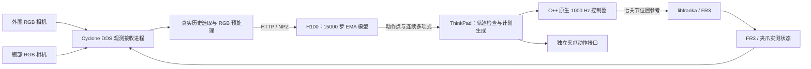

# FLASH 在 Franka FR3 上的部署全过程总结

、



修复后的相机接收进程使用 Cyclone DDS；控制器管理器服务客户端使用 Fast DDS。实际联调发现，仅更换环境变量并不能保证跨 DDS 的管理器服务调用正常，因此将这两条路径分开。10 月 30 日进一步发现，旧版在子进程目标函数内赋值 DDS 环境变量太晚，不能保证实际 RMW 已切换；现已在进程启动前设置，并查询实际 RMW 类型进行校验，详见第 18 节。

## 3. 目录和产物位置

### 3.1 ThinkPad

```text
/home/dase-hw101/franka_ws/
├── scripts/                         FLASH 数据、训练、推理和部署脚本
├── src/flash_fr3_pilot_controller/   固定微动 C++ 控制器
├── src/flash_fr3_model_controller/   模型短段、stream、task 控制器
├── dataset/snkdjn/
│   └── quest3_franka_dualcam_pickplace_74eps/
├── artifacts/flash_fr3/
│   ├── pickplace_74eps_stride4/      稀疏训练缓存和 manifest
│   ├── runtime_checks/              内核、驱动、恢复检查
│   ├── shadow_runs/                 只读影子推理
│   ├── pilot_trials/                微动与看门狗实测
│   ├── model_prefix_trials/         模型短段实测
│   ├── stream_trials/               在线切换实测
│   ├── pickplace_trials/            原任务入口尝试
│   ├── grasp_diagnostics/           高位闭爪和历史输入诊断
│   ├── history_checks/              新时钟、时效和缓存检查
│   ├── retimed_trials/              新版仅机械臂接近实验
│   ├── home_poses/task_start.json   保存的任务起点
│   ├── return_trials/               回位检查与执行记录
│   └── task_setup/events.json       训练示教抓取/释放事件
├── FLASH_FR3_复现步骤.md             按实验进展追加的历史记录
└── FLASH_FR3_部署全过程总结.md         本文
```

容器工作区是 `/home/ros/ros2_ws`。宿主机源码目录绑定到容器源码目录；不能假定宿主机 `scripts` 和 `artifacts` 也直接映射。部署入口通过 `docker cp` 将本次脚本和配置复制到容器 `/tmp/flash_fr3_*`，结束后再归档至宿主机。

### 3.2 H100

```text
/home/hanyu/flash_fr3/
├── FLASH-Policy/                    固定版本的上游源码
├── flash_fr3_reproduction/
│   ├── scripts/
│   ├── data/pickplace_74eps_stride4/
│   └── runs/train_15k_seed42_20261022_160102/
│       ├── config.json
│       ├── metrics.jsonl
│       ├── best.pt
│       ├── step_010000.pt
│       ├── step_015000.pt
│       └── offline_eval_20261022_175327/
└── flash_fr3_history_update_20261029/ 新历史格式的推理服务包
```

服务器不存在 `/home/dase-hw101/franka_ws` 是正常的。`scp` 的源文件必须先在执行该命令的电脑上存在；不存在的压缩包无法靠解压命令生成。

## 4. 数据审计与动作定义

最终使用的数据是 `quest3_franka_dualcam_pickplace_74eps`。会话中出现过 `quest3_franka_dualcam_test` 等名称，实际训练缓存的 manifest 固定指向上述 74 条示教目录。

| 项目 | 实际值 |
| --- | --- |
| 格式 | LeRobot v2.1 |
| Episode 数 | 74，用户确认全部为成功抓放 |
| 原始帧数 | 17,328 |
| 标称采样率 | 15 Hz |
| 视频 | 外置和腕部相机，共 148 个视频 |
| 训练图像 | 每路 RGB，256 × 256 |
| 稀疏采样 | 每 4 帧取 1 帧 |
| 稀疏样本数 | 4,357 |
| 划分 | 66 条训练、8 条验证；按整条 episode 划分 |
| 训练/验证窗口 | 3,874 / 483 |
| 随机种子 | 42；按采集批次分层 |
| 验证 episode | 5、20、25、39、49、53、63、69 |

完整解码全部视频，检查帧数、尺寸、视频 PTS 与标称时间列。缓存及原始文件记录 SHA256，训练入口校验缓存内容。该检查没有补出采集时未保存的独立传感器时间戳，因此不能证明真实曝光与关节采样完全同步。

### 4.1 模型状态与监督

```text
agent_pos = [q1, q2, q3, q4, q5, q6, q7, measured_gripper_closure]
action    = [q1, q2, q3, q4, q5, q6, q7, commanded_gripper_closure]
```

前七维监督来自示教实测关节角。原始数据中的六维末端增量没有被当作七关节命令，也没有通过未验证的 IK 转换来生成标签。数据未保存原始教师关节目标，使用实测关节轨迹是本次适配的一个限制。

夹爪统一使用 `0=张开，1=闭合`：

```text
训练命令闭合度 = 1 - 原始 action 最后一维的张开比例
在线实测闭合度 = 1 - (finger_joint1 + finger_joint2) / 0.08
```

夹住物体时，实测闭合度通常小于 1，不能把“没有完全闭合”直接解释为失败。

### 4.2 缓存与归一化

缓存包括 `state.npy`、`action.npy`、两路 RGB NPY、原始帧索引、时间列及 `manifest.json`，约 1.6 GiB，支持内存映射。训练与验证不会跨 episode 拼接；边界使用当前 episode 首尾帧 padding。归一化只由训练集拟合，验证集不参与确定数据范围。

## 5. 模型配置与物理时间

本地保留上游 FLASH 核心，通过配置替换观测和动作形状。

| 配置项 | 值 |
| --- | --- |
| 观测 | 两路 RGB + 8 维状态 |
| 图像编码 | 每路 ResNet18；不共享 RGB 编码器；GroupNorm；ImageNet normalization |
| 编码器初始化配置 | `weights: null` |
| `horizon` | 16 |
| `n_obs_steps` / `n_action_steps` | 8 / 8 |
| 多项式基 / 阶数 | Legendre / 6 |
| `fit_pad` | 1 |
| `poly_prefix` / `poly_suffix` | 1 / 1 |
| 模型推理步数 / solver | 1 / Euler |
| 历史噪声 / 正则 | 0.5 / 0.1 |
| 边界约束 | 上游配置启用；运行日志为 C1 |
| DiT 隐藏维度 / 层数 / heads | 512 / 4 / 8 |

稀疏时间间隔为 `dt=4/15=0.2666667 秒`。八帧观测首尾相隔七个间隔，即约 1.86667 秒；不能把八帧理解为八秒或把稀疏点当作 1 kHz 控制点。

当前配置日志中 `H_poly=10`、扩展点数为 12。连续多项式的物理时间参数为：

```text
polynomial_duration_seconds = 44/15 = 2.9333333
anchor_s                    = 2/11  = 0.18181818
action_chunk_interval       = 32/15 = 2.1333333 秒
```

上游返回的归一化时间导数必须换算到物理时间：

```text
dq/dt   = (dq/ds) / T
d²q/dt² = (d²q/ds²) / T²
T       = polynomial_duration_seconds
```

当前倍率分别约为 0.34090909 与 0.11621901。执行层慢放 K 倍后，速度还要除以 K，加速度除以 K²，jerk 除以 K³。夹爪比例不属于七关节的角速度和角加速度。

## 6. H100 环境、链路检查与正式训练

用户返回的已验证环境：Python 3.11.16、PyTorch 2.7.0+cu128、Torchvision 0.22.0+cu128、NumPy 1.26.4，PyTorch CUDA runtime 12.8。`nvidia-smi` 显示驱动 595.99.02 和 CUDA 13.2；后者与 PyTorch 自带的 CUDA runtime 是不同信息。

服务器有 4 张 H100。已有其他 GPU 任务时，显式选择物理 GPU 1。设置 `CUDA_VISIBLE_DEVICES=1` 后，进程内的 `cuda:0` 对应所选物理 GPU 1。未停止其他用户任务，正式训练没有采用四卡 DDP。

先完成 `FLASH_ENV_CHECK=PASS`，再用真实示教做两次更新的 smoke test，核对有限 loss/梯度、实际参数更新、EMA 更新、检查点重载和物理导数。第一步学习率处于预热起点为零，第二步检查实际更新。H100 返回 `FLASH_TRAINING_SMOKE_TEST=PASS`。

正式训练命令的配置为：

```bash
# H100；这是训练配置记录，已有结果无需重新训练。
conda activate flash_fr3
cd ~/flash_fr3/flash_fr3_reproduction
CUDA_VISIBLE_DEVICES=1 python scripts/train_flash_fr3.py \
  --flash-root ~/flash_fr3/FLASH-Policy \
  --dataset-cache data/pickplace_74eps_stride4 \
  --output runs/train_15k_seed42_new \
  --device cuda:0 --batch-size 32 --steps 15000
```

| 训练项 | 值 |
| --- | --- |
| 优化器 | AdamW |
| 初始目标学习率 | 1e-4 |
| betas / weight decay | (0.95, 0.999) / 1e-6 |
| Batch size / 默认 workers | 32 / 0 |
| 计算精度 | FP32，入口未启用 AMP |
| 学习率日程 | 500 步线性预热，随后余弦下降至 15,000 步 |
| EMA | `power=0.75` |
| 验证间隔 | 每 250 步遍历验证集 |
| 检查点间隔 | 每 1,250 步及最终步 |
| 最优模型准则 | EMA 模型验证关节 MAE 最小 |

每个 step 是一次 batch 的优化器更新，不是一条示教或一轮数据遍历。训练循环取随机打乱的窗口，调用上游 `compute_loss(batch)`，反向传播、检查梯度、更新优化器、更新日程及 EMA。打印的 `grad_norm` 用于观测；当前入口没有另加梯度裁剪。验证关节 MAE 与训练 loss 是不同量，不能互相当作同一目标。

15,000 步是本次小数据实验的工程训练预算，并非已证明的最优步数，也不是声称论文所有实验均使用该预算。保留 10,000 与 15,000 步模型用于比较。入口固定 15k 学习率日程，不支持超过 15k，也没有实现断点续训选项。

检查点包含在线模型、EMA、优化器、日程、随机状态、数据/源码指纹和时间尺度。输出目录已存在时拒绝覆盖。正式目录为 `train_15k_seed42_20261022_160102`；服务器确认 `best.pt`、`step_010000.pt`、`step_015000.pt` 各约 706.6 MiB。

## 7. 离线评估结果及其含义

使用第 15,000 步 EMA 权重，完整评估 483 个验证窗口，严格重载训练归一化参数并检查源码及缓存指纹。

| 模型 | 关节 MAE | 夹爪闭合比例 MAE |
| --- | ---: | ---: |
| 第 10,000 步 | 1.56035° | 0.08577365 |
| 第 15,000 步 / best | 1.53231°；0.0267439022 rad | 0.08440643 |

离线评估与训练日志同一步指标的差约为 `1.36e-10 rad` 和 `2.66e-9`。解析速度、加速度与数值差分核对通过，最大差约 `2.40e-7 rad/s`、`1.02e-6 rad/s²`；重复推理差为 0。

GPU 输入已驻留、batch=1 的 `predict_action` 延迟：中位数 6.467 ms，P95 6.489 ms，最大约 6.519 ms。该数值不含相机采集、JPEG 解码、图像转换、网络、控制器和机器人响应。

同时发现执行适配必须处理的特征：

- 预测曲线当前点相对实测关节角，最大差约 0.15827 rad。
- 两条预测曲线在一个稀疏步后的最大位置差约 0.07394 rad；完整动作块后约 0.50114 rad。这是曲线间离线比较，未发生真机跳动。
- 原始夹爪预测范围约 [-0.30791, 1.23948]，需要按有效比例解释。
- 161 点采样得到速度峰值约 0.7074 rad/s、加速度约 2.2941 rad/s²；采样不是连续极值证明。
- 71 个窗口超出训练实测关节范围；训练范围与机器人硬件限位是不同概念。

评估输出位于服务器 `offline_eval_20261022_175327/`，包括报告、逐 episode/预测时刻误差及预测数组。离线评估使用真实示教历史，没有模拟策略误差引起的未来状态分布，因此不能据此认定已具备真机抓取能力。

## 8. ROS、相机与只读驱动接入

真实系统使用 `ROS_DOMAIN_ID=30`。主要输入接口为：

| 数据 | 话题 |
| --- | --- |
| 机械臂关节 | `/franka/joint_states` |
| 夹爪关节 | `/franka_gripper/joint_states` |
| 外置图像 | `/right/right_third_person_camera/color/image_raw/compressed` |
| 腕部图像 | `/right/right_wrist_camera/color/image_raw/compressed` |

外置相机序列号为 `344522302659`，采集 RGB 1280×720×30，配置中还开启深度和对齐；腕部相机为 `351322301561`，RGB 640×480×30，未开深度。FLASH 当前使用两路 RGB，没有把深度作为模型输入。

观测接收器通过 cv_bridge 解码为 RGB8，保持比例缩放、中心裁剪到 256×256，使用与示教采集一致的方法。曾做逐像素对比检查。不能把 RGB/BGR 顺序、裁剪或相机次序随意更换。

### 8.1 关节顺序问题

实际读取过的 `JointState.name` 顺序为 `[1,3,6,7,2,4,5]`。输入必须按 `fr3_joint1` 至 `fr3_joint7` 重排，不能直接取 `position[:7]`。

既有 CRISP 控制路径的关节参考解析曾按数组顺序赋值，而 Python 接口默认发送零速度，不能直接用来保留 FLASH 的解析速度参考。本项目因此另建了原生多项式执行插件。

### 8.2 只读入口

`scripts/flash_fr3_observe.launch.py` 只启动硬件状态读取、关节状态广播器和官方夹爪驱动。它不激活机械臂命令控制器，也不发送夹爪目标。没有使用可能自动打开夹爪或激活控制器的完整 VR/CRISP launch。

健康的静止基线为：`joint_state_broadcaster active`，运动控制器 inactive，21 个关节命令接口全部 unclaimed。这里的 21 个接口是每关节 position/velocity/effort；执行插件实际只占用七个 position 接口。

`docker exec -it franka bash` 报容器未运行时，应先检查 `docker ps -a` 和日志。容器运行也不等于里面的 ROS 驱动仍在运行。实验中曾多次发生 libfranka UDP receive timeout，随后管理器和夹爪进程退出。

## 9. 实时内核与控制运行条件

初始宿主内核为 `6.17.0-1032-oem`，不是 PREEMPT_RT。容器具有实时调度权限，不能替代宿主实时内核。

用户选择 Ubuntu Pro 官方软件包路径。通过 `setup_flash_fr3_realtime.sh` 完成账户绑定、软件源启用及内核安装。过程中绑定码过期，升级 `ubuntu-pro-client` 至 `38ubuntu0~24.04` 后重新绑定。账户验证码和凭据没有作为部署配置保存。

安装结果为 `7.0.0-38-realtime`。安装完成后重启并在 GRUB 选择该内核，分别验证：

```bash
uname -r
cat /sys/kernel/realtime
```

已确认输出 `7.0.0-38-realtime` 和 `1`；检查过 `CONFIG_PREEMPT_RT=y`、`CONFIG_HZ=1000`。容器共享宿主内核，不需要在容器里再安装一套实时内核。

运行检查还包括 FIFO 优先级 50、内存锁定，以及管理器配置 1000 Hz。安装、权限和配置检查不等于每个控制周期均无截止时间违约的证明。当前使用工作区 libfranka 0.19。

## 10. 从单次真实推理到影子推理服务

首先采集八帧真实历史，离线传至 H100，得到 `[8,8]` 动作预测。初次真实输入预测起点与实测关节最大差约 9.13°，说明不能把第一点直接写入机器人。

随后使用 HTTP 服务：

| 接口 | 用途 |
| --- | --- |
| `GET /health` | 模型步数、EMA、协议、时间尺度、新历史格式能力 |
| `POST /predict` | 接收 NPZ 观测，返回动作点、连续 Legendre 系数及诊断 |
| 原服务 `10131` | 旧观测格式的影子推理与前期执行 |
| 新服务 `10132` | 启用 `retimed_observations: true`，也兼容旧格式 |

服务绑定 `192.168.1.113`，默认允许机器人电脑 `192.168.1.107` 和回环地址。它不加载 ROS 或机器人驱动，不会自行移动机械臂。`FLASH_SHADOW_SERVER_READY` 表示服务在等待请求，并非程序卡死。

10 月 23 日真实跨电脑影子推理完成 40/40 次，跳过 0 次：

| 耗时范围 | 中位数 | P95 | 最大值 |
| --- | ---: | ---: | ---: |
| 目标观测时刻至收到预测 | 364.44 ms | 576.26 ms | 624.95 ms |
| HTTP 请求往返 | 128.59 ms | 193.51 ms | 238.52 ms |
| 服务端预测与结果解码 | 23.38 ms | 26.53 ms | 27.53 ms |

实时内核恢复后另有 10/10 次通过。10 月 29 日静止复查有 60/60 次通过，观测至响应中位数约 415.78 ms、最大约 644.63 ms。不同批次的耗时不能直接归因于内核改变，也不能据静止通过推断运动过程中永不丢帧。

`ModuleNotFoundError: numpy` 曾因在 Conda `base` 运行服务出现，切换回 `flash_fr3` 即恢复。`Address already in use` 表示端口已有进程占用，应查现有服务的 health 和所属进程，不通过结束其他 GPU 任务处理。

## 11. 连续参考、原生执行与运行边界

### 11.1 连续参考适配

部署层将反归一化后的 Legendre 系数解释为物理关节曲线，按相应接口的时间规则选取曲线位置。预测切换时添加五次 Hermite 校正，使参考 q、dq、ddq 与上一参考一致，校正经过规定过渡时间后消失。这称为 C2 参考连续性。

这些连续校正、慢放和停车段属于本次执行适配；模型配置中的 C1 约束与部署参考的 C2 衔接是不同层次。C2 连续不代表 jerk 连续、实测运动完全相同或已做碰撞检查。

模型曲线通过精确多项式组合转换为执行形式，没有通过离散点重新拟合。C++ 和 Python 独立求值核对；任务计划要求差不超过 1e-9。完整参考和看门狗停车使用 Bernstein 保守界检查，超限候选整体拒绝，不逐关节裁剪后继续执行。

### 11.2 插件分工

| 插件/实例 | 用途 | 典型实验 |
| --- | --- | --- |
| `flash_fr3_pilot` | 固定微动 | 第 2 关节 +0.005 rad、出去并返回 |
| `ModelController` / `flash_fr3_model` | 冻结观测的模型短段 | 模型前缀慢放与停车 |
| `StreamController` / `flash_fr3_stream` | 运动中在线替换 | 一次或两次 C2 重规划 |
| `TaskController` / `flash_fr3_task` | 较大任务段及回位 | 停车、观测、重规划；独立回位 |

原生 update 中只做本地轨迹求值和状态检查，网络推理位于 Python/H100 路径。激活从 native `q_d` 初始化并核对实测状态、native 期望速度及加速度，避免用原始预测起点产生跳变。

### 11.3 心跳与退出

Python 按名义 50 Hz 发送含计划 ID 和递增时间戳的心跳。原生控制器检查心跳来源时效，超过 0.2 秒没有有效心跳则减速、锁存，不因后续心跳恢复而自动继续。

微动和模型短段的看门狗停车段为 0.25 秒，任务控制器为 0.5 秒。正常任务段另带 0.75 秒停车。C++ 非实时回调明确请求管理器停用；不能假定所用 Humble 版本在 `update(ERROR)` 后必定自动释放接口。

状态通常包括 Waiting(0)、Moving(1)、Braking(2)、LatchedHold(3)、Complete(4) 及错误状态。完成和停止都需核对管理器 inactive 以及接口释放，不能只看最后一个 phase。

### 11.4 任务控制器的联调边界

```text
单段相对参考位移上限：0.20 rad
参考速度：0.20 rad/s
参考加速度：1.5 rad/s²
参考 jerk：30 rad/s³
实测速度检查：0.30 rad/s
参考/实测跟踪差检查：0.02 rad

任务关节下界：[-0.40, -0.86, -0.31, -2.57, -0.08, 1.48, 0.22]
任务关节上界：[ 0.21,  0.58,  0.23, -1.83,  0.11, 2.90, 1.00]
```

这组范围围绕本数据集联调设置，是应用约束，不是 FR3 的完整硬件限位、力矩限制或环境碰撞认证。微动和 stream 插件保留更小范围；没有为任务尝试统一扩大所有插件的限制。

## 12. 真机验证的实际推进顺序

| 时间（香港） | 实验 | 实际结果 |
| --- | --- | --- |
| 10-23 | 第一次微动执行请求 | Python QoS 写法错误，激活前退出，机械臂未运动 |
| 10-28 12:54 | 固定微动往返 | 正常完成，夹爪未动作，退出后 inactive |
| 10-28 13:05 | 固定微动中断心跳 | 减速、锁存、C++ 独立停用 |
| 10-28 15:47 | 旧模型快照执行请求 | 计划过期，激活前拒绝 |
| 10-28 15:49 | 真实模型短段 | 1.1 秒播放加停车完成 |
| 10-28 15:54 | 模型短段中断心跳 | 原生停车并独立停用 |
| 10-28 16:58 | 一次运动中重规划 | 一次 C2 替换成功，正常停车 |
| 10-28 17:20 | 两次运动中重规划 | sequence 0→1→2，全部完成 |
| 10-28 18:09 | 原整任务尝试 | 完成 8 段后在方块上方闭爪，抓取失败 |
| 10-29 13:45 | 增加几何检查后的尝试 | 完成 8 段，阻止高位闭爪，结束任务 |
| 10-29 15:39 | 新历史时钟接近 | 完成 11 段后因观测过期停止 |
| 10-29 15:58 | 再次新历史接近 | 完成 11 段后历史网格缺口停止 |
| 10-29 16:24 | 增强诊断后接近 | 完成 2 段；明确定位外置相机历史缺口 |
| 10-29 16:27 | 直接重新启动接近 | 距起点较远，零运动退出 |
| 10-29 16:41 | 独立回位 | 6 段完成，夹爪不动 |

固定微动相对首个实测状态的第 2 关节位移约 0.0050056 rad；心跳中断后约 0.5156 秒观察到 inactive。模型短段心跳中断约 0.5192 秒观察到 inactive。这些查询时间包含轮询及服务延迟，不是认证的物理停车时间。

一次 stream 衔接候选提前约 116.1 ms 就绪；两次衔接分别提前约 142.2 ms、61.6 ms。参考边界位置误差在浮点舍入量级，实测最大采样跟踪误差分别约 0.01159°、0.01216°。状态采样不能证明所有 1 kHz 周期的连续极值，也不能据短程成功认定完整任务成功。

## 13. 原任务入口与高位闭爪故障

原任务入口是 `run_flash_fr3_pickplace.sh`，采用“执行有界段→停车→取得新观测→重新规划”，最多 120 秒或 30 段。候选从 0.2–0.6 模型秒、4/6/8 倍慢放中选择通过完整边界检查的组合。

训练集提取了 66 个抓取和 66 个释放事件。夹爪动作只在机械臂 inactive 且静止时调用；闭合阈值 0.7、释放阈值 0.3，原任务状态机要求两个不同时间戳的新观测确认，抓取后至少有一个搬运段才允许释放。

实际夹爪接口为 `/franka_gripper/grasp`、`/franka_gripper/move` 两个 action，以及 `/franka_gripper/stop` Trigger service。曾因将 stop 的接口类型处理不正确导致“接口未就绪”，在任何机械臂或夹爪命令前退出。不能仅凭动作名称推断它们都是 ROS action。

部署配置中的 grasp 目标宽度约 28.758 mm，来自训练抓取后的实测开度中位数；允许内外各 12 mm，速度 0.02 m/s、力 20 N。这些力和速度是部署设置，不是模型学习出的接触控制参数。

### 13.1 真实失败发生了什么

10 月 28 日首次整任务实际完成 8 段，然后模型连续给出约 0.816、0.846 的闭合意图。夹爪在方块上方闭合，驱动返回 SDK `success=false`，最终开度约 0.628 mm，未抓住方块。

FK 显示闭爪前 `fr3_link8` 法兰相对机器人基座高度约 0.18908 m，最近训练抓取姿态约 0.13491 m，相差约 54.17 mm。原逐关节接近条件仍允许该姿态，因此单靠关节差不足以拦截这次空抓。

失败报告早期可能出现 `gripper_actions=[]`，但 `gripper_motion_commanded=true` 且用户观察到闭合。失败动作没有成功追加到列表不等于夹爪没有运动。后续日志增加动作尝试、action 状态、SDK success/error 和可获取的实测开度。

### 13.2 新增几何检查

从当前运行驱动取得 `robot_description`，将训练抓取关节姿态转换为法兰 FK。闭爪时必须存在**同一个**训练抓取事件同时满足：

- 法兰位置差不超过 20 mm。
- 朝向差不超过 10°。
- 七关节最大差不超过 0.06 rad。
- 当前法兰高度落在训练抓取高度外扩 10 mm 的范围；本数据约为 [0.10796, 0.15998] m。

10 月 29 日另一轮完成 8 段后，法兰约 0.183285 m，新增检查阻止了闭爪。程序保持 inactive，没有自动增加向下位移。

这些数值是法兰相对机器人基座的几何量，不是指尖离桌面的距离。当前检查不是物体检测、已校准 TCP 或碰撞规划。桌面相对底座的精确高度不是 FLASH 的输入；当时没有完成精确测量，不能从法兰高度推导指尖净空。

## 14. 颜色与历史输入诊断

用户曾把训练的蓝色方块换成相同形状、尺寸的绿色方块，随后换回蓝色。静止同姿态的对照中，绿色当前闭合预测约 0.68716，蓝色约 0.77094；蓝色预测仍存在偏高接近。换回蓝色没有直接解决问题，也不能由一次对照排除其他视觉因素。

更关键的可复现对照来自训练接近帧：原始八帧运动历史与“将末帧重复八次”的合成输入，产生不同闭爪意图。

| Episode | 真实运动历史当前闭合预测 | 末帧重复历史当前闭合预测 |
| --- | ---: | ---: |
| 57 | -0.0053 | 0.9248 |
| 62 | -0.0150 | 0.2620 |
| 70 | -0.0124 | 0.9783 |

这些接近标签均应保持张开。末帧重复仅用于诊断，没有作为部署输入补齐方法。结果说明历史变化足以在部分输入上触发提前闭合，但没有证明它是物理失败的唯一原因。

原训练历史来自连续运动、4/15 秒采样；实际执行被慢放 4–8 倍，中间有停车、配置、IO。如果仍按真实墙钟每 4/15 秒取八帧，输入往往主要反映停车画面，运动进度与训练不匹配。背景和物体布局差异也被记录，但没有把恢复全部背景作为继续诊断的硬性前提。

## 15. 执行历史时钟与新版仅机械臂接近

新增模块：`flash_fr3_history_clock.py`、`flash_fr3_retimed_buffer.py`、`flash_fr3_retimed_schema.py`。新观测格式为 `flash_fr3_retimed_observation_v1`。

核心规则为：

```text
已成功执行的机械臂区间：模型进度增加 = 真实执行时间 / 该段慢放倍数
配置、推理及段间等待：模型进度冻结
名义停车尾段：按该段慢放倍数折算计入进度
```

区间起止来自原生状态 phase=1/4 的单调时间戳；缺少成功状态、存在故障或与计划时长差超过 20 ms 时，不补造成功区间。保留真实传感器时间戳，另存模型时间与单调时间映射。

八帧中历史七帧按已执行运动进度向真实记录回查，最后一帧来自当前场景。历史不足、重复时间戳、未来样本或源消息过期时拒绝。服务端严格验证并回传历史时钟，客户端拒绝未确认同一时钟的预测。

重定时是在慢放/停走部署下减少历史分布偏差的实验适配，未证明等同于原始连续执行。物体、外部环境和真实接触也不会随模型时钟冻结。

### 15.1 新服务

```bash
# H100：服务已经正常运行时无需重复启动。
conda activate flash_fr3
cd ~/flash_fr3/flash_fr3_history_update_20261029
FLASH_GPU=1 bash scripts/run_flash_fr3_history_server.sh
```

预期显示端口 10132、`checkpoint_step: 15000`、`weights: ema_model`、`retimed_observations: true`。仍用原 best.pt，没有重新训练或更换权重。新增客户端修复不必因此重启原模型服务。

### 15.2 新接近入口

```bash
# ThinkPad：只读观测/推理、计划检查及 inactive 配置。
cd /home/dase-hw101/franka_ws
bash scripts/run_flash_fr3_retimed_approach.sh --check
```

现场执行参数为 `--execute`，会让机械臂运动，**该入口始终禁止发送夹爪目标**。模型提出闭合意图时核对几何并结束；`APPROACH_GEOMETRY_REACHED` 只表示相应姿态检查通过，仍不是抓住物体。

开始时要求当前姿态距保存起点的逐关节最大差不超过 0.02 rad。直接在接近中途重启进程，会丢失之前的真实执行历史，因此返回 `RETURN_TO_SAVED_START_REQUIRED`，不自动回位或用静止帧冒充过去运动。

模型时龄冻结不代表物理观测可以任意陈旧。最新物理观测仍须满足 0.7 秒限制；历史源帧相对目标时间的对齐上限仍为 0.08 秒。

## 16. 新时钟后的故障、修复与尚未解决的问题

### 16.1 观测过期

10 月 29 日 15:39 一轮完成 11 段后，最后观测至响应约 898.47 ms，超过 700 ms。捕获约 262.21 ms、HTTP 约 557.40 ms、服务端预测与解码约 28.13 ms，表明端到端延迟不能由 GPU 前向耗时代表。

客户端现区分时钟格式错误和有效但过期的预测。过期预测在任务决策前丢弃，机械臂保持 inactive，最多尝试三次新采集；观测归档后再次检查时效。没有放宽 700 ms。另修复子进程重复 `rclpy.shutdown()` 异常，采用管道退出、幂等 shutdown 及有界终止兜底。

### 16.2 长关节历史查询影响接收

15:58 一轮再次完成 11 段后出现历史缺口，但旧报告缺少具体源时间戳，无法追溯该次缺口来自哪一路。

只读长时检查发现，旧查询方法遍历数万条 1 kHz 关节消息，且接收队列深度为 1，可能阻塞接收并丢失历史。改为直接二分查找目标时间，只复制选中消息引用，接收回调检查时间顺序，重定时关节队列改为 256。最新锚点也选在四路消息共同覆盖的时刻。

约 67.49 秒静止真实传感器检查中，修改前关节源最大间隔约 187.99 ms，修改后约 1.58 ms，11 组取样通过。没有放宽 80 ms 历史对齐或 700 ms 预测时效。

### 16.3 外置相机真实历史缺口

16:24 一轮完成 2 段后，增强诊断明确指向历史样本 6 的 `primary_cam`：

```text
目标 ROS 时间：1793262281.1727808
前一相机帧：  1793262281.0128791
后一相机帧：  1793262281.4448485
相邻间隔：    0.4319694 秒
最近帧偏差： -0.1599016 秒
允许偏差：    0.08 秒
```

该目标处腕部、机械臂和夹爪状态均可覆盖。接收缓存中的外置帧确实不足，不能通过等待当前新帧修复已丢失的历史，也没有复制图片或放宽边界继续运动。

尚未确定该轮缺口源于相机发布、USB、DDS 传输还是接收进程。全机累计 UDP 溢出计数不能证明特定相机接收器丢包；静止 60/60 次推理通过也不能证明运动条件已修复。10 月 30 日另观察到相机驱动自身 `Frames Timeout`，这是新的直接证据，但不能倒推它必然解释 10 月 29 日那次缺口。

## 17. 保存起点与独立回位

起点文件为 [task_start.json](artifacts/flash_fr3/home_poses/task_start.json)，按 q1 至 q7、单位 rad 保存：

```text
[-0.160625726, -0.770540833, 0.112120435, -2.383132935,
  0.071397819,  1.569829345, 0.664178193]
```

回位使用静止到静止的关节空间五次曲线，分段插值、原生执行并逐段核对；不依赖相机或H100。最多45段/240秒，最终最大关节误差容差0.002 rad。初版不改变夹爪；2026-11-13已按用户要求改为成功回位后自动开爪，见第54节。

```bash
# ThinkPad：仅检查，不运动。
bash scripts/run_flash_fr3_return.sh --check

# 现场实际回位时使用；会运动机械臂。
bash scripts/run_flash_fr3_return.sh --execute
```

它没有桌面、盒沿或抓持物体的碰撞规划。回到相同关节角能恢复机械臂及腕部相机姿态，不能自动复位方块和盒子。另存起点使用 `--save --pose 新文件.json`；原文件拒绝覆盖，不能在中途误保存来绕过起点检查。

10 月 29 日 16:27 直接重启接近时，距原起点约 0.17534 rad（10.05°），零运动退出。16:41 后续回位已经完成，6 段、实际总耗时约 31.94 秒，最终最大误差 `0.0001245141 rad`（约 0.00713°），夹爪未动作，任务控制器 inactive、全部命令接口释放。该回位状态仍需在下一天启动时重新核对，不能仅凭昨天报告认定当前姿态未变。

## 18. 2026-10-30 恢复检查

继续工作时，宿主和两个容器仍在运行，实时内核正常，FR3 的两次 ping 均成功。但应用进程状态已经变化：

| 检查项 | 恢复前结果 |
| --- | --- |
| H100 10131 / 10132 | 均拒绝连接 |
| 控制器管理器 | 服务不可用；旧驱动日志显示 UDP receive timeout 后退出 |
| 外置相机 | 6 秒订阅 0 帧；驱动连续报告 `Frames Timeout` |
| 腕部相机 | 6 秒 180 帧，约 29.95 Hz |

保留日志后重启现有 `franka_dual_realsense` 容器，保持原相机配置。重启后 6 秒内两路各收到 180 帧，外置约 29.975 Hz、腕部约 29.962 Hz，最大源时间间隔分别约 33.42 ms、33.38 ms。

确认旧机器人驱动已经退出后，恢复 `flash_fr3_observe.launch.py`，仅启动状态广播器和官方夹爪状态驱动；日志显示管理器 1000 Hz、FIFO 50。没有运行任一真机 `--execute`，没有发送夹爪目标。

恢复后的独立查询确认仅 `joint_state_broadcaster active`，21 个命令接口均未占用，机械臂和夹爪状态新鲜。当前距保存起点最大约 0.01312 rad，符合新版接近入口 0.02 rad 的起点要求，但不属于回位入口 0.002 rad 的“已精确回位”容差。

随后进行约 63 秒真实静止传感器历史取样复查，11 组全部通过。两路各保留 1,899 帧，源时间最大间隔约 33.50 ms / 33.38 ms，关节最大间隔约 2.01 ms，未出现历史覆盖失败。该检查没有调用模型或执行机器人运动，不能代替运动条件下验证。

证据目录：[resume_20261030_01](artifacts/flash_fr3/runtime_checks/resume_20261030_01/)。重启恢复图像不等于已找到 USB/相机超时的最终根因，也不证明 10 月 29 日的运动中缺口已消除。

H100 服务恢复后，10 月 30 日 13:37 的新版接近只读预检返回 `TASK_PREFLIGHT_PASS`：
第 15,000 步 EMA、新历史格式、首段计划检查均通过；观测物理时龄约 0.327 秒，
距保存起点最大约 0.01312 rad，预检首段时长 5.55 秒。
报告中的 32 条历史覆盖诊断均来自 `request_id=-1` 的启动预热，
当时最早源消息尚未覆盖八帧历史；继续采集后成功初始化时钟并通过预检。
这些条目不代表本次最终失败，也不能用它们解释昨天运动期间的历史缺口。
本次没有机械臂或夹爪运动，任务控制器 inactive，21 个命令接口均未占用。
报告：[13:37 只读预检](artifacts/flash_fr3/retimed_trials/flash_fr3_retimed_check_20261030_133708_702143058/report.json)。

13:43 的现场执行完成一段 5.55 秒运动，最大实测关节位移约 9.6783°，
最大采样跟踪误差约 0.01942°，随后返回 `TASK_FAILED`。
失败来自运动期间历史样本 6 的外置相机：相邻帧间隔约 0.23330 秒，
最近帧距目标约 0.09613 秒，超过 0.08 秒；其他三路在同一目标处可覆盖。
这次不是启动预热，也不是预测过期，不能沿用 13:37 的预热说明解释。
夹爪没有动作，控制器 inactive，21 个命令接口未占用。
报告：[13:43 接近失败](artifacts/flash_fr3/retimed_trials/flash_fr3_retimed_execute_20261030_134317_461930357/report.json)，
提要：[failure_diagnosis.json](artifacts/flash_fr3/retimed_trials/flash_fr3_retimed_execute_20261030_134317_461930357/failure_diagnosis.json)。

新增只读相机传输诊断器，记录两路压缩图像的原始源时间戳、接收时刻和 JPEG 大小，
并与各路 `CameraInfo` 的时间戳比较；另记录该诊断进程自身的 UDP socket 接收计数及
`flash_fr3_task` 阶段。`CameraInfo` 仍是另一条 ROS 发布，不能当作直接的设备侧计数器；
诊断器自身的 UDP 计数也不能代替已退出策略接收进程的计数。
新工具不解码或保留图像内容，不创建运动发布器、控制服务客户端或夹爪目标。
附加图像订阅会引入额外传输负载，比较结果需保留这一限制。
随后增加了回位期间的采集方案；实际两项操作的时间是否重叠，必须核对原始记录，不能仅依据它们出现在同一段终端输出中判断。

诊断器已做 10 秒真实静止采集验证：外置/腕部分别收到 299/300 张图像，
共同时间范围内 `CameraInfo` 均找到同时间戳压缩图像；自身 UDP 丢包增量为 0。
外置 JPEG 中位数为 310,981 字节，腕部为 101,531.5 字节。
该验证只确认工具可采集真实数据和 socket 计数，不代表运动缺口已解决。
证据：[静止诊断报告](artifacts/flash_fr3/camera_transport/flash_fr3_camera_transport_20261030_135128_567844861/report.json)。

用户随后完成的 120 秒采集收到外置/腕部图像 3,595/3,596 张，两路最大帧间隔约 33.5/33.4 ms，
共同时间范围内的 CameraInfo 都有对应压缩图像，诊断进程自身 UDP 丢包增量为 0。
但该采集在 13:56:32 结束，回位到 14:00:30 才进入运动，相隔约 238.7 秒；
采集没有任务控制器状态样本。因此这份报告仍只证明该段静止接收正常，不能说明运动期间不存在丢帧。
证据：[时间重叠核对](artifacts/flash_fr3/camera_transport/flash_fr3_camera_transport_20261030_135431_769988060/timing_overlap.json)。

14:00 的独立回位完成 5 段运动，名义运动时间 18.75 秒、总耗时约 28.75 秒，
最终逐关节最大误差 0.00011235 rad，约 0.0064°。夹爪未动，结束时任务控制器 inactive，21 个命令接口未占用。
证据：[回位报告](artifacts/flash_fr3/return_trials/flash_fr3_return_execute_20261030_140025_370163604/report.json)。

为直接诊断实际策略接收器，新增 `flash_fr3_transport_diagnostics.py`，并将诊断接入
`RetimedObservationBuffer` 和独立传感器子进程。沿用原有压缩图像订阅，仅增加两路小消息 CameraInfo 订阅。
初次成功建立历史时钟后，如再次出现历史覆盖错误，只抓取一次实际接收进程的 UDP socket 计数、
目标附近 CameraInfo 时间戳、压缩图像邻居时间戳及 JPEG 大小。该证据单独保留，避免被 32 条重试日志挤掉，
并归档为该次试验的 `sensor_transport_diagnostics.json`。
这次没有调整历史时钟、80 ms 取样界限、观测时效、运动限制或模型权重；缺口根因仍待真实运动证据定位。

14:14 的新版只读预检返回 `TASK_PREFLIGHT_PASS`，当前距保存起点最大约 0.000120 rad，
最新观测时龄约 0.222 秒，首段计划 3.15 秒。没有发送机械臂或夹爪运动命令，
结束后控制器 inactive、命令接口未占用。预热覆盖记录仍来自 `request_id=-1`，不将其当作运动缺口。
证据：[新版只读预检](artifacts/flash_fr3/retimed_trials/flash_fr3_retimed_check_20261030_141429_829334737/report.json)。

另用新版接收器类做 3 秒真实静止订阅检查：两路分别收到 90 条 CameraInfo 和 90 张压缩图像，
该进程 UDP 丢包增量为 0，读得接收缓冲区大小为 2,097,152 字节。没有发送模型请求或运动命令。
此检查确认新增诊断输入可用，不证明运动缺口已消除。
证据：[真实诊断订阅检查](artifacts/flash_fr3/history_checks/receiver_transport_20261030_01/live_receiver_check.json)。

14:39 的现场接近完成 10 段运动，累计模型历史进度约 7.814 秒，随后再次因外置相机历史覆盖失败退出。
失败请求编号为 10，样本编号为 1；压缩图像相邻帧间隔约 167.33 ms，最近帧距目标约 83.53 ms，超过 80 ms 界限。
相同图像缺口内部仍收到了 4 条 CameraInfo，腕部相机和关节状态在目标附近有消息。
实际策略接收进程的 UDP 丢包增量为 3,437，接收缓冲区仅 212,992 字节；这个计数是 UDP 数据报，不是丢失图像张数。
夹爪始终未动，退出后控制器 inactive，21 个命令接口未占用。
证据：[14:39 失败提要](artifacts/flash_fr3/retimed_trials/flash_fr3_retimed_execute_20261030_143932_345817990/failure_diagnosis.json)。

进一步定位到旧接收器启动顺序中的确定性缺陷：Python `multiprocessing` 的 `spawn` 子进程会先导入入口脚本，
该脚本顶层已导入 `rclpy` 并加载 Fast DDS；随后进入 `_sensor_worker` 再改 `RMW_IMPLEMENTATION`，已经无法切换实际 RMW。
旧报告中的 `dedicated_cyclone_process` 标签只反映代码意图，没有查询实际 RMW，不能据此认定运行时已使用 Cyclone。
此前直接在 Cyclone 环境下运行的只读检查也没有覆盖这条 spawn 启动路径，因而没有暴露两者差异。
隔离复现已确认：按旧顺序启动的子进程，即便目标函数将环境改成 Cyclone，实际查询仍返回 Fast DDS。

修复后在 `process.start()` 前为子进程设置继承环境，启动后恢复父进程环境；父进程已经加载的 Fast DDS 不变。
子进程通过 `rclpy.get_rmw_implementation_identifier()` 校验实际加载的 Cyclone DDS，类型不符则拒绝就绪。
启动回执和任务报告现在保存 `sensor_receiver.actual_rmw` 及接收 socket 状态，历史诊断也记录实际 RMW 类型。
没有修改相机分辨率、模型、内核参数、历史容差或运动限制。

修复后的实际 spawn 接收器通过 60 秒真实静止检查：成功取得 191 组观测，启动预热结束后无取样错误，
UDP 丢包增量为 0，最新观测最大时龄约 0.287 秒。父进程实际为 Fast DDS，子进程实际为 Cyclone DDS，
接收缓冲区为 2,097,152 字节。该检查不请求模型、不发送运动或夹爪命令。
这确认了启动修复和静止接收效果；尚未证明运动期间的所有缺帧问题都已消除。
证据：[DDS 启动修复与验证](artifacts/flash_fr3/history_checks/rmw_startup_fix_20261030_01/summary.json)。

14:48 独立回位预检通过，当前距保存起点最大约 61.30°，规划 31 段、名义运动 116.25 秒；
按此前每段配置开销估计，现场回位约需 3 分钟。它不提供物体碰撞检测。
14:49 新接近入口只读检查确认实际子进程为 Cyclone、H100 10132 服务正常，
并按预期返回 `RETURN_TO_SAVED_START_REQUIRED`，因为当前仍在接近中途，没有发出运动命令。
证据：[回位只读规划](artifacts/flash_fr3/return_trials/flash_fr3_return_check_20261030_144812_851722109/report.json)、
[接近入口实际 DDS 检查](artifacts/flash_fr3/retimed_trials/flash_fr3_retimed_check_20261030_144949_698894964/report.json)。

14:56 的回位完成原计划 31 段中的前 6 段，第 7 段在激活前报“任务计划过期”，因此返回了一部分，尚未回到起点。
退出时控制器 inactive、21 个命令接口未占用，夹爪未动；当前位置距保存起点的逐关节最大差仍约 49.44°。
回位创建时间包含了轨迹数值验证和 ROS 控制器配置等待，而共用执行器要求计划创建后 5 秒内激活。
旧报告没有分阶段耗时，不能进一步把这次延迟归因到某一条 ROS 服务或发现步骤。
证据：[部分回位失败提要](artifacts/flash_fr3/return_trials/flash_fr3_return_execute_20261030_145606_643366599/failure_diagnosis.json)。

修复仅针对固定保存姿态的回位：控制器配置完成后，再核对控制器参数与计划完全一致，
读取连续静止的新鲜关节状态，确认起点差不超过 0.002 rad，然后记录独立的执行前验证时刻，
从该时刻计算 5 秒激活窗口。原始 `created_monotonic` 保留不改，证据写入各段 `activation_validation.json`。
视觉模型计划仍从原始创建时刻计算 5 秒过期界限，观测时效、运动限制、心跳和看门狗均未改变。

隔离测试覆盖配置额外等待 5.5 秒后回位成功，以及配置期间起点变化时拒绝激活；
另确认同样的配置延迟对视觉任务仍触发过期拒绝。
15:05 真实只读回位预检通过，按当前位置重新规划为 25 段、名义运动 93.75 秒，预计总耗时约 2–3 分钟。
修复后的真实回位仍由现场用户执行，目前只有软件测试和真实只读规划证据。
证据：[回位激活验证修复](artifacts/flash_fr3/history_checks/return_activation_fix_20261030_01/summary.json)、
[剩余回位预检](artifacts/flash_fr3/return_trials/flash_fr3_return_check_20261030_150537_672111662/report.json)。

15:11 现场运行修复后的回位，25 段全部完成，返回 `RETURN_FINISHED`，耗时约 155.52 秒，
最终最大关节误差约 0.00012565 rad，即 0.0072°。夹爪未动，退出时控制器 inactive、命令接口未占用。
证据：[修复后真实回位](artifacts/flash_fr3/return_trials/flash_fr3_return_execute_20261030_151121_205049155/report.json)。

15:17 的新接近完成 15 段，随后模型闭合量达到约 0.944，触发抓取几何检查。
这次保留的 32 条历史覆盖诊断全部来自 `request_id=-1` 启动预热，未报告运动期间历史缺口，
实际子进程为 Cyclone DDS。不能把预热诊断解释为本次退出原因，也不能据此声称所有 UDP 数据报都无丢失。
真实退出原因为 `grasp_blocked`：法兰高度约 0.151815 m，已在允许范围内，
但最近示教抓取位置距离约 22.72 mm，超过 20 mm 界限；该示教姿态的最大关节差约 0.08428 rad，
超过 0.06 rad，因此没有同一条示教同时满足所有条件。模型闭合意图不等于实际方块已处于两指之间。

追加真实只读快照确认当前姿态与停止姿态最大差约 0.0000127 rad，夹爪开度约 80 mm，仍保持张开。
双相机能看到蓝色方块靠近指尖，但现有视角不能可靠确定手指与方块侧面的竖直重叠量。
下一步需要现场从侧面确认方块位于两指之间、指尖低于方块顶面，再决定是否做一次保持机械臂静止的闭爪试验。
这类单次夹爪验证应单独记录，不把它计作 FLASH 自主完成抓取、搬运或放置。
证据：[15:17 接近报告](artifacts/flash_fr3/retimed_trials/flash_fr3_retimed_execute_20261030_151702_825971243/report.json)、
[抓取前核对](artifacts/flash_fr3/grasp_diagnostics/near_cube_20261030_01/summary.json)、
[当前外置画面](artifacts/flash_fr3/grasp_diagnostics/near_cube_20261030_01/live_snapshot/primary_cam.png)、
[当前腕部画面](artifacts/flash_fr3/grasp_diagnostics/near_cube_20261030_01/live_snapshot/wrist_cam.png)。

用户随后从侧面确认蓝色方块位于两指之间、指尖低于方块顶面。
据此新增独立单次夹爪入口 `run_flash_fr3_stationary_grasp.sh`，仅在机械臂命令接口未占用、
当前姿态距已确认姿态不超过 0.002 rad、机械臂连续静止且夹爪张开至少 70 mm 时允许执行。
该入口不创建机械臂命令发布器或控制器切换客户端，夹爪参数沿用已记录配置：
目标宽度约 28.76 mm、速度 0.02 m/s、力 20 N、内外容差各 12 mm；只请求一次 grasp。
动作结果与动作后新鲜夹爪开度均保存，失败也等待新状态，避免把动作前的开度当作失败后的实测值。
该现场对准试验不修改自主策略的示教几何阈值，也不自动提起、搬运或释放。

15:34 真实只读预检返回 `STATIONARY_GRASP_PREFLIGHT_PASS`，姿态最大差约 0.0000230 rad，
夹爪开度约 80.0 mm；机械臂和夹爪均未收到运动命令。正式单次闭爪由现场用户执行，尚无该轮抓持成功证据。
证据：[单次夹爪计划](artifacts/flash_fr3/gripper_plans/stationary_grasp_20261030_01/plan.json)、
[静止闭爪验证归档](artifacts/flash_fr3/stationary_grasp_checks/20261030_01/summary.json)。

15:42 的静止闭爪命令在接口就绪检查阶段退出，发送的夹爪目标数为 0，机械臂和夹爪均未动作。
日志确认官方夹爪驱动已在 15:41:38 因 `libfranka: UDP receive: Timeout` 与未捕获的 Poco 网络异常退出，
因此 grasp/move/stop 接口和夹爪状态同时消失；机械臂驱动和控制器管理器仍正常运行。

随后仅重新启动官方 `franka_gripper_node`，沿用原 robot_ip、两指关节名和配置。
已核对其构造函数只连接夹爪并读取状态，未发送 homing、move 或 grasp；机械臂驱动进程保持原 PID。
15:46 的新只读预检返回 `STATIONARY_GRASP_PREFLIGHT_PASS`，夹爪开度约 79.98 mm，
当前位置距现场确认姿态最大约 0.0000262 rad，任务控制器 inactive，命令接口未占用。
接口已恢复；底层间歇性网络超时的最终根因尚未解决，不能把重启说成网络问题已根治。
当前仍等待用户重新执行同一条单次闭爪命令。
证据：[夹爪驱动恢复](artifacts/flash_fr3/runtime_checks/gripper_recovery_20261030_01/summary.json)、
[恢复后只读预检](artifacts/flash_fr3/stationary_grasp_trials/flash_fr3_stationary_grasp_check_20261030_154659_496061633/report.json)。

15:50 的单次闭爪实际发送 1 个 grasp，SDK 返回失败，夹爪最终开度约 0.239 mm，确认没有夹住原方块。
机械臂没有收到运动命令，任务控制器保持 inactive，命令接口未占用。
用户随后指出指尖仍高于方块，并估计比方块顶面高约 2 cm；这条新观察取代先前“指尖低于顶面”的确认。
原计划中的相应对准字段已置为 false，保留旧版本，阻止直接重复同姿态闭爪。

这 2 cm 是本次失败诊断的粗略指尖到方块顶面的间隙，不是标定后的桌面平面，
也没有被直接当作下降指令。指尖下降到方块顶面后，还需要有效的侧面接触重叠才能抓持。
后续 FLASH 策略输入仍是图像与关节/夹爪状态，不将人工高度测量变成每次运行的常规输入。

只读分析最后保存的预测：实际法兰高度约 0.151815 m，模型当时的原始目标约 0.149585 m，相差约 2.23 mm。
该预测块的法兰最低高度约 0.139952 m，随后预测上升至约 0.24318 m，夹爪预测始终倾向闭合。
这些数值用于区分预测目标、过渡轨迹和现场物体位置，不足以把约 20 mm 的观察间隙归因到执行跟踪误差。
法兰坐标不是已标定的指尖坐标；旧预测也没有重新作为执行计划使用。
示教姿态匹配本身不等于真实方块接触，即使某个预测姿态通过示教匹配仍可能空夹。

新增已确认空夹的开爪复位模式：仅在空夹失败记录存在、当前夹爪开度小于 3 mm、机械臂仍静止且保持原姿态时，
允许请求一次 Move 至 80 mm；若当前开度表明可能夹持了物体，则拒绝按空夹复位。
16:00 真实只读预检返回 `STATIONARY_OPEN_PREFLIGHT_PASS`，机械臂和夹爪均未收到运动命令。
当前下一步由现场用户张开夹爪，再核对接近高度。
证据：[本次空夹报告](artifacts/flash_fr3/stationary_grasp_trials/flash_fr3_stationary_grasp_execute_20261030_155002_367329824/report.json)、
[预测与空夹分析](artifacts/flash_fr3/grasp_diagnostics/empty_grasp_20261030_01/summary.json)、
[开爪只读预检](artifacts/flash_fr3/stationary_grasp_trials/flash_fr3_stationary_grasp_open-check_20261030_160031_448977384/report.json)。

16:16 用户执行空夹开爪复位，返回 `GRIPPER_OPEN_FINISHED`，发送 1 个 Move，SDK 成功，
最终开度 79.841 mm；机械臂未动作，任务控制器 inactive，全部命令接口释放。
随后用户明确指出目标是复现 FLASH，不能用人工下降来完成抓取并归为策略成功。
准备中的 5 mm 手动下降程序未执行，新增文件已撤回，没有生成或执行下降计划。
接下来先开展离线复现差异审计，不将人工对准、下降或静止夹爪操作计作 FLASH 成功。
证据：[实际开爪报告](artifacts/flash_fr3/stationary_grasp_trials/flash_fr3_stationary_grasp_open_20261030_161605_637572985/report.json)。

## 19. 当前的启动与继续实验顺序

以下顺序用于恢复本项目现有部署，不需要重新训练。每次启动应依据当次状态，不重复启动已经健康的管理器或模型服务。

### 19.1 H100：恢复新服务

```bash
conda activate flash_fr3
cd ~/flash_fr3/flash_fr3_history_update_20261029
FLASH_GPU=1 bash scripts/run_flash_fr3_history_server.sh
```

终端保持运行。预期 `FLASH_SHADOW_SERVER_READY`，端口 10132，EMA 第 15,000 步，`retimed_observations: true`。若报端口占用，先查原服务；若报缺少 numpy，先查是否激活了正确环境。

### 19.2 ThinkPad：健康检查与只读预检

```bash
cd /home/dase-hw101/franka_ws
curl -fsS http://192.168.1.113:10132/health
bash scripts/run_flash_fr3_return.sh --check
bash scripts/run_flash_fr3_retimed_approach.sh --check
```

这三项不发机械臂或夹爪运动命令；最后一项可能加载或重新配置 inactive 计划。health 成功不代表双相机正常，预检成功也只覆盖当次输入和首段计划。

若返回 `RETURN_TO_SAVED_START_REQUIRED`，先依据独立回位检查处理，不能改写起点或在方块上方直接重启来绕过历史要求。若历史缺口或图像超时仍出现，保留该次报告，先排查相机与接收链路。

### 19.3 后续真机实验的顺序

1. 先确认长时真实传感器历史稳定，区分相机源、传输与接收问题。
2. 在已保存起点附近，用新时钟的仅机械臂接近入口做有界实验，继续禁用夹爪目标。
3. 检查每段输入、预测、执行进度、实际法兰姿态与模型闭合意图；先证明接近能达到相应抓取几何条件。
4. 再设计并验证接近到抓取的接口衔接、夹爪动作及抓取结果。
5. 抓取可靠后再验证搬运、释放和完整任务成功率。

当前不将原 `run_flash_fr3_pickplace.sh --execute` 作为恢复服务后的第一条实验命令。它使用前期任务路径，已有高位闭爪及历史分布偏差的失败记录。

### 19.4 当前下一步：优先对齐控制与连续执行

本节保留 10 月 30 日的方法调整背景；11 月 4 日的最新检查结果和下一步见第 26、27 节。

夹爪已在 16:16 张开复位，机械臂保持原位。当前不继续人工下降、重复闭爪或尝试人工辅助完成任务。
优先改造已经确认偏离论文的低层接口与连续执行机制，并将当前停走执行、历史重定时、位置接口
和夹爪状态机逐项区分，详见第 24 节。离线验证抓取前后的预测与标签可并行进行，
不要求先查明空夹全部根因，才开始对齐已经确认的部署差异。

已完成 74 条示教缓存的夹爪标签时序检查，全过程离线、没有模型调用或真实运动。
后续模型评估应单独统计抓取阶段的末端位置/朝向误差与闭爪时序，不能只依赖全验证集平均关节 MAE。
自主路径的保护阈值保持原值；保护拒绝应作为策略/部署失败保留，不通过人工补偿改记为成功。

## 20. 常见报错与处理依据

| 现象 | 本项目确认过的原因/含义 | 处理方向 |
| --- | --- | --- |
| `cd /home/dase-hw101/franka_ws` 不存在 | 命令在 H100 上运行 | 区分 ThinkPad 与服务器目录 |
| 压缩包或脚本不存在 | 尚未传输、解压或路径不符 | 检查本机文件，再按正确方向传输 |
| 容器 not running | 不能对停止容器 `docker exec` | 查容器状态与退出日志 |
| 相机有话题，控制器服务没有 | 相机驱动独立运行，机器人管理器未运行 | 查管理器进程、驱动日志、domain/DDS |
| `numpy` 缺失 | 曾使用 Conda base 运行 | 激活 `flash_fr3` |
| `Address already in use` | 相同地址端口已有监听 | 查 health 和进程归属 |
| `QoSProfile.best_effort` 不存在 | rclpy 误用了 C++ 链式写法 | 用显式 ReliabilityPolicy；已修复 |
| 快照计划过期 | 前期冻结计划超过有效期 | 重新采集和 prepare，不复用旧预测 |
| grasp/move/stop 未就绪 | 夹爪端点类型或驱动问题 | 两个 action + 一个 Trigger service |
| 夹爪接口与状态同时消失 | 10 月 30 日确认官方夹爪驱动因 UDP 超时退出，机械臂驱动仍在 | 查看进程及退出日志，单独恢复只读夹爪驱动，再预检 |
| `list_controllers` 不可用 | 曾发生驱动 UDP timeout 后退出；也应核对通信环境 | 查状态基线，不直接重试运动 |
| 模型要求闭爪，几何拒绝 | 当前姿态高于/偏离示教抓取位置 | 保留预测和实际姿态，排查模型/历史输入 |
| 观测超过 0.7 秒 | 采集/传输/处理总时龄超限 | 丢弃旧预测，有限重采集 |
| 历史网格不覆盖 | 所需过去时刻缺少真实源消息 | 查具体源及相邻时间戳，不复制末帧补齐 |
| `RETURN_TO_SAVED_START_REQUIRED` | 新进程没有中途接近历史，且不在保存起点附近 | 独立检查回位后重新开始 |
| `Frames Timeout` | RealSense 驱动自身未及时收到帧 | 保留日志，检查相机/USB/驱动；一次重启不是根因证明 |

## 21. 测试方式与证据解释

本项目验证分为四类，阅读结果时需保留区别：

| 类型 | 实际内容 | 不能据此声称什么 |
| --- | --- | --- |
| 数值测试 | 多项式、物理导数、时间映射、边界、FK 交叉核对 | 真实机械臂已执行 |
| 隔离 ROS 接口测试 | 独立 domain/localhost，预设消息和服务端点，运行真实客户端 | 动力学或真实物体任务已成功 |
| 真实只读检查 | 订阅真实传感器、调用只读管理器服务、真实 H100 推理 | 后续运动效果已验证 |
| 现场真机实验 | 用户触发运动，归档状态、控制器退出及现场观察 | 自动等同于论文成功率 |

新时钟初版记录 42 项软件/接口/隔离场景检查；观测时效修复记录 17 个隔离场景；历史接收修复记录 16 项时间/取样测试和 19 个客户端场景。这些批次含回归重叠，不能简单相加当作独立用例总数。

实际接收器诊断这一批通过 18 项历史/时间/诊断测试、14 个新版客户端隔离场景、5 个旧任务客户端回归场景。
人为图像缺口场景确认：CameraInfo 仍有帧时能与压缩图像缺口区分，实际传感器子进程的 socket 计数会保存，
首次失败证据不会被后续重试挤掉，所有新版接近场景均未发送夹爪目标。
这些是数值和隔离接口测试，不加载真机硬件驱动，不算现场任务成功。
证据：[本批验证归档](artifacts/flash_fr3/history_checks/receiver_transport_20261030_01/summary.json)。

DDS 启动修复这一批通过 18 项历史/时间/诊断测试、4 项实际进程启动检查、14 个新版客户端场景、
5 个旧任务客户端场景和 5 个回位客户端场景。进程检查覆盖旧顺序错误 RMW 的直接复现、
新旧观测子进程实际加载 Cyclone、父进程保持 Fast DDS、启动异常后环境恢复。
客户端场景同时核对实际 RMW，未加载真机硬件驱动；另有 60 秒真实静止传感器验证。
证据：[本批验证归档](artifacts/flash_fr3/history_checks/rmw_startup_fix_20261030_01/summary.json)。

回位激活验证修复这一批通过 7 个回位客户端场景、6 个任务客户端场景和 14 个新版接近客户端场景。
新增场景验证固定回位可在慢配置后重新核对状态并执行、起点变化会拒绝、视觉计划仍保留原来的过期拒绝。
这些均为隔离 ROS 接口测试，没有运行机器人动力学或真实运动。
证据：[本批验证归档](artifacts/flash_fr3/history_checks/return_activation_fix_20261030_01/summary.json)。

单次静止闭爪入口通过 7 个隔离接口场景：只读预检、只发一次 grasp、缺少现场对准信息、
姿态变化、机械臂控制器 active、夹爪已经闭合、SDK 失败但手指已经运动。
所有场景均未请求机械臂激活；失败场景保留实际夹爪动作和动作后新鲜开度。
真实只读预检另行通过，尚未由助手执行任何真实闭爪。
证据：[本批验证归档](artifacts/flash_fr3/stationary_grasp_checks/20261030_01/summary.json)。

空夹复位扩展后的 10 个隔离场景全部通过，新增开爪只读检查、一次空夹开爪、当前开度可能夹持物体时拒绝复位。
这些场景不加载硬件、不请求机械臂激活。开爪模式另经真实只读预检，真实张开动作仍由用户执行。
证据：[本批验证归档](artifacts/flash_fr3/grasp_diagnostics/empty_grasp_20261030_01/summary.json)。

历史保留检查使用真实静止传感器，将过去已记录运动区间的时间表平移，仅作为软件取样 fixture。它不发机器人命令、不把该 fixture 发送给模型，不是机器人动力学仿真，也不是真实重新执行了那 11 段运动。

## 22. 关键源码与证据索引

### 22.1 源码

| 模块 | 路径 |
| --- | --- |
| 数据审计/准备 | [prepare_flash_fr3_data.py](scripts/prepare_flash_fr3_data.py) |
| 数据窗口与归一化 | [flash_fr3_dataset.py](scripts/flash_fr3_dataset.py) |
| 训练 | [train_flash_fr3.py](scripts/train_flash_fr3.py) |
| 离线评估 | [eval_flash_fr3.py](scripts/eval_flash_fr3.py) |
| 只读硬件启动 | [flash_fr3_observe.launch.py](scripts/flash_fr3_observe.launch.py) |
| 推理 HTTP 服务 | [serve_flash_fr3_shadow.py](scripts/serve_flash_fr3_shadow.py) |
| 连续参考 | [flash_fr3_reference.py](scripts/flash_fr3_reference.py) |
| 任务曲线与边界 | [flash_fr3_task_plan.py](scripts/flash_fr3_task_plan.py) |
| 抓取几何检查 | [flash_fr3_grasp_guard.py](scripts/flash_fr3_grasp_guard.py) |
| 独立传感器进程 | [flash_fr3_sensor_process.py](scripts/flash_fr3_sensor_process.py) |
| 执行历史时钟 | [flash_fr3_history_clock.py](scripts/flash_fr3_history_clock.py) |
| 历史选帧 | [flash_fr3_retimed_buffer.py](scripts/flash_fr3_retimed_buffer.py) |
| 只读相机传输诊断 | [check_flash_fr3_camera_transport.py](scripts/check_flash_fr3_camera_transport.py) |
| 实际接收进程 UDP 查询 | [flash_fr3_transport_diagnostics.py](scripts/flash_fr3_transport_diagnostics.py) |
| 进程实际 DDS 回归检查 | [test_flash_fr3_sensor_process.py](scripts/test_flash_fr3_sensor_process.py) |
| 新接近入口 | [run_flash_fr3_retimed_approach.py](scripts/run_flash_fr3_retimed_approach.py) |
| 回位入口 | [run_flash_fr3_return.sh](scripts/run_flash_fr3_return.sh) |
| 单次静止闭爪入口 | [run_flash_fr3_stationary_grasp.sh](scripts/run_flash_fr3_stationary_grasp.sh) |
| 固定微动原生包 | [flash_fr3_pilot_controller](src/flash_fr3_pilot_controller/) |
| 模型执行原生包 | [flash_fr3_model_controller](src/flash_fr3_model_controller/) |

### 22.2 本地证据

以下链接相对于本 Markdown 所在工作区；服务器检查点及评估目录见第 3 节，不假定它们也存在于 ThinkPad。

| 内容 | 报告或目录 |
| --- | --- |
| 数据 manifest | [manifest.json](artifacts/flash_fr3/pickplace_74eps_stride4/manifest.json) |
| 实时内核启动 | [thinkpad_realtime_boot_20261023.json](artifacts/flash_fr3/runtime_checks/thinkpad_realtime_boot_20261023.json) |
| 40 次影子推理 | [report.json](artifacts/flash_fr3/shadow_runs/flash_fr3_shadow_20261023_01/report.json) |
| 正常固定微动 | [report.json](artifacts/flash_fr3/pilot_trials/flash_fr3_pilot_execute_20261028_125427_673223575/report.json) |
| 固定微动看门狗 | [report.json](artifacts/flash_fr3/pilot_trials/flash_fr3_pilot_execute-watchdog_20261028_130547_784314083/report.json) |
| 模型短段 | [analysis.json](artifacts/flash_fr3/model_prefix_trials/flash_fr3_model_execute_20261028_154924_963536173/analysis.json) |
| 一次在线衔接 | [analysis.json](artifacts/flash_fr3/stream_trials/flash_fr3_stream_execute_20261028_165855_719706832/analysis.json) |
| 两次在线衔接 | [analysis.json](artifacts/flash_fr3/stream_trials/flash_fr3_stream_execute_20261028_172054_974625413/analysis.json) |
| 首次真实空抓 | [report.json](artifacts/flash_fr3/pickplace_trials/flash_fr3_pickplace_execute_20261028_180917_814329818/report.json) |
| 几何检查阻止闭爪 | [report.json](artifacts/flash_fr3/pickplace_trials/flash_fr3_pickplace_execute_20261029_134556_295362133/report.json) |
| 颜色与历史输入诊断 | [summary.json](artifacts/flash_fr3/grasp_diagnostics/grasp_failure_20261029_01/summary.json) |
| 新时钟初版 | [summary.json](artifacts/flash_fr3/history_checks/history_update_20261029_01/summary.json) |
| 观测时效修复 | [summary.json](artifacts/flash_fr3/history_checks/freshness_fix_20261029_01/summary.json) |
| 历史接收修复 | [summary.json](artifacts/flash_fr3/history_checks/coverage_fix_20261029_01/summary.json) |
| 明确定位外置相机缺口 | [summary.json](artifacts/flash_fr3/history_checks/camera_gap_diagnosis_20261029_01/summary.json) |
| 最新已归档回位 | [report.json](artifacts/flash_fr3/return_trials/flash_fr3_return_execute_20261030_151121_205049155/report.json) |
| 接收器诊断软件与只读验证 | [summary.json](artifacts/flash_fr3/history_checks/receiver_transport_20261030_01/summary.json) |
| DDS 启动缺陷修复与验证 | [summary.json](artifacts/flash_fr3/history_checks/rmw_startup_fix_20261030_01/summary.json) |
| 回位执行前验证修复 | [summary.json](artifacts/flash_fr3/history_checks/return_activation_fix_20261030_01/summary.json) |
| 15 段接近后的闭爪条件核对 | [summary.json](artifacts/flash_fr3/grasp_diagnostics/near_cube_20261030_01/summary.json) |
| 单次静止闭爪验证与只读检查 | [summary.json](artifacts/flash_fr3/stationary_grasp_checks/20261030_01/summary.json) |
| 夹爪 UDP 超时退出后的恢复 | [summary.json](artifacts/flash_fr3/runtime_checks/gripper_recovery_20261030_01/summary.json) |
| 本次空夹与开爪复位验证 | [summary.json](artifacts/flash_fr3/grasp_diagnostics/empty_grasp_20261030_01/summary.json) |
| 10 月 30 日恢复检查 | [目录](artifacts/flash_fr3/runtime_checks/resume_20261030_01/) |
| 分阶段历史记录 | [FLASH_FR3_复现步骤.md](FLASH_FR3_复现步骤.md) |

## 23. 继续复现需要完成的工作

当前证据支持“FLASH 已训练并接入 FR3 有界控制链路”，尚不支持“已成功复现完整抓放”。后续应完成：

1. 验证 DDS 启动修复在真实运动中的接收效果；若仍有历史缺口，继续根据真实源时间戳、接收时间和传输状态排查。外置相机此前驱动源帧超时仍应与接收丢包区分。
2. 用稳定的真实历史，验证新时钟下接近姿态与闭合意图是否匹配；保留失败样本，避免只观察成功短段。
3. 在同一已验证时序下完成抓取、搬运与释放，分别确认实际抓持和物体最终位置。
4. 明确每次实验的物体起点、相机布置、失败定义和重置方法，再统计任务成功率与端到端耗时。
5. 如需论文级比较，补充采样步长、训练预算、多种随机种子、连续执行/停走部署差异等对照，分别报告模型推理与真实系统延迟。

后续修改应继续保留数据 manifest、固定上游提交、模型配置、部署参数、实际输入、原始预测、执行曲线和物理结果。应用几何保护、示教姿态检查及慢放适配的效果，应与 FLASH 核心模型能力分别报告。

## 24. 复现范围审计与后续方向（10 月 30 日追加）

### 24.1 本轮结论

目前已经训练并运行上游 FLASH 策略，也验证了 FR3 执行链路，但当前任务执行方式包含较多本地适配。
这些结果还不能证明论文完整控制方法、任务成功率或效率收益已经复现。
手动补偿高度只能用于独立诊断，不能替代模型决定接近与抓取，也不能计入自主任务成功率。

论文的核心包括稀疏采样的 Legendre 轨迹、历史系数初始化、单步流匹配，以及解析速度前馈。
其真机跟踪实验使用 1000 Hz 关节力矩控制，见[论文附录 F](https://arxiv.org/html/2605.15492v1#A6)。
本地固定版本的策略设置见[官方 flash.yaml](https://github.com/NTUMARS/FLASH-Policy/blob/f47e490f2b820f835d1b9145da3cdb3df69f50a0/roboverse_learn/il/configs/policy_config/flash.yaml)。

| 核对项 | 本地实际实现/记录 | 复现意义与待做事项 |
| --- | --- | --- |
| 策略主体 | 训练入口实例化官方 `FlashDiTImagePolicy`，没有用固定轨迹替代网络 | 模型方法已接入；H100 实际权重内配置与源码摘要仍应在专门审计中再次导出核对 |
| 稀疏/多项式/生成设置 | stride 4、degree 6、fit_pad 1、history noise 0.5、regularization 0.1、consistency 1、单步 Euler | 这些已记录设置与固定版本配置一致；不能据此替代闭环验证 |
| 数据与任务 | 自有 74 条 VR 抓放；66 条训练、8 条验证 | 可用于 FR3 上复现方法，但不是原论文任务与数据的数值复刻 |
| 关节监督 | 七维采用当前实测关节轨迹；数据没有教师关节参考；第八维是夹爪命令 | 必须核对状态、相机与命令的时间关系；不能把实测关节直接称为原始教师命令 |
| 低层控制 | `TaskController` 只声明并写入七个 position 命令接口 | 没有复现力矩控制中的解析速度前馈；不能声称论文该项跟踪收益已复现 |
| 执行时序 | 短前缀慢放、停车、采图再规划，另有 C2 过渡 | 属于调试部署；应分别评估原始预测与实际曲线的偏移，并验证连续在线执行 |
| 历史处理 | 运动区间推进、空闲冻结的自定义时钟 | 数值与接口测试通过不代表与训练历史分布等价；需要模型层面的对照验证 |
| 夹爪决策 | 自定义阈值、两帧确认、几何拒绝，且机械臂停用时才发动作 | 应与原始夹爪输出分开归档；本轮未取得作者真机夹爪执行实现，不能声称两者相同 |
| 训练预算 | 当前主结果为 15k；同时保存 10k 检查点 | 论文主对比预算为 10k，官方发布启动脚本 FLASH 默认可到 15k；应分开报告，10k 中间检查点也不自动等于独立 10k 学习率日程 |
| 评价 | 全验证集关节 MAE 约 1.53°；完整抓放仍无成功记录 | 需要抓取阶段误差、闭爪时序、任务成功率与端到端耗时；不能用手工辅助成功代替 |

训练预算依据：[论文附录 B](https://arxiv.org/html/2605.15492v1#A2)、
[固定版本 il_run.sh](https://github.com/NTUMARS/FLASH-Policy/blob/f47e490f2b820f835d1b9145da3cdb3df69f50a0/roboverse_learn/il/il_run.sh)。
论文的速度调节实验也不构成对当前停走和冻结历史实现的验证；不能由“支持慢放”推出这些部署改动等价。

### 24.2 本轮完成的离线标签检查

对全部 74 条缓存逐条检查命令闭合上升沿及实测手指响应，未读取相机或控制机器人。
关节动作标签前七维与同帧实测关节完全相等；夹爪状态范围为 0–0.6552，夹爪命令范围为 0–1。
两种夹爪量的语义不同：夹住方块时不需要完全闭合，范围不同本身不等于编码错误。

每条示教均找到命令跨过 0.7 的闭合上升沿。从该帧起到实测闭合度达到 0.1 的间隔中位数约 0.80 秒，
达到 0.5 的中位数约 1.07 秒。这些指标受 0.2667 秒稀疏取样量化和采集同步限制，
是缓存中的帧级响应间隔，不能直接当成已标定的夹爪硬件延迟，也不能据此宣称已经找到空夹根因。
命令闭合后 1.1 秒内法兰继续下降的最大幅度中位数约 1.56 mm；这也不足以解释用户估计的全部 20 mm 间隙。

证据：[逐条标签时序报告](artifacts/flash_fr3/reproduction_audits/20261030_01/label_timing_audit.json)、
[审计源码](scripts/audit_flash_fr3_grasp_timing.py)。后续应在原始 15 Hz 数据中核对事件，
并对 10k/15k 模型在相同验证 episode 的抓取窗口分别评估，记录原始预测与部署后曲线。

### 24.3 下一阶段的实验顺序

用户进一步指出，应先对齐已经确认的部署差异。该要求取代此前“先完成抓取失败分析，再对齐控制”的顺序。

1. 明确固定版本、动作语义、物理时间及输出系数契约；导出 H100 实际配置与源码摘要，保留 10k/15k 的区别。
2. 优先实现并验证 1000 Hz 的关节力矩执行接口，使用同一多项式的位置和解析速度；先做软件与接口验证，再做现场小范围控制验证。
3. 实现持续运行的预测消费与轨迹切换，使常规执行不依赖每段停车、重新加载控制器及冻结空闲时间的历史时钟。真实状态和图像按清楚定义的物理时间取样。
4. 将模型夹爪输出接入相应执行时间轴，核对硬件动作语义；当前任务状态机的任务阶段决策不再作为默认替代策略。心跳、输入时效、边界与碰撞相关保护仍保留，拒绝如实记录。
5. 原始示教和抓取阶段离线预测分析并行进行，既记录当前基线，也对照改造后的输入和参考；不作为前述开发的阻塞条件。
6. 对齐后从标准起点评估完整任务，再针对剩余失败定位模型/数据问题，并进行相同数据与训练预算的基线或消融比较。

保护拒绝、空夹和人工介入都应保留为失败或辅助实验。上述步骤不需要机器人动力学仿真。

### 24.4 已核对的改造位置与尚未对齐的部分

本节记录改造前的实现范围与依赖核对。随后完成的力矩插件及首次真实保持见第 25、26 节。

| 模块 | 本次核对到的源码事实 | 接下来的改造 |
| --- | --- | --- |
| 原生低层接口 | [task_controller.cpp](src/flash_fr3_model_controller/src/task_controller.cpp) 只申请 `fr3_joint*/position`，更新时只写 `reference.q` | 新的 effort 执行路径需要消费 `q` 与 `dq`；核对实际 FR3 动力学补偿、增益、扭矩/变化率限制及停机行为 |
| 已有力矩示例 | [joint_impedance_example_controller.cpp](src/franka_ros2/franka_example_controllers/src/joint_impedance_example_controller.cpp) 有 effort 接口与 PD，但使用内置测试运动，阻尼项未消费 FLASH 目标速度 | 只能参考接口结构，不能直接启动该示例或把其默认控制律声称为论文实现 |
| 连续执行 | [stream_core.hpp](src/flash_fr3_model_controller/include/flash_fr3_model_controller/stream_core.hpp) 固定 0.5 秒前缀并限制最多两次替换 | 需要持续的、明确生效时刻的预测切换；原有短程测试不证明整任务连续执行已完成 |
| 当前任务入口 | [run_flash_fr3_pickplace.py](scripts/run_flash_fr3_pickplace.py) 在各段之间停用、配置控制器，夹爪也在停用期间动作 | 改为低层周期持续运行，高层异步预测；正常推理不再触发每段停车 |
| 历史输入 | [flash_fr3_history_clock.py](scripts/flash_fr3_history_clock.py) 对停走慢放实验冻结空闲时钟 | 连续部署应重新定义并验证训练采样间隔与实际观测物理时间的对应，不直接沿用该调试时钟 |
| 夹爪阶段逻辑 | [flash_fr3_task_plan.py](scripts/flash_fr3_task_plan.py) 的 `TaskSequence` 含两次确认、approach/carrying 等阶段逻辑 | 模型输出与硬件映射作为独立层核对；不能用手工接近或抓取姿态查表修正来冒充策略输出 |

论文公开描述可以支持“力矩模式 + 解析目标速度 + 连续多项式”这个实现方向，
尚不足以证明本地任意一组 PD 增益、补偿项或夹爪阈值就是作者原始参数。
缺少的真机细节应明确标为 FR3 适配，并由接口和现场验证支持，不编造为逐项完全一致。

全局关节 MAE 约 1.53° 是模型预测对示教标签的离线误差，不是力矩控制器的跟踪误差。
更换低层控制器不会直接改写相同输入下网络的夹爪预测；但连续执行和历史输入变化可能改变后续预测。
因此对齐和诊断可以同时推进，不应把其中一项当作另一项已经解决的证据。

## 25. 力矩执行接口与解析速度前馈（10 月 30 日追加）

### 25.1 本轮完成到哪里

本节保留 10 月 30 日首次现场激活前的验证记录；随后 17:13 的真机保持结果及当前下一步见第 26 节。

本轮按“先对齐已确认的 FLASH 部署差异”推进，新增独立的 `flash_fr3_model_controller/TorqueController`，
实例名为 `flash_fr3_torque`。现有 position 模式的 `TaskController`、任务停走入口和夹爪逻辑未切换到新插件。
插件已在 `franka` 容器内编译安装，数值及隔离接口测试通过；真实驱动下已完成只读预检和禁止激活的配置检查。
**本轮没有激活真实机械臂的 effort 控制，没有发夹爪命令，也没有执行人工下降或回位。**

这一步提供论文所需低层控制方向的实现基础。尚不能据此声称 FLASH 连续策略执行、解析速度的真机收益或完整抓放已经复现。
首次现场验证选择短时定点保持，只检查位置模式到力矩模式的切换、偏移和原生停用；它不是策略推理或任务成功实验。

### 25.2 控制律与物理单位

控制器只申请七个 `fr3_joint*/effort` 命令接口，通过名称匹配七维状态和命令顺序。
它读取当前驱动提供的 `fr3/robot_state` 与 `fr3/robot_model`，使用同一套已安装的 libfranka ABI。
不会加载第二套 SDK 或直接启动带内置运动的官方示例控制器。

在每次原生更新中，对同一多项式求位置和解析速度：

```text
q_ref(t)  = q_origin + p(t)
dq_ref(t) = dp(t)/dt
tau_raw   = Kp * (q_ref - q) + Kd * (dq_ref - dq) + coriolis(q, dq)
tau_cmd   = tau_J_d + clamp(tau_raw - tau_J_d, -rate * dt, +rate * dt)
```

其中 `p` 使用归一化时间的六阶幂基表示，导数按段时长换算为 rad/s；不通过位置差分生成目标速度。
后续从 FLASH Legendre 系数接入时，必须保留已有物理时间转换，不能将归一化导数直接当 rad/s。
首次定点保持的多项式系数全为零，因此目标速度也是零；非零解析速度进入控制律的路径已在软件中验证，真机跟踪效果尚未测量。

论文确认真机采用关节力矩模式、1000 Hz 信号和多项式解析速度前馈，但没有提供本地所需的完整增益表。
因此上述具体 PD 增益、科氏力补偿及限制属于 **FR3 接口适配**，不声称就是作者的原始控制器参数。
依据：[论文附录 F](https://arxiv.org/html/2605.15492v1#A6)。
`tau_J_d` 是不含重力的期望关节力矩，本实现不再额外加一项重力补偿，
见 [libfranka RobotState 定义](https://frankarobotics.github.io/libfranka/latest/structfranka_1_1RobotState.html)。

首次验证参数如下；这些是本次接入范围，不是机器人硬件额定限制。

| 项目 | 参数或行为 |
| --- | --- |
| 刚度 Kp | `[150, 150, 150, 150, 50, 30, 10]` N·m/rad |
| 阻尼 Kd | 逐关节取 `2*sqrt(Kp)`，属于本次选用的数值规则，不代表已证明临界阻尼 |
| 非重力力矩上限 | 前四关节 10 N·m，后三关节 4 N·m；原始力矩超限即故障，不静默裁剪成可继续的任务 |
| 力矩变化率 | 100 N·m/s，以机器人上一期 `tau_J_d` 和物理周期计算 |
| 单次计划范围 | 多项式及停车包络相对起点不超过 0.002 rad，速度 0.005 rad/s，总时长不超过 4 秒 |
| 首次现场入口 | 2 秒保持加 0.75 秒零位移尾段，七关节目标位移全为零 |
| 激活起点 | 以实测 `q` 为 origin；配置后实测起点差超过 0.002 rad 则拒绝激活 |
| 实测偏移监视 | 从激活起点偏移超过 0.004 rad 则锁止并请求停用；它是检测阈值，不能当作无超调的物理保证 |
| 周期检查 | 第一期按 1 ms；其后使用机器人时间增量，超出 0.5–2 ms 则锁止 |
| 心跳 | 会话 ID、源时效与单调递增检查；超时进入原生停车路径，不自动重启 |
| 激活开关 | 插件默认 `allow_activation=false`；只有用户 `--execute` 入口显式配置为 true |

全部七维输入和输出在写命令前一起验证。错误状态会锁存，单个实例只能激活一次，重试必须显式卸载重建。
由于当前 Humble 管理器对 `update(ERROR)` 仅记录错误，插件另有非实时定时器请求只停用自己。
这条路径不依赖 Python 客户端继续发送停用请求，但也不构成经过认证的独立安全系统。

### 25.3 软件与真实驱动验证结果

| 检查 | 结果与证据范围 |
| --- | --- |
| 容器编译安装 | PASS；仅构建 `src/flash_fr3_model_controller`，使用现有 SDK 与 semantic components |
| CTest 回归 | 8 个目标、42 个 GoogleTest 用例全部通过，包含新增 13 个力矩用例 |
| 新增核心用例 | 验证位置、目标速度和科氏力项；阻尼符号；力矩变化率；错误锁存与不部分写入；同一多项式导数；心跳停车 |
| 新增原生接口用例 | 验证乱序接口、实测起点、禁止激活、空模型指针、起点变化、模型非法值、周期故障和原生停用请求 |
| Python 客户端 | 9 个隔离场景全部通过：只读、正常保持、其他控制器 active、缺插件、缺模型、过期状态、起点变化、参数不符、原生故障 |
| 真实驱动只读预检 | `TORQUE_HOLD_PREFLIGHT_PASS`；插件声明可见，模型和 effort 接口可用，关节状态新鲜且静止 |
| 真实驱动 inactive 配置 | `TORQUE_PLUGIN_INACTIVE_LOAD_PASS`；加载 `.so`，配置 inactive，全部参数读回一致且 `allow_activation=false`，随后卸载测试实例 |
| 实际管理器参数 | `update_rate=1000`，`use_sim_time=false`，内核 `7.0.0-38-realtime`；这是配置检查，尚不是力矩激活后的实测周期统计 |
| 真实力矩激活 | **尚未执行**；不能把隔离服务中的“正常保持”测试当成真机结果 |

C++ 与 Python 测试使用 localhost 限制和独立 ROS domain 223、222；它们使用预设状态/模型/消息，未加载机器人驱动，也没有机器人动力学仿真。
真实驱动检查使用 domain 30。旧管理器初次未发现新插件，已在所有运动控制器 inactive、21 个命令接口释放时，
先停只读广播器，再以 `force_kill=false` 刷新插件缓存，随后恢复广播器 active 和原任务控制器 inactive。
没有激活任何运动控制器。插件配置检查结束时，状态仍恢复为这一组合，命令接口全部释放。

证据统一归档在 [本轮力矩接口检查目录](artifacts/flash_fr3/torque_checks/20261030_01/)，
汇总见 [summary.json](artifacts/flash_fr3/torque_checks/20261030_01/summary.json)。
真实只读预检见 [report.json](artifacts/flash_fr3/torque_hold_trials/flash_fr3_torque_hold_check_20261030_170300_049695143/report.json)。

### 25.4 首次现场命令（已于 10 月 30 日 17:13 完成）

在 **ThinkPad 宿主终端**执行；无需进入容器，不依赖 H100 或相机。
此入口只做一次短时力矩定点保持，夹爪不动，不运行抓放。
参考位置不变仍会启用真实力矩控制，因此现场应能立即停止；出现明显偏移或振动时停止并保留失败报告。

```bash
cd /home/dase-hw101/franka_ws
bash scripts/run_flash_fr3_torque_hold.sh --execute
```

`--execute` 内部先做接口、静止状态和起点检查，配置后读回核对参数，再请求激活。
正常完成应输出 `status: TORQUE_HOLD_FINISHED`，并记录 `native_deactivation_observed=true`、
`controller_left_inactive=true`、`all_command_interfaces_unclaimed=true`。
同时检查实测关节偏移、期望力矩峰值和原始 status 记录，不能只看“完成”字样。
若输出 `TORQUE_HOLD_FAILED`，先依据该次报告排查，不改大范围或自动重试。

只检查、不启用力矩可运行：

```bash
bash scripts/run_flash_fr3_torque_hold.sh --check
```

每次报告位于 `artifacts/flash_fr3/torque_hold_trials/flash_fr3_torque_hold_<mode>_<time>/`，
包含 `report.json`、`status.jsonl`，执行模式还包含配置参数。
当前 status 约 25 Hz，是诊断采样；其中的力矩峰值和限速次数只覆盖这些采样点，不是完整 1000 Hz 统计。

### 25.5 通过本次保持之后

后续按以下顺序继续，仍以方法对齐为主线：

1. 根据真实保持报告核对模式切换、偏移和停用；然后验证有界非零多项式的解析速度跟踪。
2. 将固定版本 FLASH 原始多项式及物理时间契约接入持续运行的 effort 控制器，明确异步预测的生效时刻和切换连续性；常规推理不再每段停车、卸载重建。
3. 以真实物理时间收集状态和图像历史，移除任务正常执行对冻结空闲时钟的依赖；同时归档输入与实际执行参考。
4. 把模型夹爪输出映射到同一时间轴，核对命令语义和硬件响应；原任务阶段状态机不作为策略替代。
5. 完成同起点的自主任务评估，再报告闭环成功率、控制跟踪误差及端到端耗时。抓取阶段离线诊断并行保留。

实现入口：[torque_core.hpp](src/flash_fr3_model_controller/include/flash_fr3_model_controller/torque_core.hpp)、
[torque_controller.cpp](src/flash_fr3_model_controller/src/torque_controller.cpp)、
[现场客户端](scripts/run_flash_fr3_torque_hold.py)、[宿主启动脚本](scripts/run_flash_fr3_torque_hold.sh)。

## 26. 首次力矩保持结果与非零解析速度验证（11 月 4 日续接）

### 26.1 已核对的真实保持结果

用户执行 `--execute` 后，完整报告为 `TORQUE_HOLD_FINISHED`，不再只是 inactive 加载验证。
本次确实激活了真实 effort 控制；目标位置不变，夹爪未动作。70 条诊断状态的时间跨度约 2.752 秒，
相位依次包含等待、运行、完成，未记录参考故障或力矩故障。原生控制器自行停用，最终全部 21 个命令接口释放。

| 指标 | 结果 |
| --- | --- |
| 最大保持偏移/采样跟踪误差 | 第 2 关节约 0.001903 rad，即 0.1091° |
| 最终相对初始姿态的最大差 | 约 0.001965 rad，即 0.1126° |
| 采样期望力矩最大绝对值 | 约 0.3186 N·m，位于第 2 关节 |
| 采样限速状态行 | 0；仅针对归档采样，不代表每个 1000 Hz 更新都未触发限速 |
| 完成后的控制器 | 状态广播器 active；`flash_fr3_task`、`flash_fr3_torque` inactive |

这次结果支持“力矩模式能启动、短时保持并自行停用”。第 2 关节存在偏移，不能写成完全不动，
也不能将其解释为已达到论文动态跟踪精度。保持期间解析目标速度为零，尚未覆盖非零速度信号的真实执行。

证据：[原始报告](artifacts/flash_fr3/torque_hold_trials/flash_fr3_torque_hold_execute_20261030_171312_469013582/report.json)、
[复核分析](artifacts/flash_fr3/torque_checks/20261104_01/hold_analysis.json)。

### 26.2 已完成的非零速度入口

新增 `--check-velocity` 和 `--execute-velocity` 模式，复用同一个力矩插件及其原有范围和增益。
没有放宽力矩、变化率、任务关节范围、起点差或故障锁止条件，也没有加入自动下降补偿。
固定控制验证曲线为：

```text
u = t / 3,  0 <= t <= 3 s
p4(t)  = 0.001 * (10*u^3 - 15*u^4 + 6*u^5) rad
dp4/dt = (0.001/3) * 30*u^2*(1-u)^2 rad/s
其他六个关节参考不变；随后在终点保持 0.75 s，再停用。
```

第 4 关节总参考位移为 +0.001 rad（约 0.0573°），解析速度峰值为 0.000625 rad/s。
位置、速度、加速度在运动首尾均满足静止边界，保持尾段与运动段 C2 连续。
曲线和任意时刻心跳停车的 Bernstein 包络均通过现有力矩接入范围检查。
这条固定曲线只验证低层接口，**不是模型预测，不能计入 FLASH 自主任务结果**。

已完成的软件验证：

- 力矩核心和原生接口共 14 个 C++ 用例通过。新增原生用例以预设静止实测状态，在轨迹中点独立核对非零目标速度确实进入 effort 输出，并检查正常原生停用。
- 客户端共 12 个隔离场景通过，增加非零速度只读、正常执行和“未观察到非零速度时拒绝记为成功”三个场景。
- 三个纯数学用例通过，覆盖物理导数、C2 边界、全曲线/停车包络及非法起点；其结果在 10 月 30 日中断前已返回。
- 11 月 4 日恢复时核对了测试副本与当前 8 个相关 Python 源文件的 SHA-256，一致。C++ 和客户端的完成日志已补归档，未将测试替身的执行写成真机结果。

源码：[固定测试计划](scripts/flash_fr3_torque_probe_plan.py)、
[数学用例](scripts/test_flash_fr3_torque_probe_plan.py)、
[原生接口用例](src/flash_fr3_model_controller/tests/test_torque_native.cpp)。
证据：[本轮汇总](artifacts/flash_fr3/torque_checks/20261104_01/summary.json)、
[原生测试日志](artifacts/flash_fr3/torque_checks/20261104_01/ctest.log)、
[客户端报告](artifacts/flash_fr3/torque_checks/20261104_01/client_tests/summary.json)。

### 26.3 11 月 4 日驱动恢复和只读预检

恢复时 `franka` 容器仍在运行，但机械臂与夹爪驱动进程均已退出，管理器服务不可用。
旧驱动日志记录 `libfranka: UDP receive: Timeout`。FR3 地址 `172.16.0.2` 当时可 ping 通；
仅凭该日志不能确定超时由断电、网线还是网络抖动造成。

检查安装目录的启动辅助函数后，重新使用只读 `flash_fr3_observe.launch.py`：
只启动硬件状态读取、状态广播器和标准夹爪状态驱动，没有启动完整 CRISP/VR 入口、轨迹控制器或夹爪动作适配器。
恢复日志显示管理器 1000 Hz、FIFO 优先级 50。硬件系统生命周期的 active 表示接口就绪，
不等于运动控制器已经 active；预检确认仅状态广播器 active，全部命令接口未占用。

恢复后 `--check-velocity` 输出 `TORQUE_VELOCITY_PREFLIGHT_PASS`，现场当前实测姿态及测试曲线包络重新计算，
没有重用 10 月 30 日的快照或计划。代理在 11 月 4 日未激活任何运动控制器，未发送夹爪动作。

证据：[恢复日志](artifacts/flash_fr3/torque_checks/20261104_01/driver_resume.log)、
[恢复后只读报告](artifacts/flash_fr3/torque_hold_trials/flash_fr3_torque_hold_check-velocity_20261104_120859_848706036/report.json)。

### 26.4 11 月 4 日非零速度真机结果

现场用户已执行 `bash scripts/run_flash_fr3_torque_hold.sh --execute-velocity`。
报告为 `TORQUE_VELOCITY_FINISHED`，95 条诊断样本的跨度为 3.751 秒，
观察到非零解析目标速度及原生停用，结束后 effort 控制器 inactive，全部 21 个命令接口释放。
这个状态表示试验正常结束，**不代表动态跟踪达到要求**。

| 指标 | 结果 |
| --- | --- |
| 第 4 关节参考总位移 | +0.001 rad |
| 第 4 关节最终实测位移，相对激活前读数 | −0.00100827 rad，与该参考方向相反 |
| 第 4 关节采样跟踪误差峰值 | 0.00198395 rad，约 0.11367° |
| 第 4 关节最终位置与“初始位置 + 目标位移”的差 | −0.00200827 rad；与上项采样峰值的统计时刻不同 |
| 非零解析目标速度峰值 | 0.000625 rad/s |
| `Kd * dq_ref` 目标速度项的采样峰值 | 0.0153093 N·m，不是总力矩或前馈收益 |
| 第 4 关节期望力矩采样峰值 | 0.358783 N·m |
| 其他关节的最终偏移 | 第 2 关节约 +0.001054 rad；第 6 关节约 −0.000652 rad |

因此，信号通路和停用机制已有真机证据，动态跟踪仍需排查。不能根据这一条微小曲线，
直接断言接口方向反了，或将负载配置认定为唯一原因；也不通过翻转参考符号、增大增益来隐藏偏移。
本轮没有继续扩大真机动作，没有发送开闭夹爪或回位命令。

证据：[真实试验报告](artifacts/flash_fr3/torque_hold_trials/flash_fr3_torque_hold_execute-velocity_20261104_121218_218689432/report.json)、
[原始诊断采样](artifacts/flash_fr3/torque_hold_trials/flash_fr3_torque_hold_execute-velocity_20261104_121218_218689432/status.jsonl)、
[独立复核](artifacts/flash_fr3/continuous_checks/20261104_01/velocity_analysis.json)。

### 26.5 末端负载只读核对

在所有运动控制器 inactive、命令接口释放时，短时加载标准状态广播器，读取完整 SDK 状态，
随后停用并卸载该状态实例。该广播器不申请命令接口，检查没有发送机械臂或夹爪动作。

- 已配置末端质量 `m_ee`：约 0.73 kg。
- 已配置额外负载 `m_load`：0 kg。
- 已配置总质量 `m_total`：约 0.73 kg。
- 用户不清楚腕部相机及安装支架是否已计入配置；本轮没有修改质量、重心或惯量。

这些是机器人当前**已配置**的值，不是本轮测得的真实物理质量。
额外负载为零本身不能证明相机漏配，因为附件也可能已包含在末端配置中。
后续需要将实际安装件的质量、重心及惯量资料与配置核对，再判断如何修正。
不能从一次静止外力矩读数反推一个质量直接写入配置。

随后用户提供 Desk 详情截图：实际启用的配置名为 `New Profile`，设备为 `Franka Hand`。
质量 0.73 kg、法兰至重心 `[-0.01,0,0.03]` m、惯量对角项 `[0.001,0.0025,0.0017]` kg·m²，
与 SDK 读数及官方 Hand 标称机械参数一致；TCP 为 `[0,0,0.1034]` m、yaw −45°。
由此推断当前数值未体现相机和支架带来的额外质量或重心变化，但仍不能把跟踪偏移全部归因于此。
驱动既有日志登记的腕部相机型号为 D455F，随后只读调用实时
`/right/right_wrist_camera/device_info` 再次得到 `intel_realsense_d455f`，序列号为 `351322301561`。
用户随后提供安装照片：蓝色支架及相机从外观看固定在第 7 关节下方的法兰/Hand 末端组件附近，
据此暂按随末端运动的附件核对；照片不能代替机械固定检查，也不能确定质量、重心和惯量。
下一步取得相机、支架及紧固件的实际质量和安装/CAD资料，准备组合负载参数。
实时型号及照片解读记录见 [相机只读查询](artifacts/flash_fr3/continuous_checks/20261104_01/wrist_device_info_20261104.json)。
本次没有修改配置。截图转录见 [Desk 参数记录](artifacts/flash_fr3/continuous_checks/20261104_01/desk_profile_details_20261104.json)，
标称参数参考 [官方 Hand 机械数据](https://download.franka.de/documents/100010_Product%20Manual%20Franka%20Emika%20Robot_10.21_EN.pdf#page=164)。

官方文档区分末端 `m_ee` 与额外负载 `m_load`，`setLoad` 用于额外负载，
末端参数在管理员界面配置；两者应避免重复计入。
参考：[与当前 SDK 一致的 RobotState 文档](https://frankarobotics.github.io/libfranka/0.19.0/structfranka_1_1RobotState.html)、
[setLoad 参数说明](https://frankarobotics.github.io/libfranka/0.19.0/classfranka_1_1Robot.html)。
证据：[负载只读报告](artifacts/flash_fr3/continuous_checks/20261104_01/sdk_load/report.json)、
[完整 SDK 状态](artifacts/flash_fr3/continuous_checks/20261104_01/sdk_load/full_state.json)。

## 27. 原始多项式与真实物理时间连续接口（11 月 4 日追加）

### 27.1 本轮实现的范围

本轮实现“真实传感器历史 → H100 原始多项式 → C++ 数值时间轴消费者”。
尚未实现持续运行、接收这些系数的 effort 真机控制器；原有小范围力矩插件仍只执行固定测试曲线。
数值重放不包含机器人动力学，不申请或写入任何命令接口。

| 接口环节 | 当前实现 |
| --- | --- |
| 输入历史 | 真实时间下 8 帧状态与双相机，固定间隔 4/15 秒；RGB 和关节命名顺序校验 |
| 时间契约 | 不冻结空闲时钟、不慢放；校验传感器时间戳、跨源偏移及服务回显的原始时间格式 |
| 模型输出 | 第 15000 步 EMA 服务返回 7×8 Legendre 系数，核对其与 8×8 动作一致 |
| 轨迹求值 | 在局部单调时钟中按观测锚点计算 q、解析 dq、ddq、jerk；保持已训练物理时间尺度 |
| 切换诊断 | 在同一个未来时刻比较旧曲线与新曲线的原始 q、dq，不修改系数或加入 C2 修正 |
| 多次更新 | 固定内存 active/pending 消费者，允许多次切换、跳过被拒绝的序号；不局限于两段 |
| 超期 | 原始曲线到期后进入 Expired，不继续外推；这只是数值状态，不构成真机停车实现 |

切换诊断容限为最大逐关节位置差 0.002 rad、速度差 0.005 rad/s，
属于本地诊断设定，不是作者阈值，也不是执行安全审批。
第一条预测被数值时间轴接受，只表示初始化成功；它没有通过实测起点或硬件执行检查。

在所审计固定版本源码中，`_apply_boundary_constraint` 作用于训练专家目标，
`predict_action` 直接使用采样系数求值。因此，配置显示 `boundary_constraint=C1`，
不能作为“任意相邻推理输出保证精确 C1”的依据。
若后续加入推理边界修正或拼接桥段，必须明确标记为本地适配并单独比较效果。
固定版本和源码摘要见 [原有审计](artifacts/flash_fr3/reproduction_audits/20261030_01/summary.json)。

### 27.2 软件验证

- 7 个 C++ 用例通过：解析导数物理单位、多次切换、原始位置/速度跳变拒绝、过期、时间倒退及待切换包覆盖拒绝。
- 8 个 Python 用例通过：真实历史格式、时钟回显、陈旧或未来时间拒绝、原始系数保留、时间尺度及非有限值拒绝。
- 构造同一物理线性轨迹的 21 个预测包，在 1 ms 数值步长下完成 20 次切换，包含非零解析速度。
- 构造原始位置跳变时，数值消费者拒绝切换并在旧曲线到期后停止求值，未偷偷修正系数。

以上是数学和协议测试，不是仿真任务成功或真实运动结果。
本轮重新生成 CMake 并只编译新增求值器及其测试，没有重装、激活力矩插件。
证据：[C++ 日志](artifacts/flash_fr3/continuous_checks/20261104_01/ctest.log)、
[C++ 用例明细](artifacts/flash_fr3/continuous_checks/20261104_01/test_continuous_reference.gtest.xml)、
[Python 日志](artifacts/flash_fr3/continuous_checks/20261104_01/python_tests.log)。

### 27.3 真实双相机连续预测结果

用户启动 H100 的 10132 服务后完成两轮各 20 次只读预测。
第一轮用于接通输入与数值消费；第二轮进一步校验服务器回显的历史格式，并区分“锚点误差”和“未来切换位置与当前实测值的差”。
下表来自第二轮，历史覆盖约 5.067 秒，机械臂在该轮各观测锚点间的最大关节变化约 9.78×10⁻⁶ rad。

| 指标 | 第二轮结果 |
| --- | --- |
| 原始历史格式与时钟 | 20 次均回显 `flash_fr3_live_observation_v1`，`history_clock=null` |
| 原始曲线在观测锚点与实测 q 的最大差 | 约 6.213° |
| 原始曲线在未来切换时刻与最新实测 q 的最大差 | 约 10.841°；这不是锚点误差 |
| 相邻预测在同一未来切换时刻的位置差 | 中位数约 2.997°，最大约 3.826° |
| 相邻预测在同一切换时刻的速度差最大值 | 约 0.05153 rad/s |
| HTTP 推理请求耗时 | 中位数约 108.1 ms，P95 约 181.3 ms，最大约 191.5 ms |
| 从观测锚点至响应就绪的最大时龄 | 约 0.355 秒 |
| 所选传感器源帧相对网格的最大偏移 | 约 79.7 ms，位于当前 80 ms 契约内；不是硬件同步证明 |
| 1 ms 步长的原生数值消费 | 接受更新切换 0 次；先拒绝边界不连续，随后旧曲线到期 |
| 实际机械臂/夹爪运动命令 | 均未发送；最终 torque inactive，全部命令接口释放 |

服务 health 中 `retimed_observations=true` 表示它支持旧重定时输入，
本轮实际发送并回显的是未重定时的真实物理时间格式。
该轮服务自报第 15000 步 EMA；未重新通过远程 SSH 核对服务进程的源文件、检查点 SHA 或物理 GPU 编号。

该轮第 5 关节与夹爪状态超出训练集观测区间；服务返回零起始编号 `[4,7]`，
其中 7 是夹爪维度，不是第 8 个机械臂关节。训练观测区间不是硬件关节限位。

这是**机械臂静止时的影子诊断**：旧预测假设机器人继续动作，而真实下一次历史仍是静止状态，
会影响跨预测差异。因此不能据此宣称运动中的闭环 FLASH 已失败，也不能声称连续控制已经通过。
当前锚点误差和切换差异足以说明还不能将原始曲线直接接入力矩执行；不通过冻结历史、
回写虚拟状态或人工下移来消除诊断结果。

证据：[第一轮报告](artifacts/flash_fr3/continuous_shadow_runs/flash_fr3_continuous_shadow_20261104_122803_656596996/report.json)、
[第二轮完整报告](artifacts/flash_fr3/continuous_shadow_runs/flash_fr3_continuous_shadow_20261104_123012_593057039/report.json)、
[原始预测与输入目录](artifacts/flash_fr3/continuous_shadow_runs/flash_fr3_continuous_shadow_20261104_123012_593057039/)、
[复核统计](artifacts/flash_fr3/continuous_checks/20261104_01/continuous_analysis.json)。

### 27.4 复跑入口与后续工作

服务保持运行、所有运动控制器 inactive 时，在 ThinkPad 宿主运行：

```bash
cd /home/dase-hw101/franka_ws
bash scripts/run_flash_fr3_continuous_shadow.sh
```

入口始终只读，不接受 `--execute`，不修改控制器参数；逐次保留真实历史元数据、原始预测系数、
首尾输入、数值消费者输入及其拒绝原因。完成输出 `PHYSICAL_CONTINUOUS_SHADOW_COMPLETE`
只表示采集和诊断结束，不代表切换误差通过或可执行抓放。

后续分两条推进：软件侧继续核对固定版本训练/推理边界及持续 effort 控制接口，保留 1 倍物理时间；
硬件侧先核对实际安装负载并解决固定曲线的跟踪偏移，再由现场用户进行下一次有界测试。
模型夹爪与机械臂在同一时间轴中的执行、完整自主任务及论文对照仍未完成。

源码：[物理时间与协议](scripts/flash_fr3_continuous.py)、
[只读采集与推理](scripts/run_flash_fr3_continuous_shadow.py)、
[原生曲线消费者](src/flash_fr3_model_controller/include/flash_fr3_model_controller/continuous_reference.hpp)、
[数值重放程序](src/flash_fr3_model_controller/src/preview_continuous.cpp)。
本轮汇总及源码 SHA：[summary.json](artifacts/flash_fr3/continuous_checks/20261104_01/summary.json)。

## 28. 持续力矩接口的软件实现与真实预测准入（2026-11-04）

### 28.1 本次推进的范围

新增 `flash_fr3_model_controller/ContinuousEffortController`，与之前只能执行固定短曲线的
`TorqueController` 分开。正常工作时，同一次激活内持续接收后续预测，直接求值原始 Legendre
多项式及其解析速度，不在每次更新之间停车、慢放或加入拼接修正。

本轮只编译、测试及离线审查。新插件未安装到运行前缀、未在真实 controller_manager 中加载或激活，
也没有发送机械臂或夹爪运动命令。已有 torque 插件的安装文件 SHA 未变化。

接口仍处于微动调试阶段：每个会话最长 10 秒，默认禁止激活。
这不是完整任务执行器，也没有实现与机械臂同一时间轴的模型夹爪执行。

| 项目 | 本次实现 |
| --- | --- |
| 控制输出 | 七个关节 effort，按接口名称映射，避免依赖借用接口的排列顺序 |
| 参考求值 | 原始 degree-6 Legendre，物理时长 `44/15 s`，锚点 `2/11`，未来有效区间 `32/15 s` |
| 力矩计算 | 复用 `Kp(q_ref−q)+Kd(dq_ref−dq)+coriolis`，解析速度进入阻尼前馈；不重复加入重力项 |
| 力矩边界 | 检查有限值、幅值和相对 SDK `tau_J_d` 的变化率，检查全部七维后才写命令 |
| 切换 | active/pending 原始曲线；按计划物理时刻切换，序号单调；不覆盖尚待执行的 pending 包 |
| 正常结束或缺少更新 | 0.5 秒解析减速段，随后原生定时器请求只停用自身 |
| 故障 | 心跳中断、预测过期、机器人周期异常、状态或模型异常锁止；不自动重新激活 |
| 接口可见状态 | 66 维状态，包含相位、原始参考、解析速度、力矩、切换序号和拒绝原因 |

减速是本地故障/结束处理，不是对正常预测的隐含修正；正常切换保留原始曲线。
采集历史及上层生产端仍必须遵守第 27 节的真实物理时间契约。原生 57 字段只承载七关节
曲线和时间信息，本身不能证明上游使用了真实历史；不能把单独通过包格式检查当作端到端复现。

### 28.2 本地微动准入条件

以下数值是本项目调试限制，**不是论文参数，也不是 FR3 硬件极限**：

| 检查 | 限制 |
| --- | --- |
| 参考位置相对本会话实测起点 | 每关节不超过 0.002 rad |
| 参考速度、加速度、jerk | 分别不超过 0.005 rad/s、0.02 rad/s²、0.2 rad/s³ |
| 初始或相邻原始曲线边界差 | 位置、速度分别不超过 `1e−4 rad`、`1e−4 rad/s`；不修改系数以满足限制 |
| 预测就绪时龄 | 观测锚点至就绪不超过 0.7 秒，且切换至少提前 0.02 秒收到 |
| 心跳 | 源时间戳/会话 ID 有效，最近接收不超过 0.2 秒 |
| 实测初始状态 | 距配置起点不超过 0.002 rad；测得速度不超过 0.01 rad/s |
| 运行时实测状态 | 距会话起点不超过 0.004 rad；测得速度不超过 0.05 rad/s，并处于已有任务关节区间 |

使用代数基变换和 Bernstein 凸包计算保守包络，并覆盖任意准入区间内开始的停车漂移、
速度、加速度和 jerk。执行时仍使用原始 Legendre 系数；用于上界的变换不替换模型输出。
保守上界可能大于真实峰值，不能将其报告为实测或精确极值。

57 字段 wire 格式为：版本、序号、发送端 ROS 墙钟秒、观测单调时钟、切换单调时钟、
锚点、物理时长、未来有效时长，以及行优先的 49 个关节系数；会话 ID 位于唯一 layout 维的 label。
它与第 27 节只读求值器的 53 字段输入不同。墙钟只检查包的新鲜度；参考执行按本机单调时钟，
并核对机器人时钟周期及累计漂移，不能将 H100 的单调时钟直接填入。

### 28.3 已完成的验证

41 个 C++ 用例全部通过：新增核心 10、隔离 ROS 插件 10、原有力矩核心 7、原有力矩接口 7、
原始连续求值器 7。另有 5 个 Python 到 C++ 的跨语言协议与准入用例通过。

新增隔离 ROS 测试在 domain 223、仅本机通信下运行，没有 FR3 驱动或动力学模型：

- 使用给定的固定关节状态、Coriolis 替身及可控时间，发送 21 个构造的同轨迹预测包，完成 20 次更新切换。
- 核对非零解析速度及其对力矩计算的贡献，不只检查消息到达。
- 核对心跳中断、预测缺失、结束请求和机器人周期错误后的状态及原生停用请求。
- 核对错误会话、原始边界跳变、模型非有限值、初始姿态变化、默认禁止激活和空模型指针。
- 核对全部七关节接口重排及错误情况下没有部分写命令；同一实例不能二次激活。

其中停用服务也是替身，只证明插件发出了正确的自身停用请求，不证明真实 Humble 管理器
已在本次新插件测试中释放命令接口；实际硬件停车仍需后续现场有界试验。
1 ms 给定步长也不证明系统满足实时调度期限。

证据：[测试日志](artifacts/flash_fr3/continuous_effort_checks/20261104_01/ctest.log)、
[原生 ROS 明细](artifacts/flash_fr3/continuous_effort_checks/20261104_01/test_continuous_effort_native.gtest.xml)、
[跨语言测试](artifacts/flash_fr3/continuous_effort_checks/20261104_01/python_tests.log)。

### 28.4 真实模型归档的离线准入结果

将第 27 节第二轮的 20 个真实观测预测原样送入相同 C++ 准入核心。
输入是保存的原始系数和时间，实测状态固定为该轮首个观测的七关节值；没有运行机器人动力学，
也没有以推理结果回写虚拟机器人状态。

| 项目 | 结果 |
| --- | --- |
| 接受预测数 / 实际切换数 | 0 / 0 |
| 首包拒绝原因 | `Envelope=5`，超过本地微动包络 |
| 首包在计划切换时刻相对观测实测 q 的最大差 | `0.1750729824 rad ≈ 10.030943°` |
| 后续会话状态 | 没有首包开始，等待超时并锁止；后续序号/已结束状态也会拒绝，因此不能称所有包均独立因包络失败 |
| 硬件可执行结论 | `hardware_ready=false`；未进行真机动态验证 |

10.03° 包含模型预测的未来运动，既不是观测锚点误差，也不是实测跟踪误差。
拒绝一个计划动作幅度明显大于 0.002 rad 的包符合这个微动接口的用途，
不能仅凭这一结果宣称 FLASH 算法失败或修正了模型问题。
第 27 节的锚点误差、原始相邻切换差和第 26 节的力矩跟踪偏移仍需分别处理。

证据：[完整准入报告](artifacts/flash_fr3/continuous_effort_checks/flash_fr3_continuous_effort_check_20261104_151019_698829236/report.json)。
如需复跑同一离线检查，无需启动 H100 或连接机械臂：

```bash
cd /home/dase-hw101/franka_ws
bash scripts/run_flash_fr3_continuous_effort_check.sh --run \
  artifacts/flash_fr3/continuous_shadow_runs/flash_fr3_continuous_shadow_20261104_123012_593057039
```

该入口只读取归档和调用数值程序，不接受 `--execute`。`COMPLETE` 表示检查结束，不表示准入通过。

### 28.5 当前硬件状态与后续顺序

本轮末尾只读查询：`joint_state_broadcaster` active，原 `flash_fr3_torque` inactive，
21 个 position/velocity/effort 命令接口全部 unclaimed；新持续插件未加载。
Desk 负载未改，腕部设备服务已确认 `intel_realsense_d455f`，详见第 27 节归档的
[设备信息](artifacts/flash_fr3/continuous_checks/20261104_01/wrist_device_info_20261104.json)与
[Desk 参数核对](artifacts/flash_fr3/continuous_checks/20261104_01/desk_profile_details_20261104.json)。
相机标称质量与照片估计支架只能作为负载候选，不能声称已完成质量、重心与惯量标定。

下一项软件工作是核对真实输入、动作含义和多项式锚点之间的映射，区分输入偏移与学习误差；
固定版本推理边界约束仍按第 27 节的源码审计结论记录，不因训练配置为 C1 就宣称推理精确连续。
随后还需现场验证力矩跟踪、持续更新和原生停车，再接入同时间轴的模型夹爪输出及完整任务评估。
不通过放宽微动准入、缩放系数或人工降低夹爪来代替上述验证。

源码：[持续力矩核心](src/flash_fr3_model_controller/include/flash_fr3_model_controller/continuous_effort_core.hpp)、
[ROS 插件](src/flash_fr3_model_controller/src/continuous_effort_controller.cpp)、
[57 字段契约](scripts/flash_fr3_continuous_effort.py)、
[离线检查](scripts/check_flash_fr3_continuous_effort.py)。
本轮范围、验证与源码 SHA：[summary.json](artifacts/flash_fr3/continuous_effort_checks/20261104_01/summary.json)。

## 29. 数据、动作和时间锚点审计及完整留出集复评（2026-11-04）

### 29.1 结论与范围

本轮没有发现本地缓存或服务将整个动作序列错移一帧的证据。原始数据到缓存的映射逐值一致，
服务曲线与动作数组一致，完整留出集的配对时间偏移诊断以零偏移误差最低。
但第 15000 步模型在记录的留出示教上仍存在明确的抓放时机与当前锚点预测误差。
这些误差不依赖真机控制器或 Desk 负载；也不能由此确定真机空抓的唯一原因。

本轮不连接 FR3 SDK、不激活控制器、不执行机器人动力学仿真。
HTTP 请求只向已有 H100 模型服务发送记录的输入，不修改模型参数、训练目标、多项式系数或推理时间尺度。
没有使用冻结历史、回写虚拟状态或人工下降补偿。

### 29.2 原始数据与窗口的核对

原始 74 条示教共 17328 帧；stride=4 后有 4357 个稀疏样本，其中 3874 个训练窗口、483 个验证窗口。
全部 74 个原始 Parquet 的 SHA 及全部 6 个缓存 NPY 的 SHA 通过检查。
逐条重读原始关节、夹爪、动作、时间戳和帧号，重建缓存；state/action/timestamp/raw_frame_index
最大绝对差均为 0。视频缓存的 SHA 通过，本轮没有重新解码全部原始视频，也不据此证明硬件同步。

| 字段或窗口 | 实际含义 |
| --- | --- |
| 七维关节动作 | 同一记录帧的实测 q，和状态中的七关节逐值相同；不是原始六维笛卡尔增量 |
| 夹爪观测 | 采集端实测闭合比例 |
| 夹爪动作 | `1−原始 action 最后一维`，0 张开、1 闭爪；不是实测手指位置 |
| 完整动作训练窗口 | 相对当前稀疏帧 `−8…+9`，共 18 帧，episode 边界夹取 |
| 编码器及 history flow 输入 | 去掉 fit_pad 后的 `−7…0`，8 帧，不包含未来 RGB |
| 专家多项式拟合区间 | `−2…+9`，12 个点，degree=6 |
| 当前锚点 | 扩展网格 index=2，`s=2/11`，物理时间 t=0 |
| 返回的八个动作 | `0…+7`，最后一个点在 `28/15 s`；第一点对应当前时刻 |
| 动作块交接边界 | `+8`，在 `32/15 s`；不是第八个返回动作点 |
| 多项式完整时长 | `44/15 s`，来自扩展网格 11 个时间间隔 |

固定版本上游把八帧真实过去状态拟合到 history flow 的前八行基矩阵；在上述目标物理网格中，
这些行对应 `−1…+6`。这是 flow 初值的构造方式，训练与推理一致，不能把这些初值解释成
已观测的未来状态，也不能单独将它移动六帧来“修复时间对齐”。实际执行的是 flow 预测的目标系数。

另用独立 float64 实现重建该固定版本的专家 KKT 拟合目标：全部窗口当前锚点关节残差最大
约 `1.78e−15 rad`；八点关节重建平均误差约 `0.19392°`，最大误差约 `8.89891°`。
前者说明专家目标锚点约束的代数映射正确，后者说明固定阶数拟合也有局部表示误差。
这些是专家目标的独立重建结果，不是模型推理误差，也不证明实际检查点逐位采用相同浮点计算。

证据：[数据与索引审计](artifacts/flash_fr3/alignment_audits/20261104_01/data_audit.json)。

### 29.3 同一服务上的完整验证结果

将 483 个留出窗口的真实记录历史，通过现有 HTTP `/predict` 路径送入服务。
数据集回放使用明确标记的标称时间戳，只用于满足文件格式；不是新鲜传感器采集或机器人运动。
没有把历史重复为最后一帧；只有 episode 边界采用与训练一致的夹取。

| 指标 | 本轮 HTTP 完整复评 | 原训练后离线记录 |
| --- | --- | --- |
| 验证窗口 / 动作点 | 483 / 3864 | 483 / 3864 |
| 关节 MAE | `1.53227812°` | `1.53231272°` |
| 夹爪动作 MAE | `0.08441112` | `0.08440642` |
| 关节 MAE 差 | `约 3.46e−5°` | — |
| 夹爪 MAE 差 | `约 4.69e−6` | — |

二者接近，但没有宣称逐位一致；本轮没有定位微小数值差的具体来源。
同一归档真实观测再次推理，其动作数组与该轮原始回复最大绝对差为 0。
全部 20 个归档真实回复中，多项式按离散点重建动作的最大差约 `3.59e−7`。
这些结果支持服务输入缩放、动作解码和物理求值没有引入显著的额外错位。
服务仍自报第 15000 步 EMA；本轮未独立读取远程检查点文件 SHA 或内部张量。

在全部留出集中，当前锚点的七关节平均绝对误差约 `1.13853°`，最大单关节误差约 `9.06678°`。
因此全动作块 MAE 约 1.53° 并不等于推理首点会精确等于当前实测 q，也不能据此直接激活力矩执行。

对可共同比较 `−2…+2` 帧的 395 个验证窗口，使用相同预测、只在离线分析中改变真值索引：

| 真值相对偏移 | −2 | −1 | 0 | +1 | +2 |
| --- | --- | --- | --- | --- | --- |
| 关节 MAE（°） | 2.12566 | 1.66793 | **1.47545** | 1.58614 | 1.90032 |

零偏移误差最低；这支持当前全局索引关系，不代表每条轨迹都没有局部提前或滞后。
按抓放事件抽查的小子集可能偏好不同偏移，不能用局部最优偏移去修改整个执行时钟。

证据：[完整 483 窗口报告](artifacts/flash_fr3/alignment_audits/20261104_01/full_heldout/report.json)、
[逐窗口指标](artifacts/flash_fr3/alignment_audits/20261104_01/full_heldout/windows.json)、
[配对偏移诊断](artifacts/flash_fr3/alignment_audits/20261104_01/diagnostic_analysis.json)。

### 29.4 抓放阶段的诊断

在 8 条留出示教中，每条固定检查起点、闭爪前两帧、闭爪命令帧、闭爪后两帧、释放命令帧，
共 40 个窗口；另有 16 个训练控制窗口，总计 56 个诊断窗口。
对夹爪动作以 0.5 作离线开/闭分类阈值，该阈值仅用于统计，不是新增执行状态机。

| 留出集检查点 | 标签要求闭爪 | 模型预测闭爪 | 可见问题 |
| --- | --- | --- | --- |
| 起点 | 0/8 | 0/8 | 这八个检查点未观察到误闭爪 |
| 闭爪前两帧，约提前 0.533 秒 | 0/8 | 3/8 | 3 个检查点提前要求闭爪 |
| 闭爪命令帧 | 8/8 | 4/8 | 4 个检查点未及时要求闭爪 |
| 闭爪后两帧 | 8/8 | 7/8 | 仍有 1 个检查点漏闭爪 |
| 释放命令帧 | 0/8 | 4/8 | 4 个检查点仍要求闭爪 |

这里只比较命令标签，不把人类闭爪命令帧等同于物体已抓牢的时刻。
当前表格不是任务成功率、不是连续时间误触发率，也不是完整轨迹中每一事件的统计。
分采集批次的细节也有保存；样本很少，尚不能确定相机批次是误差原因。

在完整 483 窗口中，锚点距闭爪命令不超过两帧的 40 个窗口，动作块夹爪 MAE 约 `0.14678`；
释放附近 40 个窗口约 `0.13026`；其他 403 个窗口约 `0.07367`。
总体平均会稀释决策阶段的误差。下一轮模型比较需要保留这些阶段指标，不能只按全局关节 MAE 选模型。

证据：[56 个诊断窗口与原始预测](artifacts/flash_fr3/alignment_audits/20261104_01/cases.json)、
[阶段计数](artifacts/flash_fr3/alignment_audits/20261104_01/diagnostic_analysis.json)。

### 29.5 已修复的夹爪观测差异及其实际影响

采集端 CRISP 的 `Gripper.value` 将归一化实测值截断至 `[0,1]` 后，环境使用 `1−value`。
原实时脚本直接使用 `1−手指总宽度/0.08`，手指总宽度略大于 0.08 m 时会产生微小负闭合比例。
已在独立采集、普通物理历史接收和旧重定时接收三处统一使用：

```text
measured_closure = clip(1 − width_m / 0.08, 0, 1)
```

原有宽度有效范围检查保留，明显错误或非有限值仍报错；没有把状态截断到训练集观测区间。
此修复只作用于实测夹爪观测，不截断模型动作，不改变关节值、RGB、历史时间或训练数据。

对归档首个真实输入做配对离线诊断：八个夹爪历史值都受修正，最大改变量只有 `8.6963e−5`；
最大关节锚点误差从 `5.749175°` 变为 `5.749674°`，最大关节预测变化约 `0.000499°`。
因此应修复这项观测约定差异，但它没有解释或解决主要预测偏移。

修改后的历史接收回归测试共 21 个用例通过，包含新增的边界/异常宽度、物理历史接收、
重定时历史接收三项检查；这些测试不初始化 ROS、不加载硬件驱动。
代码已在宿主脚本与本轮测试目录更新；尚未重启任何现场执行客户端或重新训练模型。

源码：[共享观测换算](scripts/capture_flash_fr3_observation.py)、
[普通物理历史接收](scripts/run_flash_fr3_shadow_client.py)、
[历史回归测试](scripts/test_flash_fr3_history.py)。
证据：[21 项回归日志](artifacts/flash_fr3/alignment_audits/20261104_01/sensor_regression_tests.log)、
[修正前后推理对照](artifacts/flash_fr3/alignment_audits/20261104_01/full_heldout/report.json)。

### 29.6 后续实验应如何衔接

当前能够区分三件事：整体数据索引/曲线解码未发现明显错误；模型在留出示教上存在阶段与锚点误差；
新持续力矩接口只有软件证据，真实跟踪偏移仍待验证。不能通过整体移帧、人工降低夹爪、
冻结历史或将观测强行改成训练状态来合并处理这些问题。

下一轮训练或检查点对照应固定现有 66/8 episode 划分和原 FLASH 算法，增加当前锚点误差、
闭爪/释放附近误差与事件时机统计，再比较检查点和随机种子。
若改变推理边界投影、动作监督或模型结构，必须作为本地方法变体单独记录，不能替换基线后仍称原样复现。
选出模型后，还需要现场有界力矩跟踪、持续更新与原生停车验证，再评估完整自主任务。

本轮审计入口：[数据与时间审计](scripts/audit_flash_fr3_alignment.py)、
[完整留出复评](scripts/eval_flash_fr3_alignment_full.py)。二者不接受执行机械臂的参数。
运行依赖为 Python 3.12、NumPy 1.26.4、PyArrow 17.0.0；本轮仅在 `/tmp` 的独立环境安装，未改机器人 ROS 环境。
汇总、源码 SHA 与范围：[summary.json](artifacts/flash_fr3/alignment_audits/20261104_01/summary.json)。

## 30. 固定算法的训练与检查点对照包（2026-11-04）

### 30.1 目的和固定条件

第 29 节未发现整体错帧，但留出示教仍有提前闭爪、漏闭爪、延迟释放和当前锚点误差。
本轮因此准备模型对照实验，不新增人工下降、动作慢放或夹爪执行状态机。
现有持续力矩接口及真机跟踪问题仍需单独验证，离线模型对照不会代替这些检查。

比较已有 seed42 的第 10000、15000 步 EMA 检查点，以及从头训练 seed43 的全部保存检查点和 `best.pt`。
保持原 FLASH 上游提交、策略配置、损失、标签、历史处理、数据缓存和 66/8 episode 划分不变。
原 `train_flash_fr3.py`、`flash_fr3_dataset.py`、`eval_flash_fr3.py` 按当前文件逐字节打包，未改训练算法。
batch、worker、验证及保存间隔从服务器正式 seed42 训练配置继承，正式训练仍为 15000 步。

原训练器没有续训入口，且原 15000 步余弦学习率日程在终点降至零。
本轮选择相同日程的全新 seed43，不续接 seed42 优化器，不延长其日程。
这用于检查现有训练设置和检查点选择的稳定性；单个新种子不能证明统计显著性或论文任务成功率。

### 30.2 阶段指标与比较方式

每份检查点先用原评估脚本评估完整 483 个验证窗口，再从原始预测追加阶段统计。
阶段统计严格检查窗口集合、顺序、缓存 SHA 和保存真值，没有修正模型输出。
episode 末端填充与原评估一致；事件窗口不会跨 episode。

| 对比指标，均越低越好 | 定义 |
| --- | --- |
| 全局关节 MAE | 全部 483 窗口、八点、七关节，包括 episode 末端填充 |
| 当前锚点关节 P95 | 各窗口第一个预测点与实测当前 q 的逐关节绝对误差的第 95 百分位 |
| 阶段夹爪 MAE | 距闭爪或释放命令不超过两帧的窗口并集，重叠窗口只计一次 |
| 提前闭爪错误率 | 闭爪命令前两帧且标签仍张开时，模型首点要求闭爪的比例 |
| 闭爪错误率 | 闭爪命令帧，模型首点仍要求张开的比例 |
| 释放错误率 | 释放命令帧，模型首点仍要求闭爪的比例 |

夹爪分类采用原始预测与命令标签的 0.5 阈值，只用于离线统计。
报告保存逐事件及分采集批次结果，并给出六项指标的 Pareto 候选：没有其他候选在全部指标上不差、
且至少一项更好的检查点。没有人为加权总分，也不会自动复制模型或切换推理服务。
同一验证集被重复用于检查点选择，因此不能称为独立测试集；命令分类也不能等同于物体抓取成功。

归档 HTTP 的 483 个模型回复经新统计工具复算，复现关节 MAE `1.53227812°`、
夹爪 MAE `0.08441112`，以及提前闭爪 3/8、漏闭爪 4/8、延迟释放 4/8。
这个参考文件没有独立读取远程检查点 SHA；新实验的实际文件评估会记录 SHA，并核对配置、源码与训练日志。

### 30.3 服务器执行流程

以下为首次交付 v1 的记录。服务器执行在完整清单文件 SHA 检查处停止；后续使用第 31 节的 v2 包及命令。

实验包：[flash_fr3_phase_compare_20261104.tar.gz](artifacts/flash_fr3/packages/flash_fr3_phase_compare_20261104.tar.gz)。
大小 27394 字节，SHA256：

```text
10dd15dadb047bbcc5f17adda3a47d4ba1ee448d9363f1f52221ae048fb2e90f
```

包内不含数据或权重，读取 H100 现有缓存与训练目录。启动脚本先校验包内文件摘要，随后：

1. 检查固定数据配置、原策略配置、Conda 环境、空闲 GPU 和至少 12 GiB 可用磁盘。
2. 评估 seed42 的 10k、15k 检查点，生成阶段比较表。
3. 执行 seed43 两次更新和 EMA 重载的真实训练 smoke；失败时不启动正式训练。
4. 原训练器从头训练 seed43 共 15000 步，输出独立目录。
5. 完整评估其所有 `step_*.pt` 和 `best.pt`，更新比较表。

默认选择物理 GPU 2。检测到该 GPU 已有计算任务会直接退出，不停止已有进程；
通过 GPU UUID 设置 `CUDA_VISIBLE_DEVICES`，子进程内部设备为 `cuda:0`。
实验不使用 ROS 或机器人接口，也不修改已运行的 10132 推理服务。

先在 **ThinkPad 宿主终端**上传：

```bash
scp /home/dase-hw101/franka_ws/artifacts/flash_fr3/packages/flash_fr3_phase_compare_20261104.tar.gz hanyu@192.168.1.113:~/flash_fr3/
```

再在 **H100 的新终端**执行，保留原推理服务终端：

```bash
conda activate flash_fr3
cd ~/flash_fr3
tar -xzf flash_fr3_phase_compare_20261104.tar.gz
bash flash_fr3_phase_compare_20261104/scripts/run_flash_fr3_phase_comparison.sh --mode all --gpu-index 2
```

若只比较已有两份检查点，将 `--mode all` 改成 `--mode baseline`；该模式不训练新模型，需至少 1 GiB 空间。
保持实验终端开启。原训练用时可作参考，脚本在正式训练每 500 步打印剩余时间估计。
输出位于服务器的 `~/flash_fr3/flash_fr3_phase_compare_20261104/runs/phase_compare_*/`：

```text
run_status.json
comparison.md / comparison.csv / comparison.json
evaluations/*/report.json / predictions.npz / phase_report.json
smoke/smoke_result.json
seed43_training/config.json / metrics.jsonl / step_*.pt / best.pt
```

### 30.4 本地已验证与尚未执行的部分

11 项软件用例通过，包括阶段统计、缺失/重排/非有限预测拒绝、GPU 忙时退出、参数继承、
失败子进程处理、完整编排替身和 smoke 失败阻止训练。解压实验包后运行同一套用例也通过，
这仍是 11 个独立用例，不是 22 个不同测试。
另用临时评估格式样本检查完整阶段汇总、禁止覆盖和错误真值拒绝，共三项通过。
所有脚本完成语法检查；包内摘要、压缩包内容与工作区对应脚本逐字节一致。

**本轮产物是已验证的软件和实验包；尚未在 H100 启动新训练或运行本轮实际检查点评估。**
编排测试使用假 GPU 与替身子进程，不能把其完成标记当作真实模型训练完成。
没有真机运动、夹爪操作、负载配置修改或推理模型替换。

源码：[阶段统计](scripts/flash_fr3_phase_metrics.py)、
[阶段汇总入口](scripts/summarize_flash_fr3_phases.py)、
[实验编排](scripts/run_flash_fr3_phase_comparison.py)、
[打包器](scripts/build_flash_fr3_phase_comparison_package.py)。
证据：[本轮验证汇总](artifacts/flash_fr3/phase_comparison_checks/20261104_01/summary.json)、
[483 窗口统计回归](artifacts/flash_fr3/phase_comparison_checks/20261104_01/baseline_http_15000.json)、
[包内使用说明](artifacts/flash_fr3/packages/flash_fr3_phase_compare_20261104/README.md)。

## 31. 跨机器缓存身份检查修正（2026-11-04）

用户返回首次服务器运行结果：包内 SHA256 校验全部通过，但 v1 编排入口比较本地参考与服务器
`manifest.json` 的完整文件 SHA 时停止。该检查发生在 GPU 检查、检查点评估和新训练之前。
完整文件摘要包含 `source_dataset` 绝对路径及 JSON 排版，因此原错误文字不能直接说明 66/8 划分变化。
首次报错时尚未取得服务器清单内容，不能把差异确定归因于路径或排版；随后用户返回的检查结果见第 32 节。

v2 包保留 v1 产物，新增完整的冻结参考清单和只读身份检查：与参考比较时仅排除 `source_dataset`，
忽略 JSON 排版、键顺序，其他字段全部要求一致，包括 episode 列表、划分、采样间隔、schema、
原始文件摘要及缓存文件摘要。六个实际 NPY 文件逐个流式计算 SHA，必须同时匹配参考和服务器声明。
当前服务器清单的完整文件 SHA 及完整字段内容还必须匹配原 seed42 训练配置。
原训练、数据读取和评估脚本未改，原评估器对检查点内缓存摘要的检查仍保留。
不会通过改写缓存清单、训练配置、检查点或实验预期摘要使检查通过。

每次检查保存 `runs/cache_identity_*.json`，控制台打印 `FLASH_CACHE_IDENTITY`，包括三个摘要、
不同字段、失败原因及报告路径。真正的数据或历史摘要差异仍会阻止评估和训练。
可用 `--mode check-cache` 只诊断，不访问 GPU 或启动模型子进程。

18 项软件用例通过；其中新增检查覆盖跨机器路径/排版、同样 episode 数量但不同划分、文件损坏、
文件缺失、训练后清单变化、采样和来源信息变化，以及失败时阻止模型子进程。
解压包运行同一套 18 项用例也通过。另已对本机六个真实缓存文件执行校验，结果 PASS；
这使用本机 CPU smoke 配置作历史对照，不能替代远程 seed42 正式训练记录核对。
本轮未在服务器运行 v2、未训练新模型或操作机器人。

新版包：[flash_fr3_phase_compare_20261104_v2.tar.gz](artifacts/flash_fr3/packages/flash_fr3_phase_compare_20261104_v2.tar.gz)，
43841 字节，SHA256 `63bc06680d7ee2cf111e8161ef38aab58e9f5714fb143b6d1c13613aa5a236a4`。

在 ThinkPad 上传：

```bash
scp /home/dase-hw101/franka_ws/artifacts/flash_fr3/packages/flash_fr3_phase_compare_20261104_v2.tar.gz hanyu@192.168.1.113:~/flash_fr3/
```

在 H100 的新终端执行：

```bash
conda activate flash_fr3
cd ~/flash_fr3
tar -xzf flash_fr3_phase_compare_20261104_v2.tar.gz
bash flash_fr3_phase_compare_20261104_v2/scripts/run_flash_fr3_phase_comparison.sh --mode all --gpu-index 2
```

只有所有身份检查通过，才会继续第 30 节的模型对照流程；失败时返回 `FLASH_CACHE_IDENTITY` 输出即可定位下一步。
源码：[只读缓存身份检查](scripts/flash_fr3_cache_identity.py)。
证据：[v2 验证汇总](artifacts/flash_fr3/phase_comparison_checks/20261104_02/summary.json)、
[本机真实缓存校验](artifacts/flash_fr3/phase_comparison_checks/20261104_02/local_cache_identity.json)。

## 32. 服务器身份检查通过与旧模型对照进度（2026-11-04）

用户返回 v2 的远程终端输出，`FLASH_CACHE_IDENTITY.status=PASS`。
本机参考的 `source_dataset` 为 `/home/dase-hw101/franka_ws/dataset/snkdjn/quest3_franka_dualcam_pickplace_74eps`，
服务器为 `/home/hanyu/flash_fr3/flash_fr3_reproduction/data/lerobot/quest3_franka_dualcam_pickplace_74eps`。
除该路径外，参考内容字段无差异；六个实际缓存文件校验通过。服务器当前清单摘要和原训练记录均为
`f1324bb39cf45d80acdd90ae5dd2878a800301e9aaf91e311f385f6aa258f5f3`。
仍为 4357 个样本、66 条训练和 8 条验证，没有修改清单或检查点。
Python、PyTorch、NumPy 与 CUDA 环境检查通过，使用的设备名称为 NVIDIA H100 PCIe。

| seed42 检查点 | 验证窗口 | 关节 MAE | 夹爪 MAE | 日志可见范围 |
| --- | --- | --- | --- | --- |
| 10000 | 483 | 1.56035256° | 0.08577365 | 完整原始评估和阶段统计均完成；训练日志复现、解析导数检查 PASS |
| 15000 | 483 | 1.53231272° | 0.08440642 | 已看到评估完成标记和以上数值，但该行末尾截断，后续阶段输出未收到 |

10000 步当前锚点关节 P95 约 4.14170°；提前闭爪 3/8、漏闭爪 4/8、延迟释放 4/8。
15000 步的全局平均略低，不能据此判断事件时机已经改善。
10000 步检查点文件 SHA 为 `9f3b91da8589715598945f33ce6364819975e8d4dcaadf891f2f013607164b36`。

这份粘贴没有 traceback，也没有 seed43 正式训练启动或 `FLASH_PHASE_COMPARISON=COMPLETE` 标记。
因此只能记录上述进度，不能确认提交后的实时进程状态或完整实验完成。
正常流程接下来应完成 15000 步阶段汇总、真实训练 smoke，再启动 seed43 正式训练。
保持原实验终端运行即可，不应根据这份部分日志重复启动另一轮实验。

以上均为用户返回日志证据，本轮未直接登录服务器或控制机械臂。
归档：[原始部分输出](artifacts/flash_fr3/phase_comparison_checks/20261104_03/server_output.partial.txt)、
[结构化进度记录](artifacts/flash_fr3/phase_comparison_checks/20261104_03/summary.json)。

## 33. 连续力矩真机验证状态复核与下一步（2026-11-04）

用户询问原始多项式连续执行、解析速度前馈及力矩跟踪是否已完成。复核结论是尚未完成：
第 26 节已有非零解析目标速度进入真机力矩计算的证据，但该试验使用固定诊断曲线，
不是 FLASH 模型输出。第 4 关节参考总位移 +0.001 rad，最终实测约 −0.00100827 rad，
采样跟踪误差峰值约 0.00198395 rad，因此 `TORQUE_VELOCITY_FINISHED` 只能说明执行结束并停用，
不能当作动态跟踪通过。第 28 节持续插件只有隔离软件测试证据，尚无原始模型曲线的持续真机执行记录。

本次实际只读查询及 `--check-velocity` 通过：`joint_state_broadcaster` active，
`flash_fr3_torque` inactive，21 个命令接口均 unclaimed。新持续插件安装文件仍不存在，
已安装的原 torque 插件 SHA 与此前相同。没有加载、激活新插件，没有机械臂或夹爪运动。

下一步先在当前姿态测量零位移参考下的力矩保持漂移，再与受限微动比较。
这用于区分静态保持偏差和参考轨迹响应，不把“实测与参考方向不同”直接解释成接口符号错误，
也不通过扩大运动、翻转符号或改模型输出掩盖问题。
现成的现场入口如下：

```bash
cd /home/dase-hw101/franka_ws
bash scripts/run_flash_fr3_torque_hold.sh --execute
```

该命令会真实启用力矩保持约 2.75 秒，目标关节位置不变，夹爪不动；实际仍可能产生保持漂移。
本次尚未执行该命令，留给用户现场监看执行。结果和原始采样需一起分析，完成标记不代替跟踪判据。
低层保持及微动验证不依赖 seed43 训练完成；模型部署基线继续保留旧 15k EMA。
后续仍需持续插件接入、真实管理器下有界切换与独立停车验证，以及原始模型锚点/切换误差准入。

证据：[最新只读预检](artifacts/flash_fr3/torque_hold_trials/flash_fr3_torque_hold_check-velocity_20261104_164846_190990417/report.json)、
[本次状态复核](artifacts/flash_fr3/continuous_checks/20261104_02/summary.json)。

## 34. 静态偏差分析与同次激活微动诊断（2026-11-11）

### 34.1 上次零位移保持的结果

读取用户 11 月 4 日 16:53 的完整报告及 70 条采样。全部关节参考保持恒定，目标速度为零，
控制器正常结束并停用，采样中未观察到变化率限制。
J4 最终实测相对激活前偏移 −0.00175595 rad，约 −0.10061°；J2 约 +0.00042522 rad。
J4 最后 0.75 秒的采样位置跨度约 0.00004458 rad，拟合斜率约 −0.00005875 rad/s，
相较早期瞬态已明显减小，但尚未证明精确静态平衡或确定偏差原因。

这确认低层在目标不动时也有保持偏差，其幅度超过此前 +0.001 rad 的微动目标。
因此此前实际净位移为负不能单独证明参考接口符号错误。
不同次激活和不同起点的端点不能直接相减，作为严格的配对因果结果。
没有据此修改目标符号、增益、负载配置或 FLASH 系数。
分析：[hold_analysis.json](artifacts/flash_fr3/torque_diagnostics/20261111_01/hold_analysis.json)。

### 34.2 当前硬件恢复与只读检查

11 月 11 日初次查询未发现 `ros2_control_node`，直接服务预检也报告管理器不可用。
用户告知已启动 Franka 后，恢复此前的 `flash_fr3_observe.launch.py`：
只启动硬件状态读取、关节状态广播器与标准夹爪状态节点，不激活命令控制器或发送夹爪目标。
驱动成功连接 `172.16.0.2`，日志显示 1000 Hz、FIFO 优先级 50。
随后 `TORQUE_SETTLED_VELOCITY_PREFLIGHT_PASS`：仅 `joint_state_broadcaster` active，
21 个命令接口全部释放，力矩插件可用。

该只读恢复没有执行保持或微动。已安装 torque 插件的 SHA 仍为
`a1d01dc2030f7fe35b9b8b0f19157e97cefe8141cdf6c518ce28fe155f525f48`，
没有安装新持续插件或修改原生控制器二进制。
只读预检：[report.json](artifacts/flash_fr3/torque_hold_trials/flash_fr3_torque_hold_check-settled-velocity_20261111_143522_816159153/report.json)。

### 34.3 新诊断的目的、时序与限制

新增 `--check-settled-velocity` / `--execute-settled-velocity`，在同一次力矩激活内：

1. 利用已有 Waiting 状态保持 1.5 秒，暂不发送开始心跳。
2. 末段基线通过检查后，发送开始心跳，执行原有 J4 +0.001 rad、3 秒五次曲线。
3. 沿用原有 0.75 秒终点保持及原生停用，总时长约 5.25 秒。

基线要求最近 0.4 秒至少七条采样、覆盖至少 0.25 秒，采样间隔不超过 0.1 秒；
全部为 Waiting、无故障、参考不变且目标速度为零；各关节实测跨度不超过 0.0002 rad，
最新接收时龄不超过 0.1 秒。未达到条件时不发送微动开始心跳，沿用已有超时与清理路径停用。
这些是本地诊断条件，不是论文参数或硬件精度规格。

原生 2 秒 Waiting 超时、4 秒计划上限、客户端 6 秒截止、实测位移与速度限制、
力矩幅值/变化率和任务关节区间均未放宽。原曲线、解析速度、增益及参考起点不变。
没有把实测保持偏移补偿进参考，也没有修改模型输出或夹爪。

报告额外保存基线均值、微动后相对基线的实测与参考增量、J4 增量比例及方向，
同时保留最终绝对参考误差。增量方向正确也不自动代表完整动态跟踪通过，
`tracking_validation` 明确标为 `NOT_CERTIFIED`。
这仍是固定诊断曲线，不是原始 FLASH 模型连续执行。

### 34.4 软件验证与现场入口

五项 NumPy 诊断测试通过，包含保留绝对偏差、无响应不判方向正确、漂移/阶段/故障/缺口拒绝。
隔离 domain 222、仅本机通信的 ROS 客户端测试十五个场景通过，包含原有十二场景及新增只读、
预保持后执行、预保持不稳定拒绝微动。替身没有机器人驱动或动力学模型。
八项 C++ 核心用例通过，新增用例确认 1.5 秒后心跳可以启动原曲线，
不发送心跳仍会在原有 2 秒期限后锁止。仅构建测试目标，未安装控制器二进制。

下一次现场操作，在 ThinkPad 宿主终端执行：

```bash
cd /home/dase-hw101/franka_ws
bash scripts/run_flash_fr3_torque_hold.sh --execute-settled-velocity
```

此命令会真实启用力矩并请求受限微动，需现场监看；夹爪不动，不自动回位。
本轮尚未执行该命令。返回 `FLASH_TORQUE_SETTLED_VELOCITY_RESULT` 后需分析原始采样，
再决定低层跟踪下一步，不能直接跳到整段原始模型抓放。
此次检查不依赖 H100 或 seed43 训练是否完成。

源码：[采样诊断](scripts/flash_fr3_torque_diagnostics.py)、
[力矩客户端](scripts/run_flash_fr3_torque_hold.py)、[入口](scripts/run_flash_fr3_torque_hold.sh)。
证据：[本轮汇总](artifacts/flash_fr3/torque_diagnostics/20261111_01/summary.json)、
[隔离客户端结果](artifacts/flash_fr3/torque_diagnostics/20261111_01/isolated_client_summary.json)、
[原生核心测试](artifacts/flash_fr3/torque_diagnostics/20261111_01/native_core_tests.log)。

## 35. 预保持微动结果及复现范围澄清（2026-11-11）

用户已现场执行第 34 节的预保持微动。程序正常完成并自行停用，命令接口全部释放，夹爪未动作。
第 4 关节预保持基线相对参考已有约 −0.00165427 rad 偏差；随后参考增加 +0.001 rad，
相对该基线的实测变化约 −0.00009954 rad，最终绝对参考误差约 0.00275381 rad（0.15778°）。
因此没有观察到所请求的正向微小增量，不能把程序的 `FINISHED` 标记当作跟踪精度通过。
但这也不足以证明命令符号错误或负载配置就是原因；该微动尺度下的摩擦、保持偏差和信号传递均未分离。
这是单关节微动诊断，既不是模型动作误差，也不能与论文整段七关节平均跟踪 MAE 直接比较。

试验后只读 SDK 状态显示末端总质量约 0.73 kg、附加负载为 0 kg，与 Hand 配置一致。
第 4 关节外力矩估计约 +0.90 Nm。该值来自试验结束后的静态模型残差，混合外力、建模误差等因素，
不能用于反推附件质量，也不是相机负载导致误差的直接证据。没有修改 Desk 或调用 `setLoad`。

**末端质量不是 FLASH 策略输入、训练参数或独立算法步骤。**
[论文附录 F](https://arxiv.org/html/2605.15492v1#A6)描述关节力矩控制、1000 Hz 连续参考和解析速度前馈，
没有规定末端质量精密辨识流程，也没有规定必须跟踪本项目的 +0.001 rad 诊断曲线。
[Franka 官方说明](https://frankarobotics.github.io/docs/doc/libfranka/docs/overview.html#external-controller)
指出用户力矩之外，机器人补偿重力与电机摩擦。因此实际末端负载属于 FR3 的硬件配置事项，
值得核对，但不应把精密辨识或微动零误差增加为 FLASH 复现要求。
后续主线继续是原始模型多项式的连续执行、解析速度前馈、实测跟踪与任务评估；
完整原始模型闭环尚未完成，仍需结合实际轨迹和有界执行条件推进。

为需要时区分接口写入与 SDK 接收，代码新增独立 `/flash_fr3_torque/sdk_status` 被动遥测：
版本、单调时间、机器人时间、阶段、前次写入有效标志、周期，随后八组七关节向量
（SDK `tau_J_d`、上一周期接口写入、本周期接口写入、实测 `tau_J`、外力矩估计、Coriolis、SDK q、SDK dq），
末尾为末端/附加/总质量与命令成功率，共 66 项。沿用约 25 Hz 采样，预分配内存，实时线程只尝试一次发布锁；
原 54 项状态格式、控制律、曲线、增益和保护不变。SDK 接收力矩不与含不同补偿的实测力矩直接等同。
这是可选诊断工具，不是新增 FLASH 算法或现场复现门槛。

新增遥测分析的 8 项 NumPy 测试、19 个隔离 ROS 场景、8 项 C++ 核心测试和 7 项原生接口测试通过。
隔离测试使用 domain 222、本机通信和指定消息，没有机器人驱动或动力学仿真。
首次原生测试误加载安装目录中的旧插件，发生 ABI 不匹配崩溃；显式使用构建目录的库后 7 项通过。
该故障发生于隔离测试进程。**新增插件仅构建、测试，未安装、未切换现场驱动，未执行新真机试验。**
已安装力矩库 SHA 仍为 `a1d01dc2030f7fe35b9b8b0f19157e97cefe8141cdf6c518ce28fe155f525f48`。

证据：[本次真实微动报告](artifacts/flash_fr3/torque_hold_trials/flash_fr3_torque_hold_execute-settled-velocity_20261111_144823_964442075/report.json)、
[只读 SDK 状态](artifacts/flash_fr3/torque_diagnostics/20261111_02/sdk_load/report.json)、
[结果汇总](artifacts/flash_fr3/torque_diagnostics/20261111_02/summary.json)、
[隔离客户端测试](artifacts/flash_fr3/torque_diagnostics/20261111_02/software/client_summary.json)。

## 36. 回到原始 FLASH 的持续力矩执行入口（2026-11-11）

用户明确要求严格参考论文、停止扩展底层诊断。本轮没有执行新的保持、微动、夹爪动作或负载辨识，
部署模型继续固定为原 seed42、15000 步 EMA。H100 10132 服务由用户恢复，并已核对健康响应。

### 36.1 方法与硬件适配的界限

重新阅读[论文附录 F](https://arxiv.org/html/2605.15492v1#A6)及官方固定提交
`f47e490f2b820f835d1b9145da3cdb3df69f50a0` 的
[`flash_policy.py`](https://github.com/NTUMARS/FLASH-Policy/blob/f47e490f2b820f835d1b9145da3cdb3df69f50a0/roboverse_learn/il/policies/flash/flash_policy.py)。
保留原始推理、历史初始化、单次 Euler、原始系数与解析导数，不在部署端重新投影或拼接曲线。
该版本 `predict_action` 直接解码采样系数；边界修正用于构造训练目标，推理时没有再次调用该修正。
因此不能把本地额外的精确 C1/C2 强制修正当作官方推理行为。

现有持续插件此前只有微动调试包络：相对激活起点 0.002 rad、目标速度 0.005 rad/s，
以及切换位置、速度各 0.0001 的容差。新增独立 `raw_policy_rollout` profile，
保留原 `commissioning` 默认入口与测试语义，用于正常模型参考，不再要求模型轨迹符合微动包络。

任务 profile 直接在 1000 Hz 控制回路求值原始 Legendre 多项式及其解析速度，使用现有 PD + Coriolis 力矩律；
正常更新之间不停车，不修改系数、历史时间或执行速度。每个原始预测保留最多 0.8 秒可执行前缀，
新预测及时到达则直接切换；预测缺失、心跳中断或会话结束时进入已有 0.5 秒停车及原生停用流程。
位置范围沿用本项目任务关节区间，参考速度/加速度/jerk 上限为 0.8/10/100，
实测速度上限 1 rad/s、参考与实测关节误差上限 0.05 rad。保留原增益、10/4 Nm 力矩限幅和 100 Nm/s 变化率限制。
这些数值是本机部署保护，**不是论文公布的控制参数或复现成功指标**。
控制器仅在范围检查后写入完整七关节命令，越界不通过截断模型系数来继续执行。

### 36.2 已完成的软件及部署

新增 [run_flash_fr3_raw_policy.py](scripts/run_flash_fr3_raw_policy.py) 与
[run_flash_fr3_raw_policy.sh](scripts/run_flash_fr3_raw_policy.sh)：
默认 `--prepare` 只读采集并评估启动参考；`--execute` 每次重新采集、推理、配置独立会话，
不重用过期计划。推理在后台工作线程执行，主线程持续处理 ROS 状态和 20 ms 心跳。
首次现场会话上限 3 秒，仅机械臂，不发送夹爪动作，因此尚不是完整抓放任务。

13 项持续核心测试、11 项持续原生接口测试、5 项 wire 回归测试通过。
新增 5 个真实客户端的隔离 ROS/HTTP 场景通过：只读、滚动更新、较大初始参考差拒绝、
错误 profile 拒绝、执行期推理失败停车；正常场景收到 9 个原始系数更新。
原生测试包括超过微动包络的 20 次更新、解析速度进入力矩通路及原生停用。
这些使用指定状态、消息和模型输出，不连接 FR3，不包含机器人动力学仿真。

只安装 `continuous_effort` 组件，新增持续库与对应求值器；没有替换原 torque 调试库。
为登记新插件，在确认命令接口全部释放后重启本轮拥有的只读驱动。
驱动恢复 1000 Hz/FIFO50，只激活 `joint_state_broadcaster`。
随后将持续插件以 `allow_activation=false` 配置为 inactive，参数读回一致，21 个命令接口均 unclaimed。
新增持续库 SHA：`579b1219898702d384e04b9706a535e0c5959e810f10d82c95616f411f973dcf`；
原 torque 库 SHA 仍为 `a1d01dc2030f7fe35b9b8b0f19157e97cefe8141cdf6c518ce28fe155f525f48`。
现场 `--execute` 会卸载该禁止激活的 inactive 配置，再创建启用执行的新会话。

### 36.3 当前真实模型检查与现场下一步

本轮完成 20 次真实双相机输入下的原始物理时间预测，输入格式为
`flash_fr3_live_observation_v1`、`history_clock=null`，没有使用服务允许的重定时格式。
随后执行新入口的只读 `--prepare`。
原始预测通过任务范围、解析导数及停车包络检查，首个计划接入参考与实测姿态最大差为
0.1385239039 rad（7.936835°），超过本机 0.05 rad 启动跟踪保护，结果为 `RAW_POLICY_START_REJECTED`。
这不是微动精度不够，也不是 SDK 质量检查失败；它是当前真实观测下模型提出的初始参考差。
没有平移预测或添加过渡多项式来绕过该结果。

下一次现场命令：

```bash
cd /home/dase-hw101/franka_ws
bash scripts/run_flash_fr3_raw_policy.sh --execute
```

该命令重新检查当时的真实观测。通过后真实执行 3 秒连续机械臂参考并自动停车，夹爪不动；
若仍返回 `RAW_POLICY_START_REJECTED`，不会激活机械臂命令，需保留该模型表现结果继续处理模型/任务部署问题。
本轮已经完成持续执行入口的安装和 inactive 配置，**尚未执行原始模型的真机持续会话**。

证据：[真实预测归档](artifacts/flash_fr3/continuous_shadow_runs/flash_fr3_continuous_shadow_20261111_152727_829200011/report.json)、
[新入口只读结果](artifacts/flash_fr3/raw_policy_trials/flash_fr3_raw_policy_prepare_20261111_153135_751065310/report.json)、
[inactive 配置](artifacts/flash_fr3/raw_policy_rollout_checks/20261111/inactive_configuration/report.json)、
[客户端测试](artifacts/flash_fr3/raw_policy_rollout_checks/20261111/client_summary.json)、
[原生接口测试](artifacts/flash_fr3/raw_policy_rollout_checks/20261111/native_tests.log)。

## 37. 原始模型启动再次拒绝与示教起点复位（2026-11-11）

用户执行新入口，结果为 `RAW_POLICY_START_REJECTED`，没有激活机械臂或发送夹爪目标；
持续控制器 inactive，命令接口全部释放。最大接入参考差 0.1513719432 rad，约 8.67282°，
超过本机 0.05 rad 启动保护。没有修改模型、增益、系数或放宽保护。

对同一份归档多项式按原时间求值，将起点学习误差与未来参考运动分开：

| 时刻 | 七关节最大参考差 | 说明 |
| --- | --- | --- |
| 观测锚点 t=0 | 4.53613° | 此时模型已经与输入关节存在起点差 |
| 推理回复就绪 t=0.40866 s | 7.47104° | 其中服务器推理与解码约 25.82 ms，其余还包含观测时龄及传输等开销 |
| 计划接入 t=0.53333 s | 8.67282° | 回复后额外等待约 0.12467 s；相对 t=0，J6 曲线自身前进约 4.13670° |

输入 q 从服务器 `action[0] − deg2rad(first_q_gap_deg)` 重建，用于归档分析，
没有把该重建值当作新的 SDK 实测值或用于运动执行。该拆分说明不能把整个 8.67° 都归为模型锚点误差，
但即使去除等待时间，当前观测下的 t=0 差也仍超过本机启动保护。

下一步转为评估前任务复位，不继续保持/微动或负载诊断。
从现有 66 条训练示教中，按首帧七关节与本次输入的平方距离选取最近的 episode 36，
直接使用其缓存首帧关节角，未按模型输出搜索或修正目标。
目标已保存为 [demo_episode036_start.json](artifacts/flash_fr3/home_poses/demo_episode036_start.json)，
保留 episode、缓存行、采集组、source_id、训练划分及 manifest 摘要，未覆盖原 `task_start.json`。
当前姿态相对该目标最大关节差约 2.62°，包含 J3/J5 等起点差异；不能据此保证复位后模型一定通过。

复用已有回位程序完成只读检查：`RETURN_PREFLIGHT_PASS`，两段、名义 7.5 秒；
Python/原生曲线与范围检查通过，控制器均保持 inactive，命令接口全部释放。
归档 URDF 沿关节插值采样的法兰最终位移约 [+4.56, −10.52, +21.21] mm，
只是运动学参考，未进行桌面或物体碰撞认证。夹爪策略为保持不变。
复位发生于策略会话之前，不计入 FLASH rollout，也不修改模型输出；本轮尚未执行该复位。

现场下一步：

```bash
cd /home/dase-hw101/franka_ws
bash scripts/run_flash_fr3_return.sh --execute \
  --pose artifacts/flash_fr3/home_poses/demo_episode036_start.json && \
bash scripts/run_flash_fr3_raw_policy.sh --prepare
```

先真实恢复示教起始姿态，再自动进行只读模型启动检查。根据复位后的新预测，决定后续原始模型连续执行，
不重复执行已经知道被拒绝的旧预测。

证据：[用户本轮执行报告](artifacts/flash_fr3/raw_policy_trials/flash_fr3_raw_policy_execute_20261111_154504_364471379/report.json)、
[数值拆分与复位来源](artifacts/flash_fr3/raw_policy_rollout_checks/20261111_start_reset/summary.json)、
[只读回位检查](artifacts/flash_fr3/return_trials/flash_fr3_return_check_20261111_155250_298072492/report.json)。

## 38. 示教复位完成，修正首段执行时间原点（2026-11-11）

用户已成功执行 episode 36 示教起点复位，`RETURN_FINISHED`，最终最大关节误差
0.0002496243 rad。随后原入口仍在只读准备阶段拒绝，接入差为 0.1546957690 rad。
但新预测在动作锚点 t=0 的最大误差已经降至约 2.60994°，小于本机 0.05 rad（2.86479°）
启动阈值。这里的拒绝不能继续解释为“示教复位无效”。

具体原因是本机客户端把源观测时间同时当作首段曲线的执行起点：
该预测从源观测到就绪经过约 0.33296 秒，再等待网格切换后，直接接入 t=0.53333 秒的参考。
机械臂此时仍静止，尚未执行曲线的前半秒。该启动计时属于部署实现问题。
作者公开 [runner](https://github.com/NTUMARS/FLASH-Policy/blob/f47e490f2b820f835d1b9145da3cdb3df69f50a0/roboverse_learn/il/runners/default_eval_runner.py)
从动作锚点构造稠密曲线；该公开代码是仿真评估入口，不能据此声称作者公开了完整真机异步时钟协议。

本轮修正如下：

- 首条预测新增明确的执行时间原点，在切换时从原始动作锚点 t=0 开始，以原始物理速度求值。
- 独立保留真实源观测时间，继续检查观测过期；后续预测仍按真实观测时间补偿延迟。
- v2 首包含 58 个字段，附加执行起点；后续预测保留 v1 的 57 字段。
  Python 编码、C++ 准入、范围证明、原始曲线求值及到期停车使用同一语义。
- 不改 Legendre 系数，不加入测量位置偏移或边界投影，不修改增益或放宽保护；
  不冻结、伪造或重定时观测历史。加入实际输入数组及预检实测 q 归档。

同一份拒绝预测、同一份复位末次实测 q 的数值对照：
旧启动规则的接入差约 0.1546907 rad，被拒绝；从原始动作锚点启动的差约
0.0455523 rad，通过相同原生准入检查。该归档对照不是新的真机运动或跟踪结果。

随后使用真实双相机及关节历史执行新的只读准备：`RAW_POLICY_PREFLIGHT_READY`，
最大启动差 0.0452988568 rad（2.59543°），机械臂与夹爪均未动作。
14 项核心、12 项原生接口、6 项跨语言消息检查，以及 5 个隔离 ROS/HTTP 客户端场景通过。
原生测试中的人工时钟在源网格边界存在浮点等值问题，且需要给状态发布线程调度时间；
已修正测试夹具，保留此前失败日志，没有更改真机时间或保护阈值来通过测试。

已确认全部命令接口释放后，更新持续力矩组件，重启本会话的只读驱动，并重新配置控制器 inactive、
`allow_activation=false`。旧 torque 调试库未更新。当前仍未完成原始模型真机连续 rollout，
也未完成抓放任务评估。

现场下一步（无需重复回位或重训）：

```bash
cd /home/dase-hw101/franka_ws
bash scripts/run_flash_fr3_raw_policy.sh --execute
```

命令会重新采集真实观测并检查起点，通过后进行 3 秒原始多项式、解析速度前馈及力矩跟踪验证，
结束自动停车；夹爪不动。若当前新预测不满足保护条件，仍会拒绝执行并保存报告。
这次验证用于确认原始模型实际连续执行行为，不能替代完整任务成功率测试。

证据：[本轮汇总](artifacts/flash_fr3/raw_policy_rollout_checks/20261111_start_clock/summary.json)、
[同预测计时对照](artifacts/flash_fr3/raw_policy_rollout_checks/20261111_start_clock/archived_comparison.json)、
[真实观测只读预检](artifacts/flash_fr3/raw_policy_trials/flash_fr3_raw_policy_prepare_20261111_161245_379995583/report.json)、
[更新后停用配置](artifacts/flash_fr3/raw_policy_rollout_checks/20261111_start_clock/inactive_configuration/report.json)。

## 39. 首次执行因相机时间戳中断，修正时间映射与激活顺序（2026-11-11）

用户运行 16:20 的真机入口，首次预测通过准入，但随后返回
`观测到达时已过期或时间戳异常`。完整记录包含 48 行状态，所有行的 active sequence 均为 -1，
解析参考速度均为零：控制器进入过初始关节参考的力矩保持，但尚未接入原始模型曲线。
客户端最终请求停用，控制器 inactive、全部命令接口释放，夹爪没有动作。
因此，这次结果仍不构成原始 FLASH 连续轨迹的真机验证完成。

短时只读检查复现了错误：腕部 RGB 帧的源时间戳比本机接收时间超前约 89.8 ms，
触发原有 -50 ms 下界。原报错没有区分过旧与超前；现已归档具体传感器、样本序号、
源时间差和采样网格偏移，便于准确报告原因。没有放宽时效或跨传感器偏差阈值。

RealSense 官方维护者在 [SDK 问题 13122](https://github.com/realsenseai/librealsense/issues/13122)
讨论过 Global Time 生成未来时间戳的问题，并建议在 ROS 下尝试关闭 Global Time。
[ROS 驱动说明](https://github.com/realsenseai/realsense-ros/issues/2963)
解释了关闭此选项后使用 ROS 驱动自身的时间映射。
本机按此方式将两台 RGB 相机的 `rgb_camera.global_time_enabled` 设为 false，
保存在挂载配置 `src/camera_driver/realsense_sensor_data.yaml`，保留 SENSOR_DATA QoS。
相机位置、色彩输入、分辨率和帧率没有调整。

仅在运行中切换参数不够：一度出现源时间基准跳变，新的只读预检失败且没有激活机械臂。
随后重启 `franka_dual_realsense` 相机容器，让驱动从新配置重新建立时间基准，
并读回确认两台 RGB 相机的参数在重启后均为 false。没有重启机械臂控制驱动。
重启后的 12 秒只读检查取得 154 次有效历史观测，没有再出现源时间超前/过期错误；
最初的缺帧与历史覆盖不足属于接收启动、等待完整八帧历史的阶段。
该结果是短时检查，不表示永久不会发生传感器故障。

客户端同时调整激活顺序：

1. 在 inactive 状态完成控制器配置与端点就绪。
2. 采集新的真实历史并生成本次运行的首个预测，重新检查实测起点、原生准入与调度余量。
3. 全部通过后才激活控制器并提交已检查的首包；后续保持在线真实观测与原始多项式更新。

首包执行起点预留 0.15 秒调度时间，从动作锚点按 1 倍物理速度开始；
真实源观测时间仍独立保存并检查。没有使用旧预检预测替代本次运行预测，
没有冻结历史、修改系数、慢放、增加抓取补偿或改动控制增益与保护。
新增测试确认首次运行推理失败时不会激活，激活后推理失败仍能清理并停用。
本轮 6 个隔离客户端场景及 6 个跨语言消息检查通过；未重新安装 C++ 控制器库。

最后使用重启后的真实双相机重新预检，结果为 `RAW_POLICY_PREFLIGHT_READY`，
最大启动参考差约 0.0414728881 rad（2.37622°），机械臂与夹爪均未动作，命令接口全部释放。
下一步仍由用户现场执行同一个三秒入口：

```bash
cd /home/dase-hw101/franka_ws
bash scripts/run_flash_fr3_raw_policy.sh --execute
```

证据：[本轮汇总](artifacts/flash_fr3/raw_policy_rollout_checks/20261111_observation_freshness/summary.json)、
[用户执行记录](artifacts/flash_fr3/raw_policy_trials/flash_fr3_raw_policy_execute_20261111_162016_502976508/report.json)、
[时间戳错误复现](artifacts/flash_fr3/raw_policy_rollout_checks/20261111_observation_freshness/readonly_probe_report.json)、
[相机重启后短检](artifacts/flash_fr3/raw_policy_rollout_checks/20261111_observation_freshness/after_camera_restart_report.json)、
[客户端回归检查](artifacts/flash_fr3/raw_policy_rollout_checks/20261111_observation_freshness/client_summary.json)、
[最新真实观测预检](artifacts/flash_fr3/raw_policy_trials/flash_fr3_raw_policy_prepare_20261111_163347_117181719/report.json)。

## 40. 原始轨迹首次真机接入与换段跟踪保护（2026-11-11）

用户执行 16:37 的连续入口，预检与激活前运行预测均通过。记录显示原始曲线 sequence 0
于单调时钟 170018.254762 开始执行，解析速度非零；随后发生一次 sequence 0 → 1 换段，
在 170018.615541 触发本机保护并停用。夹爪没有动作，命令接口最终全部释放。
这确认了原始模型曲线已接入真机，但三秒连续会话仍未完成，不能报告完整 FLASH 抓放复现成功。

`torque_fault=4` 在当前代码中表示 `ReferenceOrState`，不是力矩幅值故障码。
故障行第 6 关节的 `q_ref − q` 为 0.0543539 rad（3.11425°），
超过本机 0.05 rad（2.86479°）跟踪保护；当时实测与参考速度均未超过对应保护上界。
`reason=0` 是轨迹状态机的原因码，实际失败来自力矩律的参考/状态检查。
失败行的力矩输出列仍保留上次成功计算值，不能拿它们当作本次失败计算的力矩或硬件实测力矩。

按同一故障时刻，对归档的两个原始多项式分别求值，拆分第 6 关节误差：

| 项目 | 数值 |
| --- | --- |
| 保持旧曲线时，相对本次实测 q 的参考差 | 1.32569° |
| 新旧曲线切换增加的参考差 | 1.78856° |
| 切换后参考差 | 3.11425° |

第二次预测的源观测锚点为 170018.081757，比首段实际开始早约 0.172885 秒。
虽然它比首个观测网格新，但仍未包含首段运动后的反馈。
这暴露了本机更新调度问题；不能仅按网格序号递增就认为已经取得上一段执行后的新观测。
该事实与误差拆分不能证明所有跟踪误差均来自这一问题，后续仍需实际执行验证。

本轮修改客户端：每次在线更新除检查网格递增、源时效和同步外，
还等待最新网格目标及各路最新实际源时间均位于上一段实际接入之后。
不更名旧时间戳，不补造观测，不冻结历史，也不修正模型系数、改变物理速度或放宽保护。
等待期间继续执行已接入的原始曲线；若预测不及时，原有超时停车机制仍生效。
保护报告增加实际跟踪差、超限关节及换段序号，避免仅返回不明确的整数故障码。

9 项物理时间/数值求值测试及 6 个隔离客户端场景通过。
新增检查确认“网格虽更新但源观测早于实际接入”的输入会等待，而不是发送给执行器；
对本次归档的旧输入也复现了此拒绝。没有重新安装 C++ 控制器库，没有再次指令真机运动。
**修正后的原始策略真机连续执行尚未验证。**

由于本次机械臂已经移动，下一轮先恢复相同的示教起点。
现有回位程序的只读检查为 `RETURN_PREFLIGHT_PASS`，最大关节差约 5.09°，
三段、名义 11.25 秒，夹爪保持不变。助手没有执行回位。
现场命令：

```bash
cd /home/dase-hw101/franka_ws
bash scripts/run_flash_fr3_return.sh --execute \
  --pose artifacts/flash_fr3/home_poses/demo_episode036_start.json && \
bash scripts/run_flash_fr3_raw_policy.sh --execute
```

回位属于评估前复位；其后的三秒会话使用原始模型曲线、解析速度前馈和力矩跟踪，仍不发送夹爪目标。

证据：[用户执行报告](artifacts/flash_fr3/raw_policy_trials/flash_fr3_raw_policy_execute_20261111_163729_024465177/report.json)、
[同一时刻的误差拆分](artifacts/flash_fr3/raw_policy_rollout_checks/20261111_post_handoff_feedback/archived_fault_analysis.json)、
[本轮修改与验证汇总](artifacts/flash_fr3/raw_policy_rollout_checks/20261111_post_handoff_feedback/summary.json)、
[客户端检查](artifacts/flash_fr3/raw_policy_rollout_checks/20261111_post_handoff_feedback/client_summary.json)、
[回位只读检查](artifacts/flash_fr3/return_trials/flash_fr3_return_check_20261111_164517_462916906/report.json)。

## 41. 相机时间来源修正与真实观测预检（2026-11-11）

用户已在 16:51 成功回到 episode 36 起点，最终最大关节差约 0.000250 rad。
随后的原始策略入口在预检阶段拒绝输入：主相机与腕部相机的 ROS header
分别比本机接收时间超前约 82 ms、90 ms，超过原有允许范围。
本次没有激活控制器，机械臂与夹爪均未动作，因此之后无需重复回位。

第 39 节关闭 Global Time 的处理只通过了当时的短时检查，后来仍出现时间异常，
不能视为稳定解决方案。进一步检查还发现主相机不同帧曾共用一个固定 header。
本轮已撤销 `global_time_enabled=false`，恢复相机默认值 true 和原 SENSOR_DATA QoS，
重启相机容器并读回确认。没有重启机械臂驱动，也没有重新安装 C++ 控制器。

原始策略入口现在使用 RealSense 每帧元数据中的 `time_of_arrival`，
即 SDK 记录的主机系统到达时间；本机字段单位为 Unix 毫秒。
它不是曝光时间，也不是策略回调时临时生成的当前时间。
SDK 的字段定义见 [官方帧元数据接口](https://github.com/realsenseai/librealsense/blob/master/include/librealsense2/h/rs_frame.h)。

图像与元数据按完全相同的原始 ROS header 精确配对，保留帧号、原 header、
SDK 到达时间与设备时钟域作为来源证据。关联缺失、同一 header 对应不同帧号、
帧号不递增、源时间过期或超前都会拒绝使用，不回退到回调接收时间。
相机原 header 和图像像素没有改写；关节与夹爪仍使用各自原始 ROS 时间。
真实八帧历史仍按 4/15 秒采样，原有时效、同步和历史覆盖检查保持不变。
这是本机传感器适配，不是论文规定的相机时间协议。

在主相机 header 异常尚未恢复时，新入口的首次只读检查没有取得有效窗口，
正确拒绝了无法可靠关联的帧；该失败记录仍保留。
恢复相机默认配置后，30 秒只读检查取得 446 次有效观测、106 个不同历史锚点。
主相机 SDK 到达至策略接收延迟约 12–33 ms，腕部相机约 3–23 ms。
启动阶段出现缺少观测与历史覆盖不足，随后没有记录源时间异常。
这仍是短时检查，不能证明长期运行不会再次出现传感器故障。

验证结果：

- 相机时间与逐帧关联测试 5 项通过，包括原 header 超前、缺失或歧义元数据的情况。
- 物理历史及数值回归测试 9 项通过。
- 隔离 ROS/HTTP 客户端场景 7 项通过，包括原 header 超前 150 ms、推理失败与清理。
- 接收子进程选择检查 4 项通过。上述隔离检查不加载真机驱动，不包含机器人动力学仿真。
- 真实双相机和 H100 模型预检返回 `RAW_POLICY_PREFLIGHT_READY`；原生首段准入通过，
  最大起始参考差约 0.0478974 rad（2.744°）。机械臂与夹爪均未动作，命令接口全部释放。

容器仅补装 `ros-humble-realsense2-camera-msgs` 消息接口依赖。
没有改变 H100 服务、原 15000 步 EMA 模型、多项式系数、解析速度、物理执行速度、
力矩增益或保护阈值。后续更新仍等待上一段接入之后的真实反馈。
**修正后尚未执行新的真机连续会话，三秒连续执行与完整抓放仍待验证。**

若现场姿态保持不变，下一步由用户执行：

```bash
cd /home/dase-hw101/franka_ws
bash scripts/run_flash_fr3_raw_policy.sh --execute
```

该入口重新采集并检查本次观测，尝试三秒原始多项式连续执行、解析速度前馈和力矩跟踪，
夹爪不动；不会复用刚才预检中的旧预测。

证据：[本轮汇总](artifacts/flash_fr3/raw_policy_rollout_checks/20261111_camera_host_clock/summary.json)、
[用户本次失败报告](artifacts/flash_fr3/raw_policy_trials/flash_fr3_raw_policy_execute_20261111_165135_230220515/report.json)、
[30 秒只读结果](artifacts/flash_fr3/raw_policy_rollout_checks/20261111_camera_host_clock/readonly_30s_default_camera_report.json)、
[真实模型预检](artifacts/flash_fr3/raw_policy_trials/flash_fr3_raw_policy_prepare_20261111_171250_746686874/report.json)。

## 42. 控制周期时间保护与整数毫秒修正（2026-11-11）

用户 17:20 的运行已接入首段原始多项式，但在首次换段前停车：
`stream_reason=3`、`torque_fault=4`。当前枚举中 reason 3 表示 Clock，
即控制周期时间检查失败；这里的 fault 4 是核心执行失败传给力矩控制器的通用码，
不能据此认定关节跟踪差超限。故障行最大位置参考差约 0.046421 rad，
低于本机 0.05 rad 保护，且没有传感器历史覆盖错误。
记录观察到约 0.052 秒原始曲线执行，换段次数为零；三秒会话仍未完成。

原状态流约每 40 ms 发布，故障前的逐控制周期时差没有保存。
已记录的累计机器人/主机时钟差仅约 −44 微秒，但这不能排除单个周期真实超时。
因此本次归档只能确定触发了时间保护，不能确定其中哪一个时间条件失败。

排查同时复现了一个独立的数值缺陷：SDK 时间先转成浮点秒再相减时，
`10491.239 − 10491.237` 得到约 `0.002000000000407` 秒，
会被严格的 `> 0.002` 判断误拒绝，尽管原 SDK 时间恰好相差 2 毫秒。
生产控制入口现直接对 `franka::Duration::toMSec()` 返回的整数毫秒作差，
再将差值换算为秒；核心周期检查和力矩变化率计算使用同一个结果。
原有 0.5–2 ms 周期范围、10 ms 主机周期上界和 20 ms 累计时差范围保持不变。
真实 3 ms 周期、重复或倒退的 SDK 时间、主机长间隔与累计漂移仍拒绝执行。

状态消息保留原有前 66 个字段，追加实际 SDK 周期、浮点秒直接相减结果、
主机周期与累计时差四项；客户端兼容原 66 字段与新 70 字段。
发生保护时将这些值写入 `protection_event.clock`，下一轮可以区分数值边界和真实超时。
模型系数、物理执行速度、解析速度、力矩增益和运动保护范围均未改变。

验证与安装：

- 16 项核心检查通过，包含归档时间量级下的恰好 2 ms 情况和真实时间异常拒绝。
- 13 项原生控制器检查通过，确认整数 SDK 周期进入实际控制器与力矩律，并保留原生停用。
- 8 个隔离客户端场景通过，覆盖新旧状态格式及时间故障报告。这些检查不包含机器人动力学仿真。
- 原生检查首次误加载旧安装库而崩溃；明确使用配套的新构建库后全部通过，原失败日志保留。
- 确认所有运动控制器 inactive、21 个命令接口均未占用后，替换持续执行插件并重启只读驱动。
  原单独力矩保持插件未改。新持续控制器已配置为 inactive，`allow_activation=false`，接口全部释放。
- 新的真实观测预检返回 `RAW_POLICY_PREFLIGHT_READY`，首段准入通过，最大起始参考差约 0.0487582 rad。
  助手没有再次指令机械臂或夹爪运动。

这次用户运行确实产生了运动，当前最大关节位置与 episode 36 保存起点相差约 0.37024°。
现有回位程序的只读检查为 `RETURN_PREFLIGHT_PASS`，一段、名义 3.75 秒。
下一轮先恢复同一评估起点，再运行相同入口：

```bash
cd /home/dase-hw101/franka_ws
bash scripts/run_flash_fr3_return.sh --execute \
  --pose artifacts/flash_fr3/home_poses/demo_episode036_start.json && \
bash scripts/run_flash_fr3_raw_policy.sh --execute
```

回位是评估前复位；策略会话仍为三秒原始 FLASH 多项式连续执行、解析速度前馈和力矩跟踪，
夹爪不动。**整数周期修正后的真机连续会话尚未执行，不能报告该问题已在运动中验证解决。**

证据：[本轮汇总](artifacts/flash_fr3/raw_policy_rollout_checks/20261111_sdk_period/summary.json)、
[用户运行报告](artifacts/flash_fr3/raw_policy_trials/flash_fr3_raw_policy_execute_20261111_172059_629771694/report.json)、
[时间检查分析与证据限制](artifacts/flash_fr3/raw_policy_rollout_checks/20261111_sdk_period/archived_clock_analysis.json)、
[真实观测预检](artifacts/flash_fr3/raw_policy_trials/flash_fr3_raw_policy_prepare_20261111_173600_449983711/report.json)、
[回位只读检查](artifacts/flash_fr3/return_trials/flash_fr3_return_check_20261111_173815_882204541/report.json)。

## 43. 首段第 7 关节跟踪保护与局部增益调整（2026-11-11）

17:47 的真机运行使用整数 SDK 周期修正后的持续控制插件。
本次故障行的 SDK 周期为 1 ms、主机周期约 0.985 ms、累计时差约 54 微秒，
没有触发时间保护或传感器历史错误。实际故障为第 7 关节位置参考差
0.050006292 rad，超过本机 0.05 rad 跟踪上界；夹爪未动作，控制器最终停用，接口全部释放。

故障发生在首段开始后约 0.52688 秒，sequence 仍为 0、换段次数为零。
第二段虽已准入并等待接入，其接入时刻还在故障后约 0.153 秒，
因此本次不能归因为换段跳变。
首段开始时第 7 关节的原始模型参考与实测位置已相差约 0.0472885 rad（2.70943°）。
之后参考增加约 0.0050818 rad，而实测仅增加约 0.0023640 rad，误差逐渐越过保护线。
原第 7 关节增益为 Kp=10、Kd≈6.3246，成功状态行报告的未限幅计算力矩约为 0.414–0.557 Nm。
这些是主机控制律计算值，不能当作 SDK 实测执行力矩。

下一轮仅在 `run_flash_fr3_raw_policy.py` 的原始策略入口中，
将第 7 关节 Kp 从 10 调为 30、Kd 按同一 `2√Kp` 规则从约 6.3246 调为 10.9545。
其余六关节增益、原单独保持/微动入口、0.05 rad 跟踪保护、4 Nm 第 7 关节力矩上界、
100 Nm/s 变化率及其他保护均不变。报告新增增益修订标识以区分试验。
没有修改模型系数、初始位置偏差、解析导数、执行速度或在线观测规则。

这是本机控制增益的待验证调整，不能据此证明原偏差全部由增益造成。
尤其模型一开始约 2.71° 的预测位置差仍如实保留，没有通过偏移修正消除。
[论文附录 F](https://arxiv.org/html/2605.15492v1#A6)说明真机采用力矩控制、
1000 Hz 多项式求值和解析速度前馈，但未列出具体关节增益；本次 Kp=30 不是论文参数。

在同一批归档状态上代入候选增益，所得第 7 关节计算力矩约为 1.31–1.60 Nm，
低于现有 4 Nm 上界。此比较以旧控制律计算力矩反推 Coriolis 项，
只是相同已记录状态上的代数对比，不是新增益的实测结果、动力学仿真或未来全程力矩保证。
实际控制律仍会逐周期执行原有力矩与跟踪检查。

8 个隔离客户端场景通过，确认新增益被写入控制器配置、阻尼配套更新、力矩保护不变，
并继续覆盖旧/新状态格式、推理失败和时间故障清理。
真实驱动中已完成新参数读回检查，持续控制器保持 inactive、`allow_activation=false`，
所有命令接口均未占用；本轮没有重建 C++ 插件或重启驱动，也没有指令机械臂或夹爪运动。

当前姿态已因本次用户运动偏离保存起点：最大关节差约 8.36378°。
当前位置的原始模型准入被拒，最大启动参考差约 0.0629710 rad；
因此不能报告新的真实预检已通过，更不能直接原地重试。
回位的只读检查为 `RETURN_PREFLIGHT_PASS`，五段、名义 18.75 秒。
下一步现场命令仍为：

```bash
cd /home/dase-hw101/franka_ws
bash scripts/run_flash_fr3_return.sh --execute \
  --pose artifacts/flash_fr3/home_poses/demo_episode036_start.json && \
bash scripts/run_flash_fr3_raw_policy.sh --execute
```

回位后入口会重新采集观测并准入，随后尝试三秒原始 FLASH 连续力矩执行，夹爪不动。
**新增益是否改善真实跟踪尚未验证，完整三秒会话与抓放复现均未完成。**

证据：[本轮汇总](artifacts/flash_fr3/raw_policy_rollout_checks/20261111_j7_tracking/summary.json)、
[用户执行报告](artifacts/flash_fr3/raw_policy_trials/flash_fr3_raw_policy_execute_20261111_174751_395524553/report.json)、
[首段分析与同状态增益比较](artifacts/flash_fr3/raw_policy_rollout_checks/20261111_j7_tracking/archived_tracking_analysis.json)、
[新参数 inactive 配置](artifacts/flash_fr3/raw_policy_rollout_checks/20261111_j7_tracking/inactive_configuration/report.json)、
[当前姿态准入拒绝](artifacts/flash_fr3/raw_policy_trials/flash_fr3_raw_policy_prepare_20261111_175448_080283314/report.json)、
[回位只读检查](artifacts/flash_fr3/return_trials/flash_fr3_return_check_20261111_175448_079635142/report.json)。


## 44. 统一完整任务入口，撤销默认短程调试限制（2026-11-12）

本轮围绕实际正式入口处理13:59会话的 `code=3`，并将原始策略推进为完整抓放尝试。
固定0.8秒prefix让首段提前于第二段接入约19.670毫秒结束；该时间上限已移除，
以模型真实未来有效期和已有0.5秒停车时间计算截止。后续不再向上取整到DT网格等待接入。
原默认三秒、C++十秒会话上限、强制禁用夹爪和示教关节范围门禁已退出正式默认流程。

对同次归档曲线进一步解析求值发现，第二段在新接入时刻的位置差仍约0.115569 rad，
并不能通过保留的0.05 rad检查。本轮没有扩大该上界或修正系数。
时效/位置拒绝只丢弃未接入包，客户端在当前有效曲线上继续请求真实新观测；
当前曲线到期仍会停车，错误协议、非法数值、越界和实际跟踪/力矩异常仍导致失败清理。

`run_flash_fr3_pickplace.sh` 现在是 `run_flash_fr3_raw_policy.sh` 的兼容别名，
默认120秒整任务预算，原始Legendre曲线按真实物理时间连续求值，解析dq进入力矩控制律。
夹爪复用Franka action接口，异步等待结果；闭爪与释放由实际已接入曲线的第八维触发，
不调用旧的停车、观察、慢放及示教抓取几何门禁。抓取与释放SDK成功后请求已有控制器停车停用。

新持续力矩插件已安装并由只读驱动重新加载，独立保持/微动插件保持原文件哈希。
120秒配置已在inactive状态读回，夹爪接口可用，21个命令接口未占用。
本轮真实观测首包准入通过；现有回位只读检查通过，当前距保存起点约17.815度，
计划九段、名义33.75秒。未命令真机或夹爪运动。
隔离ROS/HTTP执行确认同一次激活期间在线换段、异步grasp/release和候选拒绝后的继续更新；
这些不是实际物体抓放成功记录。

当前执行命令、检查分类、数值依据及结果含义见
[正式入口说明](FLASH_FR3_正式入口检查说明.md)。
[本轮证据](artifacts/flash_fr3/deployment_changes/20261112_full_task/)包含源码备份、归档分析、
安装哈希、inactive配置和当前只读检查。下一步由现场执行同一正式入口的完整自主抓放；
尚不能报告FLASH抓放复现完成。


## 45. 第二条候选未反馈导致reason=8（2026-11-12 14:29运行）

真机已完成一次在线换段，心跳最大年龄24.15 ms，所有力矩故障码为0。
第二条候选进入订阅回调后被提前丢弃，invalid计数增加，但候选确认序号没有前进，
客户端因等待其确认而停止请求下一条预测；当前曲线最后到期停车。
已有日志不能唯一定位回调里的具体丢弃分支；该包的格式及曲线准备离线有效，
而首次看到invalid增加时距预定接入只剩1.683 ms。
代码还把大图像存档放在确定50 ms调度提前量之后，因此存档会消耗该提前量。

本轮将大文件存档移到调度就绪时刻之前；源时间与曲线不变。
同一组700 ms源时龄和20 ms提前量检查由已有RT核心返回带序号拒绝，
移除订阅回调中重复但静默的时间丢包分支；客户端可按现有逻辑继续请求新观测。
协议与曲线准备非法包仍拒绝，已有invalid计数现在会触发明确错误清理。
reason=8的报告文字也改为“当前模型曲线到期，未接入后续预测”，不再把它与心跳故障混称。

数值保护、原始模型、多项式解析q/dq和连续夹爪执行保持原设定；
本轮不新增真机诊断入口、不增加执行前置项目。
源码备份、改动与安装记录位于
`artifacts/flash_fr3/deployment_changes/20261112_candidate_ack/`。
具体执行状态以该目录summary.json为准；完整物体抓放结果仍需现场运行观察。

## 46. 连续候选预测落后及已有权重比较（2026-11-12 14:43运行）

前一轮确认修复在本次实际运行中生效：完成一次连续接入，invalid计数为0，
力矩故障为0，心跳最大年龄约19.81 ms，无传感器历史覆盖失败。
客户端在拒绝后继续请求了新预测，未再等待一个永远不返回的确认。
三条后续候选分别因0.09546、0.14791和0.13761 rad的位置接入差被拒绝，
之后曲线到期，reason=8停车。模型在动作锚点即落后于真实输入关节位置，
主要发生在第2、6关节，不能再归结为客户端没有继续发送或GPU推理不及时。

已在H100用同一组保存观测比较15份已有权重，并自动回传报告。
原seed42/15000的系数重现最大绝对差为2.6584e-5；回放最大接入差约0.14793 rad，
seed43/15000约0.17080 rad，未显示改善，因此未替换服务。
这里使用的是记录中seed42参考，属于离线对照，不能声称其他权重已做闭环运行。

下一步准备从原seed42/15000继续到累计30000步，恢复模型、EMA及AdamW，
显式扩展余弦日程，避免在原结束时的零学习率上空转。
原始FLASH网络、损失、采样与66/8划分保持一致，增加锚点误差日志观察本次实际问题。
15k与官方仓库配置一致，30k为本机数据上的额外训练实验，不是论文预算。
原正式控制器及限制不改；未运行新真机动作，完整自主抓放尚未完成。

证据及可运行入口见
[本次分析与续训说明](artifacts/flash_fr3/deployment_changes/20261112_model_handoff/flash_fr3_continue_20261112/README.md)。

## 47. 移除正式任务中的0.05 rad人为位置误差门限（2026-11-12）

用户指出该门限不是FLASH或Franka的要求，并要求停止将临时调试条件作为部署前置。
本轮移除`raw_policy_rollout`中的新旧参考位置接入门限，以及参考核心和力矩控制律中
同值的参考/实测位置误差停止条件。接入差和跟踪误差继续记录，不替换成更大的阈值，
不修改模型系数、解析速度或物理时钟。原Franka保护、断联、非法数值、越界及现有力矩约束保留。

14:43归档的7条原始预测经更新后的核心重放均接入、完成6次更新；这是固定实测状态的
程序验证，不是力矩或真实物体抓放成功。相关控制器验证通过，新插件和预检程序已安装，
只读驱动重新加载，仅状态广播器active，命令接口未占用；本轮没有命令真机或夹爪动作。

原15k EMA推理服务仍可用。30k续训已恢复运行，但只能视为补充实验；
本机阈值触发不能证明模型欠训练，不应把加训当作必需步骤。
下一次现场直接通过原回位与正式抓放入口运行，不等待续训或新增诊断关卡。
源码备份、安装及重放记录位于
`artifacts/flash_fr3/deployment_changes/20261112_remove_position_gate/`。

## 48. 解除正式入口对微动力矩预算的复用（2026-11-12）

15:50真机记录中已完成两次连续更新，未拒绝候选；随后`torque_fault=5`来自本机力矩幅值检查。
第二轴的位置反馈项为−12.3368 Nm，超过了从旧微动程序继承的10 Nm预算。
这不是Franka原生过载报告；失败周期的总力矩未完整保存，状态力矩列保留上次成功求值。
因此不能用该列推断实际失效周期总力矩，也不能把该预算触发解释成欠训练。

正式客户端现已独立定义其力矩参数，采用[FR3厂家规格](https://frankarobotics.github.io/docs/robot_specifications.html)
的推荐幅值`[87,87,87,87,12,12,12] Nm`；到达或超过仍拒绝，未做力矩幅值裁剪。
力矩变化率采用已安装libfranka的`kMaxTorqueRate=999.999 Nm/s`，原驱动标准`limitRate`保持启用。
正式profile的配置合法性上界同步修正，旧微动profile仍保留其自身范围。
本轮没有更换15k EMA、修改控制增益、原始多项式、解析速度、物理时间或夹爪触发。

更新后的插件已安装，原只读驱动已恢复；正式profile在inactive状态下完成参数读回，
全部命令接口未占用。对应已观察反馈需求的计算分支通过，厂家范围与非法值拒绝保留，
现有隔离客户端连续更新及grasp/release流程通过。上述结果不代表真实抓放成功；本轮没有发送运动指令。
下一步由现场运行既有回位与正式抓放命令，不等待补充训练，不增加微动或诊断入口。
源码备份、差异、构建和实际安装记录位于
`artifacts/flash_fr3/deployment_changes/20261112_fr3_torque_limits/`。

## 49. 第三次换段后触发原生反射（2026-11-12 16:10）

现场记录为`flash_fr3_raw_policy_execute_20261112_161018_687138189`。
已接入3次更新；随后Franka原生`cartesian_reflex`触发，驱动readOnce路径抛出未捕获异常退出。
客户端的状态过期和服务查询失败是该退出的结果，不是本轮输入超时数值被证实过小。
操作者确认机械臂仍离桌面较高、未见接触或线缆拉紧；目前不能单凭这些记录确定唯一物理原因。
第三次换段处第二轴参考差约−0.14413 rad，紧邻保护触发，但相关性不等于已证明因果。

四份保存的真实观测已在现有15k服务重新计算，系数与现场完全一致，
最新预测在观测锚点落后实测第二轴约0.145 rad。官方源码核对显示KKT约束用于训练目标，
不能将启动日志C1视为任意学习预测的在线强制连续保证。
本轮没有修改保护、增益或超时，没有重启控制或发送恢复/运动指令。
已请求H100既有续训进度和检查点列表，以比较已有权重，不启动新训练或自动切换服务。
当前任务尚未完成，不应直接重跑导致反射的同一策略序列。
证据见`artifacts/flash_fr3/deployment_changes/20261112_cartesian_reflex/README.md`。

16:29已有17.5k、20k、22.5k回放均未改善当前记录约8.3°的最大锚点误差，未更换模型。
官方8帧配置与当前训练/部署索引一致，未发现一步错位。抽查示教0/36/73的相近姿态画面，
实验室标牌均正对外部相机；当前标牌位于左侧，背景大面积变化。这是已确认的视觉条件差异，
不是已证明的反射唯一原因。已恢复只读状态服务，命令接口未占用，未请求错误恢复或运动。
下一步恢复采集布置，保持原生保护；对照图及结果均保存在本轮cartesian_reflex目录。

## 50. 恢复布置后回到示教起点（2026-11-12 16:47）

操作者恢复布置后，只读画面确认标牌回到外部相机前方；仍使用原15k服务。
现有prepare通过，相机、夹爪和控制接口可用，但当前位置仍是上次停车姿态，
当前静止预测初始差约0.11274 rad，不能据此宣称动态跳变已经改善。
原回位只读检查显示距demo36起点最大约21.60°，规划11段、名义运动41.25秒。
下一步现场通过已有return --execute回到任务起点，再读取新观测推进正式完整抓放。
本轮未修改正式控制实现或保护参数，未发送机械臂或夹爪动作。
原始只读记录与对照图位于`artifacts/flash_fr3/raw_policy_trials/flash_fr3_raw_policy_prepare_20261112_164724_981558315/`。

16:54现场回位完成，最终最大误差0.00012547 rad，耗时63.55秒。
16:55起点新观测的现有prepare通过，原15k EMA首条接入差约0.04534 rad；尚未验证运动换段是否改善。
控制器inactive、命令接口未占用，正式实现和保护参数未改。下一步现场执行同一完整抓放入口。
证据：`artifacts/flash_fr3/raw_policy_trials/flash_fr3_raw_policy_prepare_20261112_165525_480477871/`。

## 51. 连续策略到达抓取阶段，夹爪动作未完成（2026-11-12 17:01）

原15k EMA保持不变，本次约9秒状态记录中完成15次连续换段；没有候选拒绝、
本机力矩故障或Franka原生反射。模型实际生效曲线的夹爪输出超过0.7，正式客户端发送grasp。
目标为28.758毫米、0.02米/秒、20牛；驱动接受目标，约1.62秒后返回SDK false，
ROS action状态6，错误文本为空。任务按既有异常处理停止，控制器inactive、命令接口未占用。

任务观测中的夹爪开度在动作前后约为80毫米；后续只读状态亦约79.987毫米。
因此本次并非“模型不想闭爪”，也没有证据说明手指已经闭合后空抓。
操作者报告夹爪位于方块后方，这可能影响后续抓取成功，但不能据此解释本次夹爪未明显闭合。
相同参数在10月30日的静止抓取记录中曾使手指闭合至0.239毫米，
不能仅凭本轮失败便断言20牛必然无效或直接增加抓取力。

本轮只读核对执行链，保存抓取前后画面和时序分析，没有修改任务代码、参数、模型或发送动作。
直接建立第二个SDK夹爪连接后，原夹爪节点出现UDP超时退出；这是任务结束后的检查副作用，
不是17:01抓取失败的原因。已恢复原夹爪驱动，恢复过程不发送homing、move、grasp或stop。
证据目录：`artifacts/flash_fr3/raw_policy_trials/flash_fr3_raw_policy_execute_20261112_170116_743514691/`，
其中`gripper_timeline_analysis.json`和`grasp_frames.png`记录本轮模型输出、实测开度及画面。

## 52. 夹爪Move命令期间连接中断（2026-11-12 17:21）

操作者用标准ROS Move接口发送40毫米、0.02米/秒目标，反馈始终约79.986毫米。
结果为ABORTED、success false，错误`libfranka: TCP connection got interrupted.`。
对应驱动出现UDP接收超时和未捕获Poco网络异常，夹爪节点退出，机械臂控制节点仍运行。
此次move期间没有建立第二个SDK夹爪连接，不能把它归因于上一轮只读检查的连接副作用。
也不能单凭本次结果确定17:01的SDK false具有同一根因。

短时4次ping全部成功，只能说明检查时机器人IP可达，不能证明动作期间网络或夹爪设备正常。
当前需现场确认Hand在线/供电错误状态及厂家Pilot-Disc夹爪操作是否可动；
本轮不改FLASH模型、力矩保护、抓取力、闭爪阈值或网络超时，不重复完整抓放。
证据：`artifacts/flash_fr3/deployment_changes/20261112_gripper_connection/`。

## 53. 实际空抓与正式夹爪速度修正（2026-11-12 17:52至18:06）

17:52的正式任务再次发送grasp，驱动约4.97秒后返回false，此次没有动作期间TCP中断。
真实观测显示开度从79.98毫米逐步降至0.58毫米，后续实测约0.63毫米，确认实际发生了闭合，
物体没有被夹住。操作者报告接近、抬起和移向盒子的轨迹合理，但未能在方块处完成闭爪。
该次任务发生在先前只读恢复之后，因此不能依据其后的Desk状态变化断言“仅连接就丢失初始化”。

任务仍使用试验速度0.02米/秒。现有采集适配器close不覆盖grasp默认速度0.1米/秒；
原示教0/36/73从闭爪命令到实测半闭分别约0.60/0.87/1.20秒，
本次约2.98秒后开度才至31毫米，约4.58秒后闭至0.58毫米。
本轮仅将正式`artifacts/flash_fr3/task_setup/events.json`中的速度改为0.1米/秒，
逐项JSON差异仅此一项；独立旧静止试验计划与其他参数不变。
这修正采集与正式部署之间已观察到的慢闭时间差，不证明位置偏差或既有间歇断联已经消除。

之后操作者重启FR3，原控制器管理器和夹爪节点因连接失效退出，
18:05再次执行时报`/controller_manager/list_controllers`不可用，与模型输出无关。
操作者确认重启后已初始化Hand并激活FCI；已恢复原只读状态启动入口，
新鲜夹爪状态约79.85毫米，grasp/move/stop就绪、命令接口未占用。
恢复过程未发送运动，也未修改模型、解析轨迹、力矩控制和原生保护。
本轮依据及配置备份见`artifacts/flash_fr3/deployment_changes/20261112_gripper_timing/`。

## 54. 加速独立回位，并在到位后自动开爪（2026-11-13）

用户报告回位过慢，并要求每次返回原位自动开爪。旧入口每段路点最多0.035 rad、
每段至少3秒运动加0.75秒保持，还需逐段启动spawner；最近一次32段实际耗时约207.66秒。
此次保留同一入口和五次插值，将路点间隔改为最多0.14 rad，
每段选取符合既有速度、加速度、jerk和心跳停车范围的最短候选时长。
重建单段的最大位移0.16 rad仍位于既有0.20 rad含停车包络内，原生控制器限值未提高。
控制器配置改用同一ROS节点直接调用现有参数、加载、配置服务，避免逐段启动spawner；
参数读回和激活前新鲜起点核对保留。

相同起终点的离线对照：最近一次32段/120秒名义运动变为8段/26秒，
另外两次28段/105秒变为7段/22.75秒、34段/127.5秒变为9段/29.25秒。
这些数值不包含新版本实际状态确认、配置与开爪耗时，不作为真机实测提速结果。

`--execute`成功回位并确认机械臂控制器停用后，调用现有Move接口，
以0.1米/秒张开至0.08米；已在保存姿态时也执行开爪。
动作完成后读取新的夹爪反馈，避免把动作前缓存开度写成最终开度。
`--save`和`--check`不动作，回位失败不额外开爪；开爪失败会报告错误，
通过`arm_return_completed`区分机械臂已到位但夹爪未成功的情况。
速度沿用现有采集与正式任务配置，未更改模型、多项式策略或抓放入口。

已完成既有Python/C++轨迹核对和隔离ROS客户端验证，包含多段回位、
已在起点仍开爪、开爪失败报告及只读行为。未加载硬件驱动，未发送真机动作。
现场继续使用原命令；仍需确认关节回位路径无遮挡。
证据与修改前备份见`artifacts/flash_fr3/deployment_changes/20261112_faster_return_open/`。

## 55. 首次记录完整自主抓放成功（2026-11-13 13:57）

操作者报告“i just executed and the episode is successful”。相应任务记录为
`artifacts/flash_fr3/raw_policy_trials/flash_fr3_raw_policy_execute_20261113_135720_809761462/`。
报告返回`TASK_SEQUENCE_FINISHED`、`task_sequence_complete=true`，32次连续换段，
抓取与释放均获ROS action和SDK成功响应，结束后所有运动控制器inactive、命令接口释放。
原始报告中的`physical_placement_success=requires observation`保留，
现场成功确认单独记录于`success_summary.json`，没有改写原始机器结果。

本次执行设置：原seed42第15000步EMA；1倍物理时间；原始Legendre系数直接求值；
解析速度前馈及连续关节力矩；无系数修正、历史冻结或块间停车。
夹爪速度0.1米/秒、抓取力20牛；抓取后实测开度约28.47毫米，释放后约79.28毫米。
32次换段无候选拒绝，采样状态对应的七关节平均跟踪MAE约0.60493°。
状态记录首末跨度17.77秒，仅描述控制器采样记录区间，不作为相机到最终放置的完整计时。

成功归档目录为`artifacts/flash_fr3/successful_runs/20261113_135720/`，
保存报告、实际控制器参数、当前夹爪配置、demo36起点、部署源码压缩包、
已安装连续力矩插件和SHA256清单。原始观测、预测及状态日志保留在原任务目录，未重复复制。
H100上的15k检查点仍在原服务器目录，归档记录其引用，没有下载或替换模型。

此前系统盘100%导致记录复制失败；清理后本轮检查系统盘可用约28GB。
这不构成磁盘清理解决先前模型换段差异或原生反射的因果证明。
当前确认一次物理成功，下一步固定已有成功配置，重复相同任务并记录每次结果，
再统计成功率；不将单次成功写成原论文任务成功率或其全部性能指标的复现。
