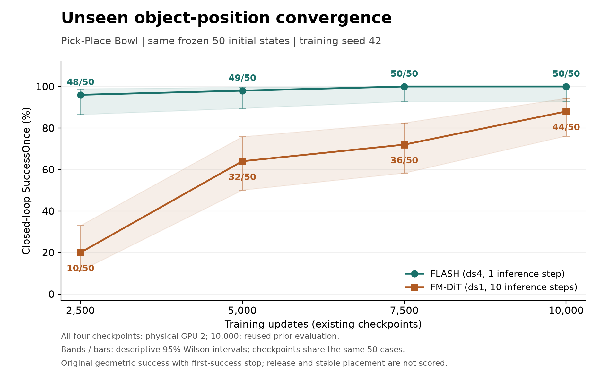

# FLASH 仿真复现与 Franka FR3 真机部署

基于 [FLASH: Efficient Visuomotor Policy via Sparse Sampling](https://arxiv.org/abs/2605.15492) 的复现项目，包含 LIBERO/MuJoCo 单任务仿真评测和自有双相机 Franka FR3 抓放部署。真机部分使用80条VR示教训练策略，在真实FR3上执行原始Legendre多项式位置、解析速度前馈、连续关节力矩和异步夹爪动作。

真机自主抓放最终成功率为**40/50（80%）**
本仓库保存源码、配置示例、过程文档、仿真结果及选定的真机统计摘要。真机示教视频、数据缓存、模型权重、现场图像和原始现场运行记录保留在本机。

## 真机结果

| 指标 | 结果 | 
| --- | --- | --- |
| 完整自主抓放成功率 | **40/50（80%）** | 
| 七关节采样跟踪MAE | **0.6002 ± 0.0361°** | 
| 服务端预测与解码 | **均值23.434 ms，P95 26.402 ms** |
| 观测到候选就绪 | 均值307.542 ms，P95 426.161 ms | 
| 控制器记录区间 | 17.8389 ± 2.6105 s | 

## 仿真结果

单任务实验现已整理到 [simulation/](simulation/README.md)。任务为 `libero_90.kitchen_scene1_put_the_black_bowl_on_the_plate`，使用同批40条参考回放示范（39条优化、1条内部验证），训练 seed 42。

以下为冻结的50组未见物体位置、同一 H100 GPU2 上的配对闭环评测，共400回合：

| 训练更新数 | FLASH，1步推理 | FM-DiT，10步推理 |
| --- | --- | --- |
| 2,500 | 48/50（96%） | 10/50（20%） |
| 5,000 | 49/50（98%） | 32/50（64%） |
| 7,500 | 50/50（100%） | 36/50（72%） |
| 10,000 | 50/50（100%） | 44/50（88%） |



成功率采用原任务的几何 `SuccessOnce`，测试范围为固定机器人初态、训练坐标范围内的新物体位置。此前在原始50组来源初态上的独立补充实验中，要求释放并稳定保持至少2秒时，双方均为0/50；该结果与上表分开报告。当前结果限于单任务、单训练 seed。

[完整结果与口径](simulation/README.md)包括逐回合 CSV/JSONL、冻结初态、配置、曲线、稳定放置诊断、推理计时及校验脚本；训练数据、检查点、视频和二进制轨迹仍在原实验留档中。

## 代码范围

| 路径 | 用途 |
| --- | --- |
| `third_party/FLASH-Policy` | 作者官方实现，子模块固定为 `f47e490f2b820f835d1b9145da3cdb3df69f50a0` |
| `scripts/prepare_flash_fr3_data.py` | LeRobot示教检查、关节监督适配、按episode划分缓存 |
| `scripts/train_flash_fr3.py`、`eval_flash_fr3.py` | 无仿真的训练、EMA检查点和离线评估 |
| `scripts/serve_flash_fr3_shadow.py` | H100端观测到原始多项式的HTTP推理服务 |
| `scripts/run_flash_fr3_raw_policy.py` | 正式连续力矩抓放客户端 |
| `scripts/run_flash_fr3_pickplace.sh` | 正式抓放入口，转发到原始连续策略实现 |
| `scripts/run_flash_fr3_return.*` | 快速回位，成功到位后自动开爪 |
| `src/flash_fr3_model_controller` | C++连续力矩、解析曲线求值及既有执行控制器 |
| `src/flash_fr3_pilot_controller` | 早期接口调试控制器，不是正式任务前置条件 |
| `configs/` | 本次成功配置摘要、夹爪和起始关节姿态示例 |
| `docs/DEPLOYMENT.md` | 机器人端依赖、部署与正式运行入口 |
| `simulation/` | LIBERO/MuJoCo仿真结果、逐回合记录、历史复现脚本和文件校验 |
| `results/fr3/2026-11-13/` | 真机40/50最终计数及25条已提供日志的指标摘要 |

其他`pilot`、`model_prefix`、`retimed`、`torque_hold`及相关测试脚本保留开发历史。正式完整任务使用`run_flash_fr3_pickplace.sh --execute`，无需逐个运行这些旧入口。

## 获取源码

```bash
git clone --recurse-submodules \
  https://github.com/jason-0712/FLASH_Efficient-Visuomotor-Policy-via-Sparse-Sampling.git
cd FLASH_Efficient-Visuomotor-Policy-via-Sparse-Sampling
```

已经克隆的目录使用`git submodule update --init --recursive`获取固定版本的官方策略。训练代码核对上游提交和IL源码摘要；不要把上游切换到最新版后直接加载旧检查点。

## 数据和训练

已验证环境：Python 3.11、PyTorch 2.7.0+cu128、Torchvision 0.22.0+cu128、NumPy 1.26.4、NVIDIA H100。GPU驱动显示的CUDA版本不等于PyTorch自带运行时版本。训练和机器人ROS分别使用独立环境。

在已有CUDA训练环境中安装本项目附加依赖：

```bash
python -m pip install -r scripts/flash_fr3_requirements.txt
export FLASH_ROOT="$PWD/third_party/FLASH-Policy"

python scripts/prepare_flash_fr3_data.py \
  --dataset /absolute/path/to/quest3_franka_dualcam_pickplace_74eps \
  --output data/pickplace_74eps_stride4 --stride 4 --seed 42

CUDA_VISIBLE_DEVICES=1 python -u scripts/train_flash_fr3.py \
  --flash-root "$FLASH_ROOT" \
  --dataset-cache data/pickplace_74eps_stride4 \
  --output runs/train_seed42_15k --steps 15000 --schedule-steps 15000 \
  --seed 42 --batch-size 32 --device cuda:0
```

本数据适配要求原采集器的LeRobot v2.1字段和`meta/merge_manifest.json`，不是任意LeRobot数据集的通用转换器。原始6维末端动作没有被当作关节命令：七关节监督来自示教实测关节，夹爪动作统一为闭合比例。

74条示教按episode分成66条训练、8条验证，每4帧稀疏采样；图像为两路RGB 256×256。窗口中保留8个历史观测，预测8个动作点。物理采样间隔为4/15秒。训练使用作者官方FLASH核心；上述数据、动作监督和FR3控制参数属于本地适配。

离线评估：

```bash
CUDA_VISIBLE_DEVICES=1 python scripts/eval_flash_fr3.py \
  --flash-root "$FLASH_ROOT" --dataset-cache data/pickplace_74eps_stride4 \
  --checkpoint runs/train_seed42_15k/best.pt \
  --output runs/eval_seed42_15k --device cuda:0
```

原成功检查点的483个验证窗口关节MAE约1.53231°。离线MAE与真机任务成功率分别记录。

## 推理与FR3执行

机器人端使用ROS 2 Humble、原生FR3/libfranka驱动、两路相机和标准Hand动作接口；详细准备见[部署步骤](docs/DEPLOYMENT.md)。现有部署默认使用名为`franka`的Docker容器，容器内工作区为`/home/ros/ros2_ws`，ROS_DOMAIN_ID为30。路径、IP、相机话题和物体配置需要与实际设备对应。

H100端使用已有检查点和一份真实观测文件预热后启动服务：

```bash
CUDA_VISIBLE_DEVICES=1 python -u scripts/serve_flash_fr3_shadow.py \
  --flash-root "$FLASH_ROOT" --dataset-cache data/pickplace_74eps_stride4 \
  --checkpoint runs/train_seed42_15k/best.pt \
  --warmup-observation /absolute/path/to/observation.npz \
  --bind 192.168.1.113 --port 10132 --allowed-client 192.168.1.107 \
  --device cuda:0 --allow-retimed-observations
```

正式客户端发送真实物理时间历史；`--allow-retimed-observations`只保留旧接口兼容能力，不会主动重定时正式输入。`run_flash_fr3_history_server.sh`保留原服务器目录布局，新的克隆建议使用上面的显式参数命令。

机器人端首次部署将本机配置放到以下本地路径：

```bash
mkdir -p artifacts/flash_fr3/task_setup artifacts/flash_fr3/home_poses
cp configs/gripper.example.json artifacts/flash_fr3/task_setup/events.json
```

起点应来自本机实际示教或已有保存文件；`configs/task_start.example.json`记录本次成功场景的参考关节姿态，不是任意FR3场景的通用目标。

已完成驱动和配置准备后，保持相机、ROS驱动与H100服务在线：

```bash
# 真实任务：会运动机械臂和夹爪
bash scripts/run_flash_fr3_pickplace.sh --execute --server http://192.168.1.113:10132

# 复位：会运动机械臂，成功到位后自动开爪；使用本机已保存的目标
bash scripts/run_flash_fr3_return.sh --execute \
  --pose artifacts/flash_fr3/home_poses/task_start.json
```

回位使用关节插值，需要现场确认路径无遮挡。正式任务保留机器人原有保护及必要异常处理。成功条件是物体实际抓起并放到目标盒内；`TASK_SEQUENCE_FINISHED`表示软件完成抓取/释放序列，物理成功仍由现场观察或独立评估记录。

## 成功配置与后续评估

`configs/fr3_successful_rollout.json`记录一次成功使用的15k EMA、1倍物理时间、原始多项式、解析速度和力矩参数；没有系数修正、历史冻结或块间停车。夹爪速度0.1米/秒、抓取力20牛。

后续固定代码提交、检查点、场景与初始条件；每次都记录结果，包括失败。统计物理成功次数/完整尝试次数，并分别保存机器结果和操作者观察。当前机器人试验的原始记录保留在本机，不由推送动作修改。

## 过程文档与来源

- [部署全过程总结](FLASH_FR3_部署全过程总结.md)：含首次完整成功记录。
- [正式入口与检查说明](FLASH_FR3_正式入口检查说明.md)：当前执行方式及保留参数依据。
- [复现步骤与开发历史](FLASH_FR3_复现步骤.md)：数据、训练和各阶段适配记录。
- [上游依赖与来源](THIRD_PARTY.md)。

历史文档中的绝对路径、局域网地址和`artifacts/`链接对应原实验电脑；大型证据文件不包含在Git仓库中。`docs/source_export_manifest.json`记录本次从运行工作区导出的源码哈希。导出和推送不会部署新版本或控制机器人。
