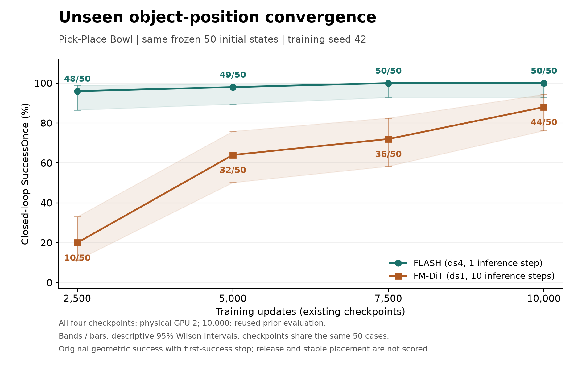

# FLASH / FM-DiT 单任务仿真实验

仿真任务为 `libero_90.kitchen_scene1_put_the_black_bowl_on_the_plate`，采用作者官方 FLASH/RoboVerse 实现的 MuJoCo 路径。

## 实验结论
**在单任务、seed42及所列完整管线设置下，FLASH在未见物体位置上更早达到较高的几何成功率，策略调用耗时也更低**

1. **较少训练更新时已有较高几何成功率。** 在同一批50组冻结测试初态上，2,500步时FLASH为96%，FM-DiT为20%；10,000步时分别为100%和88%。这支持FLASH在本实验已测检查点上的早期学习优势，以及最终检查点高12个百分点的几何成功率。“更早”指训练更新数，不能据此宣称训练墙钟时间更短，也无法确定2,500步之前首次学会的时刻。
2. **策略调用的计算开销较低。** 同一H100上的预热计时中，FLASH实际推理调用均值为10.819 ms，FM-DiT为49.452 ms，后者约为前者的4.57倍。该计时包含官方`get_action`中的传输、预处理、历史维护、模型与动作解码，支持这次测试下策略调用效率更高；不能将该倍数直接写成完整任务提速倍数。

## 未见物体位置上的闭环结果

两个策略共用50组预先冻结的测试初态，在同一张 H100（物理 GPU2）上评测。机器人、柜子和物体姿态固定，碗与盘的 XY 在39条优化示范来源初态的坐标包围盒内采样。测试具体配置未进入训练或归一化拟合；此分布与论文原始随机初态采样器不同。

| 训练更新数 | FLASH | FM-DiT | 成功率差 |
| --- | --- | --- | --- |
| 2,500 | 48/50（96%） | 10/50（20%） | +76个百分点 |
| 5,000 | 49/50（98%） | 32/50（64%） | +34个百分点 |
| 7,500 | 50/50（100%） | 36/50（72%） | +28个百分点 |
| 10,000 | 50/50（100%） | 44/50（88%） | +12个百分点 |



共400个正式回合：新增2,500/5,000/7,500步的300回合，复用此前10,000步的100回合。小规模检查和 GPU0 补充回合不计入此分母。失败回合全部保留。

- [400回合 CSV](flash-heldout-convergence/results/all-rollouts.csv)、[逐初态配对表](flash-heldout-convergence/results/paired-outcomes.csv)、[汇总 JSON](flash-heldout-convergence/results/convergence.json)。
- 原始逐回合 JSONL：[2,500步](flash-heldout-convergence/runs/2500/)、[5,000步](flash-heldout-convergence/runs/5000/)、[7,500步](flash-heldout-convergence/runs/7500/)、[10,000步](flash-heldout-evaluation/runs/)。
- [冻结测试初态](flash-heldout-convergence/inputs/test-initials.json)、[生成协议](flash-heldout-convergence/inputs/generation-protocol.json)、[配对结果图](flash-heldout-convergence/plots/paired-outcomes.png)、[原实验验收报告](flash-heldout-convergence/results/verification.json)。

主指标为原任务几何 `SuccessOnce`：碗盘 XY 中心距离小于0.06米，碗盘中心高度差严格处于0到0.03米；首次满足立即结束，每回合最多300个15毫秒控制步。它不要求夹爪释放或持续稳定放置。这里仅有一个训练 seed（42）；重复 checkpoint 共用相同初态，图中描述性 Wilson 区间不表示训练 seed 的波动。

测试输入文件 SHA256：

```text
ad70b6e7b77873373246002ea0a07e1345312e0e2c10b62e092f939f16b24076
```

## 原始来源初态上的历史对照

下面是另一组400回合主曲线，与上面的未见位置实验分开统计。50组来源初态中40组用于采集训练/验证示范，其余10组由参考回放采集结果决定，因此这组不能称为独立测试集。

| 训练更新数 | FLASH | FM-DiT |
| --- | --- | --- |
| 2,500 | 50/50（100%） | 18/50（36%） |
| 5,000 | 49/50（98%） | 35/50（70%） |
| 7,500 | 49/50（98%） | 39/50（78%） |
| 10,000 | 49/50（98%） | 37/50（74%） |

[历史对照报告](flash-comparison/README_zh.md)、[400回合 CSV](flash-comparison/results/all-official-rollouts.csv)、[配对表](flash-comparison/results/paired-outcomes.csv)、[原始记录与配置](flash-comparison/results/official/)。更早单独在 GPU3 上进行的 FLASH 10,000步评测为50/50，保存在[首次复现报告](flash-reproduction/README_zh.md)。这些设备与重置流程不同的运行没有合并为一个成功率。

## 释放与稳定放置的补充结果

在原始50组来源初态上，使用双方10,000步 checkpoint，另行运行每种方法50回合、每回合300步的补充评测。该实验未在新冻结的50组物体位置上执行。

| 指标 | FLASH | FM-DiT |
| --- | --- | --- |
| 继续执行中曾满足几何成功 | 49/50 | 37/50 |
| 曾在目标处达到释放条件 | 2/50 | 17/50 |
| 释放并稳定保持至少2秒 | **0/50** | **0/50** |

稳定指标要求几何条件、双手指实际开度至少3厘米、碗与手掌/手指无接触、质心线速度不超过0.02米/秒、角速度不超过0.2弧度/秒同时持续至少2秒。15毫秒采样对应135个连续合格样本，首尾跨度2.01秒；首次几何成功后继续由策略运行，没有人为强制张开夹爪。

[预先固定的稳定协议](flash-comparison/configs/stable-placement-protocol.json)、[100回合记录](flash-comparison/results/stability-rollouts.csv)、[失败原因汇总](flash-comparison/results/stability-summary.json)、[独立重算报告](flash-comparison/results/stability-recomputation-audit.json)。后续[示范与判据诊断](flash-placement-audit/README_zh.md)发现，40条训练示范的记录前缀没有通过该完整稳定保持验收，不能将几何成功直接视为完整放置成功。

## 推理耗时

同一 H100 GPU3 上用固定参考观测流进行预热计时，双方各两轮并交换顺序。每轮先预热10次实际推理，再测3,200个控制步，使用 CUDA 同步后的墙钟时间。

| 口径 | FLASH | FM-DiT |
| --- | --- | --- |
| 实际推理调用均值 | 10.819 ms（200次） | 49.452 ms（800次） |
| 包括缓存命中的每控制步均值 | 0.731 ms | 6.368 ms |

该次实测中，FM-DiT 的平均实际推理调用耗时约为 FLASH 的4.57倍。计时包围官方 `DefaultEvalRunner.get_action`，包含观测传输、预处理、归一化、历史维护、模型计算、重采样和动作转换，排除仿真、渲染、重置和模型加载。它不同于纯网络 forward，也不同于机器人完整任务时间。每控制步的摊销差异还包括32对8个缓存目标的差异。

服务器未整机独占，两轮 FLASH 实际调用均值为9.28/12.36毫秒，FM-DiT为49.78/49.13毫秒。[完整计时定义与分布](flash-comparison/results/latency/summary.json)、[12,800条原始计时样本](flash-comparison/results/latency/calls.csv)、[历史计时脚本](flash-comparison/scripts/latency_benchmark.py)。

## 训练与控制配置

- 双方使用同批40条官方参考轨迹重新回放采集的示范，39条优化、1条内部验证；它们不是论文作者提供的原始训练示范。两个来源 ID 在默认采集结束前耗尽动作，以公开参数关闭成功后补录后重新采集，偏离记录保留在[采集清单](flash-reproduction/manifests/collection-deviations.json)。
- seed 42、batch 32、AdamW、cosine、500步预热及 EMA。训练请求15,000次更新，按完整 epoch 实际执行15,015次；本页比较预选的2,500/5,000/7,500/10,000步 checkpoint。
- 双方为随机初始化 ResNet-18 / GroupNorm 与4层、hidden 512、8 heads 的 DiT。FLASH 采用 ds4、Legendre 6阶、1步推理；FM-DiT采用 ds1、10步推理，保留各自发布版 dropout 等设置。
- 物理控制周期均为15毫秒；FLASH 训练帧间隔60毫秒、每次执行32个目标、重规划间隔480毫秒；FM-DiT对应15毫秒、8个目标和120毫秒。FLASH 参数首尾跨度420毫秒，实际32个执行目标首尾间隔465毫秒，保留了发布版行为。
- 双方 MuJoCo 原生位置 actuator 的有效 gain/bias/damping 相同。当前 handler 只缓存 FLASH 速度目标，物理步进没有消费该缓存，因此这组仿真没有证明有效速度前馈的收益。动作覆盖、历史时域、重规划和目标表示也不同，不能把整体差异归因于单一模块。
- 固定上游提交 `f47e490f2b820f835d1b9145da3cdb3df69f50a0`。原有 Diffusers 兼容修复、日志补丁和评测观察器另行归档。训练环境为 Python 3.11、PyTorch 2.7.0+cu128、NumPy 1.26.4、MuJoCo 3.17.0；完整版本与历史命令见阶段报告。

## 目录与复查

| 目录 | 内容 |
| --- | --- |
| [flash-reproduction](flash-reproduction/README_zh.md) | 首次 FLASH 训练、50回合评测、数据审计和环境 |
| [flash-comparison](flash-comparison/README_zh.md) | FM-DiT训练、原始初态对照、稳定放置和计时 |
| [flash-placement-audit](flash-placement-audit/README_zh.md) | 参考示范、采集终点及稳定判据诊断 |
| [flash-heldout-initials](flash-heldout-initials/README_zh.md) | 新测试初态生成规则和CPU检查 |
| [flash-heldout-evaluation](flash-heldout-evaluation/README_zh.md) | 未见位置10,000步的100个正式回合 |
| [flash-heldout-convergence](flash-heldout-convergence/README_zh.md) | 未见位置完整400回合曲线与补充跨卡记录 |

从仓库根目录运行，无需 GPU 或仿真依赖：

```bash
python3 simulation/verify_results.py
```

