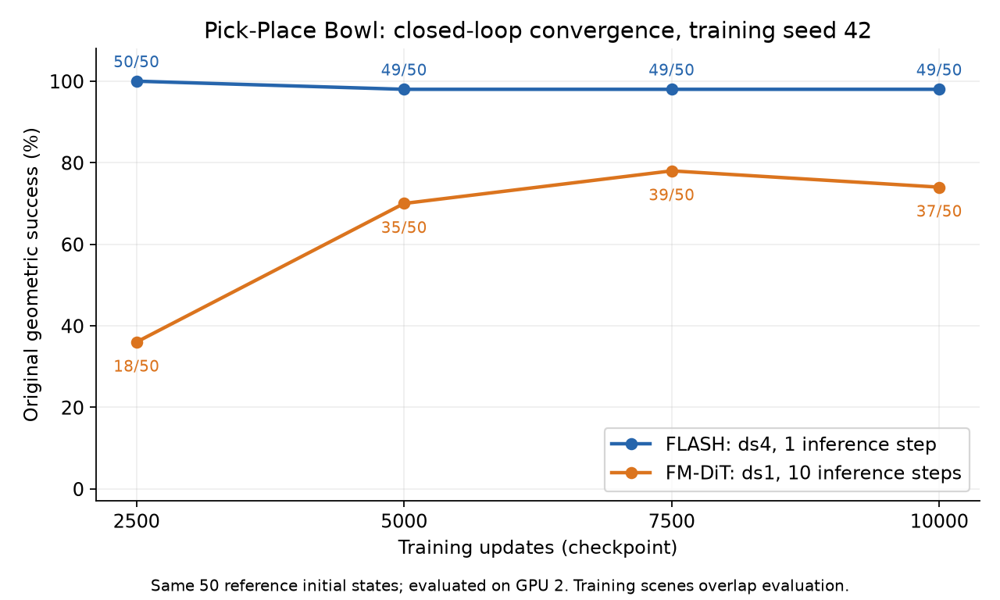
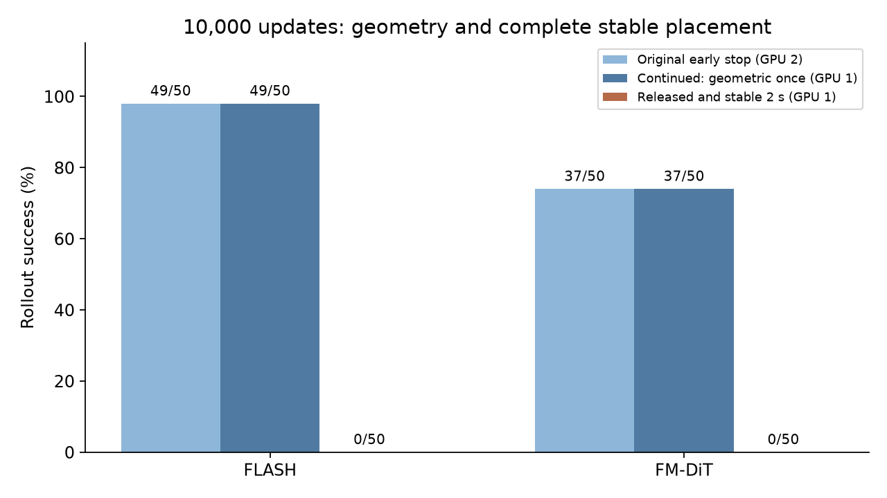
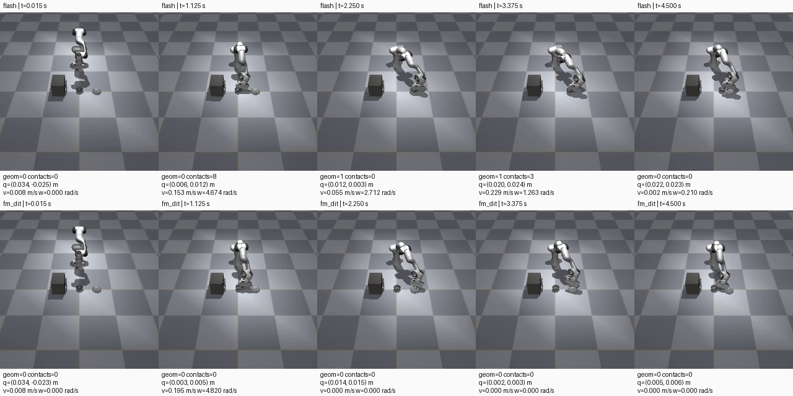
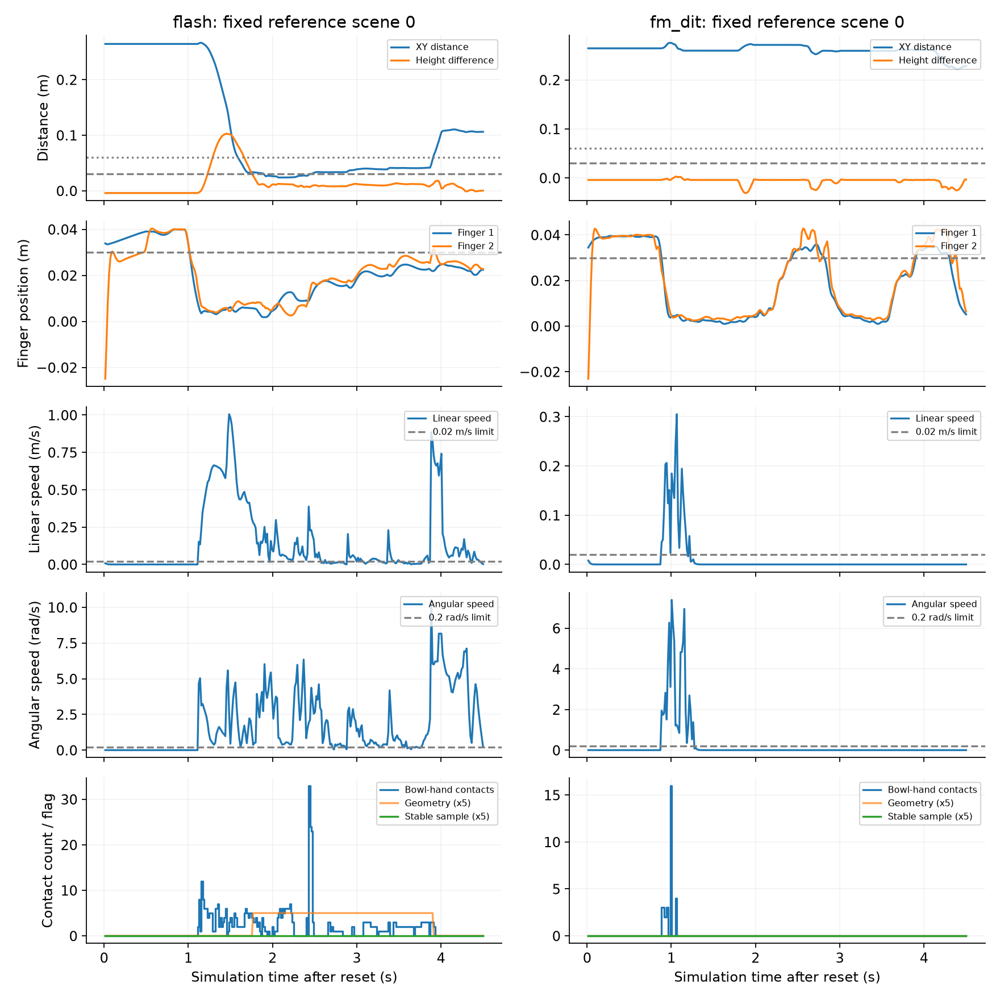

> 历史实验报告，记录的是2026-10-28—29执行时的状态；于2026-11-13整理发布。当前发布范围见[仿真实验总览](../README.md)。未发布的视频、权重、二进制轨迹等链接已标为“原始留档”；下文的服务器路径和原始文件完整性描述保留历史含义。

# FLASH / FM-DiT 单任务对照与闭环收敛

本轮已完成：FM-DiT 同数据训练，双方 4 个 checkpoint × 50 回合的闭环评测，双方 10,000-step checkpoint 的 50 回合稳定放置补充评测，以及同 GPU 预热推理计时。全部数字来自本机实际运行；没有把论文数字或此前简历中的预期数字作为结果。

当前单 seed 结果显示：FLASH 在最早评测的 2,500 次更新时为 50/50，FM-DiT 为 18/50；10,000 次更新分别为 49/50 和 37/50。这个固定场景池中 FLASH 的原几何成绩更高，但两种方法的新增稳定放置成绩均为 0/50 与 0/50。结论限于本任务、本 seed、本数据与各自发布版动作时域。

## 闭环曲线与逐场景配对

| checkpoint 更新数 | FLASH，ds4 / 推理 1 步 | FM-DiT，ds1 / 推理 10 步 |
| --- | --- | --- |
| 2,500 | 50/50（100%） | 18/50（36%） |
| 5,000 | 49/50（98%） | 35/50（70%） |
| 7,500 | 49/50（98%） | 39/50（78%） |
| 10,000 | 49/50（98%） | 37/50（74%） |

这是闭环成功率曲线，不是训练 loss。每个点由 50 条原始逐回合记录复核；同一对场景的初始状态 SHA256 相同。所有主曲线在物理 GPU 2 上评测，最多 300 个 15 ms 控制步。EMA 权重的真实 global step、加载日志、checkpoint SHA256 和视频帧数均通过检查。

| 更新数 | 双方成功 | 仅 FLASH 成功 | 仅 FM-DiT 成功 | 双方失败 |
| --- | --- | --- | --- | --- |
| 2,500 | 18 | 32 | 0 | 0 |
| 5,000 | 34 | 15 | 1 | 0 |
| 7,500 | 38 | 11 | 1 | 0 |
| 10,000 | 36 | 13 | 1 | 0 |

[逐场景配对表](results/paired-outcomes.csv)、[全部 400 条主曲线评测记录](results/all-official-rollouts.csv)、[checkpoint 汇总与哈希](results/convergence.json)。每个 `results/official/方法-步数/raw/` 都保留 50 段视频、50 条文字记录和 50 份关节诊断 NPZ。

本次最早只测到 2,500 步，不能据此定位 FLASH 首次学会的准确更新数，也没有评估随机初始化的 0-step 表现。单 seed 的优势不能当作跨 seed 的统计结论。CSV 中的 Wilson 区间仅描述二项比例；固定参考场景并非随机独立测试抽样，区间不代表泛化或训练 seed 的不确定性。

## 训练与数据对齐

两者使用同一批 40 条原始示范，原始视频、metadata 和参考 ID 的哈希逐一相等；相同的 39 条用于优化，参考 ID 49 的 1 条用于内部验证。FLASH ds4 为 1,204 帧，FM-DiT ds1 为 4,767 帧；转换后逐帧 RGB、状态和动作与原始数据一致。没有重新收集一批更容易的 FM-DiT 示范。

双方 seed 42、batch 32、15,000 次请求更新、AdamW/cosine/500-step 预热/EMA，均因完整 epoch 边界实际执行 15,015 次更新。FLASH 训练循环实测 34.19 分钟，FM-DiT 为 31.98 分钟；这是本轮各自运行时间，不是通用训练速度基准。两种 loss 定义不同，不能用绝对 loss 大小跨方法排名。

两者均从随机初始化的 ResNet-18 / GroupNorm 和 4 层、512 hidden、8 heads 的 DiT 出发；保留 FLASH dropout 0 与 FM-DiT dropout 0.1。双方数据采样率和目标表示不同，比较的是完整发布版管线。[数据对齐清单](manifests/aligned-dataset-split.json)、[ds1 数据校验](manifests/ds1-validation.json)、[FM-DiT 训练审计](results/fm-training-summary.json)、[逐更新日志](logs/fm-updates.jsonl)。

## 动作覆盖与实际控制

| 项目 | FLASH | FM-DiT |
| --- | --- | --- |
| 训练帧间隔 | 60 ms | 15 ms |
| 8 帧历史首尾跨度 | 420 ms | 105 ms |
| 8 个动作点的首尾参数跨度 | 420 ms | 105 ms |
| 每次预测执行目标数 | 重采样为 32 | 8 |
| 实际发出目标的首尾间隔 | 465 ms | 105 ms |
| 重规划间隔 | 480 ms | 120 ms |
| flow 推理步数 | 1 | 10 |

两者均以 15 ms 执行 MuJoCo 原生位置目标。FLASH 的多项式参数跨度与实际发出目标的时刻有上述差异，保留源码行为。原生 actuator 的 gain、bias 和关节 damping 数组逐项相同，见 [控制器实测对比](results/native-controller-comparison.json)。上层 FLASH 虽发送速度目标，当前 handler 只缓存它而未在 `_simulate()` 中消费；配置中的增益重写也未写入原生 MJCF。因此不能声称本轮启用了有效速度前馈，也不能把整个性能差异归因于某个网络模块。

原始关节数组前两维是手指位置（m），后七维是机械臂关节（rad）。原版诊断图统一使用 rad 标签时，应以这个实际单位说明为准。参考初态中的第二手指可短暂出现负值；保留原始初始化，没有对开度取绝对值来改变判据。

## 从“到达目标”到“稳定放置”

原判据只要求碗盘 xy 中心距离小于 6 cm、碗高于盘且中心高度差小于 3 cm，首次命中即成功。新增协议在首个稳定性试验前固定，双方均不强制张开夹爪，并继续执行至 300 步（4.5 s）。原几何条件、两个手指实际开度均至少 3 cm、碗与手掌/手指无 contact 数组接触对、质心线速度 ≤0.02 m/s、角速度 ≤0.2 rad/s，必须同时保持至少 2 s。

15 ms 采样要求 135 个连续合格样本，首尾实际跨度 2.01 s。这个指标只覆盖采样时刻和有限回合长度，不是无限期或每个 1 ms 子步的稳定性保证。较晚到达目标可能没有足够的剩余保持时间，按保持不足计分。阈值固定后没有为提高成绩调整。

| 判据与运行 | FLASH | FM-DiT |
| --- | --- | --- |
| 原版几何成功，提前结束（GPU 2） | 49/50 | 37/50 |
| 继续执行中曾几何成功（GPU 1） | 49/50 | 37/50 |
| 曾在目标处达到释放条件（GPU 1） | 2/50 | 17/50 |
| 释放并连续稳定保持至少 2 s（GPU 1） | 0/50 | 0/50 |

| 稳定放置失败原因 | FLASH | FM-DiT |
| --- | --- | --- |
| 从未几何成功 | 1 | 13 |
| 目标处从未满足释放条件 | 47 | 20 |
| 到过目标且释放，但稳定保持不足 | 2 | 17 |

逐步复算显示，每种方法各 15,000 个采样点中，FLASH 有 1 个、FM-DiT 有 1 个同时满足全部瞬时条件，未形成稳定保持。碗速度来自原生 MuJoCo 的世界系刚体惯性质心速度接口，完整保存每步速度、姿态、夹爪开度和接触数。双方各 50×300 个样本的所有判据均已从 NPZ 独立重算，与保存的成功标记一致。[逐回合稳定性记录](results/stability-rollouts.csv)、[速度及失败汇总](results/stability-summary.json)、[重算审计](results/stability-recomputation-audit.json)、[固定协议](configs/stable-placement-protocol.json)。

固定选取场景 0 展示全过程，而非挑选最佳场景。视频容器为 30 FPS，300 帧播放约 10 s，对应仿真时间 4.5 s；播放时长不能当成任务仿真耗时。

FLASH 场景 0 全过程视频（原始留档：`videos/flash-10000-scene0-continued-300steps.mp4`）、FM-DiT 场景 0 全过程视频（原始留档：`videos/fm_dit-10000-scene0-continued-300steps.mp4`）。

40 条训练示范结束时，双手指实际开度均达到 3 cm 的有 5 条，目标开度达到的有 8 条。这只是开度审计，不能替代接触、目标位置和稳定保持判据，但提示示范对完整释放的监督可能不足。默认采集仅在几何成功后再录最多 20 步（0.3 s），参考 ID 7、25 在上一轮采用公开参数 0 步补录；这批数据并未经过 2 s 完整放置验收。详见 [示范末端开度审计](results/demo-release-audit.csv)。

## 预热推理计时

同一张 NVIDIA H100（物理 GPU 3）在训练结束并释放显存后测量，使用固定参考 ID 49 的原频率观测流。每轮先预热 10 次实际调用；两轮交换方法顺序，各计时 3,200 个控制步，CUDA 前后同步。

| 计时口径 | FLASH | FM-DiT |
| --- | --- | --- |
| 实际模型调用，平均 ms | 10.819 | 49.452 |
| 含缓存的每控制步，平均 ms | 0.731 | 6.368 |
| 仅缓存调用，平均 ms | 0.405 | 0.213 |

本测量下 FM-DiT 的平均实际模型调用耗时为 FLASH 的 4.57 倍。这里的“实际模型调用”包括官方 `get_action` 中的图像传输、预处理、历史维护、模型计算、重采样和动作字典转换，排除仿真、渲染、加载，不是单个 DiT forward 的纯 kernel 时间。每控制步的摊销差异还包含 32 对 8 个缓存目标的重规划差异。主评测日志含冷启动与 CPU 绘图等开销，不用目录名中的 ms 数字计算这个倍数。[完整计时定义与均值/中位数/p90](results/latency/summary.json)、[所有计时样本](results/latency/calls.csv)。

这是共享服务器上的一次实测，未申请整机独占。启动前 GPU 3 显存为 1 MiB，服务器其他卡仍在运行评测；后续也观察到其他作业进入部分卡。两轮实际调用均值分别为 FLASH 9.28/12.36 ms、FM-DiT 49.78/49.13 ms。保留这种波动，不将单次测得倍数当成通用硬件基准。

## 复现边界与后续阶段

原始 FLASH 10,000 checkpoint 在上一轮 GPU 3 上为 50/50，本轮 GPU 2 为 49/50，均保留。相同权重在不同 GPU 上微小数值差异会在闭环中累积；场景 0 曾出现首次几何成功 117 对 118 步。新增观察器在同 GPU 的场景 0 控制实验中，FLASH 的动作/实际状态/速度和 FM-DiT 的动作/实际状态在原回合终点前数组逐值完全一致，见 [FLASH 核对](results/stability-smoke-validation.json)、[FM-DiT 核对](results/stability-fm-smoke-validation.json)。首次成功后恢复 RNG 使后续回合不额外消耗 flow 随机数，但沿用原版 reset，不声称继续执行后的隐藏求解器状态与提前结束运行完全相同。

10,000-step 主结果分组如下：

| 初始条件来源 | FLASH | FM-DiT |
| --- | --- | --- |
| 优化示范来源 | 38/39 | 28/39 |
| 内部验证示范来源 | 1/1 | 1/1 |
| 未纳入示范（非随机测试集） | 10/10 | 8/10 |

50 个参考初始条件中，40 个用于生成示范；另外 10 个由回放采集结果筛除，并非预先随机划分的测试场景。发布版 normalizer 也拟合整个当前 Zarr，包括内部验证示范。当前结果不能写成独立测试集泛化成功率。

用户优先级中的第 1、2 项与新增稳定放置评测已完成；第 3 项独立测试重训、第 4 项双方各 3 个训练 seed 尚未执行。下一阶段应先固定场景划分，测试示范完全排除在训练 Zarr 和 normalizer 拟合之外，再重新训练双方并另表报告；若目标升级为完整放置，应另行收集或验证完整释放示范。第二任务和模块消融仍未执行。

## 保存位置与校验

服务器：`cps-server` / `/home/hanyu/flash_fr3/flash_sim_reproduction_20261028/comparison_20261028`。

原始数据与 checkpoint 继续保存在服务器，不复制数 GB 权重到本地。双方 checkpoint 的真实绝对路径和 SHA256 位于 `results/convergence.json`；FM-DiT 最终权重与训练审计见 `results/fm-training-summary.json`。原版完整环境、依赖和早期 FLASH 训练证据位于相邻 [原始复现报告](../flash-reproduction/README_zh.md)，本轮未改写。

固定源码 commit 为 `f47e490f2b820f835d1b9145da3cdb3df69f50a0`。保留原来的兼容性/日志补丁，未更改任务判据或策略核心。当前 diff 见 [源码补丁](configs/current-source.patch)。稳定性观察器源代码、原始函数、变换函数和 diff 均随运行保存。所有脚本与阶段日志位于 `scripts/`、`logs/`；完整比较口径见 [实验协议](PROTOCOL_zh.md)。

交付文件通过 `SHA256SUMS` 校验；大 checkpoint 与 Zarr 的独立哈希清单位于 `results/` 和 `manifests/`。本地保留全部回合的视频、文字、NPZ 与汇总图；原版逐回合诊断 PNG 全集留在服务器，避免与原始数组重复传输。没有将未执行实验写成成果。
