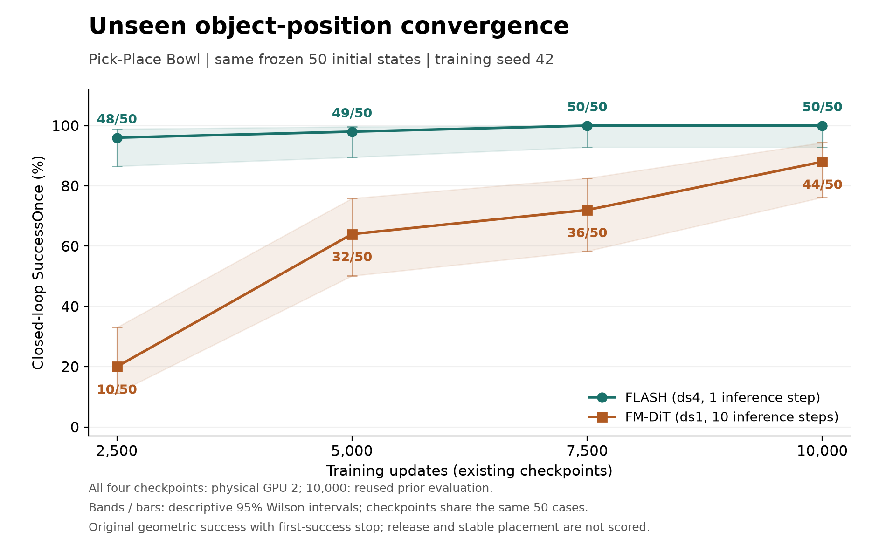
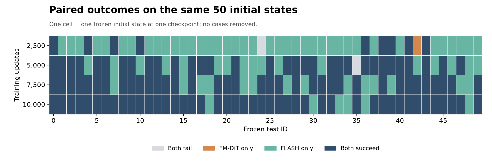

# FLASH / FM-DiT 未见位置闭环收敛曲线

## 真实结果

| 训练更新步数 | FLASH | FM-DiT | FLASH − FM-DiT | 来源 |
| --- | --- | --- | --- | --- |
| 2,500 | 48/50（96%） | 10/50（20%） | +76 个百分点 | 本轮 GPU2 新增 |
| 5,000 | 49/50（98%） | 32/50（64%） | +34 个百分点 | 本轮 GPU2 新增 |
| 7,500 | 50/50（100%） | 36/50（72%） | +28 个百分点 | 本轮 GPU2 新增 |
| 10,000 | 50/50（100%） | 44/50（88%） | +12 个百分点 | 复用既有 GPU2 未见位置结果 |

图中区间为每点描述性 95% Wilson 区间，完整数值见 [convergence.json](results/convergence.json)。所有 checkpoint 共用同一批测试初态，因此各点相关；区间不涵盖训练 seed 的波动。

这组结果检验同批示范训练出的两个方法，在训练位置范围内的新物体位置上，闭环几何成功率如何随训练更新变化。它只支持本任务、seed42 的观察，不能单独证明跨任务优势、多个训练 seed 的稳定性或某个网络模块的因果贡献。最早只测到 2,500 步，无法确定更早从哪一步开始学会。

| 更新步数 | 两者成功 | 仅 FLASH 成功 | 仅 FM-DiT 成功 | 两者失败 |
| --- | --- | --- | --- | --- |
| 2,500 | 9 | 39 | 1 | 1 |
| 5,000 | 32 | 17 | 0 | 1 |
| 7,500 | 36 | 14 | 0 | 0 |
| 10,000 | 44 | 6 | 0 | 0 |

[全部 400 个正式回合](results/all-rollouts.csv)、[200 对逐初态结果](results/paired-outcomes.csv)。全部预选初态均保留，失败回合没有剔除。10,000-step 是此前完成的固定参考点，未重复训练或按新结果选择。

## 沿用的数据和成功判据

训练仍使用原来同批 40 条有效示范，其中 39 条优化、1 条内部验证；FLASH 使用 ds4，FM-DiT 使用 ds1。使用 seed42 的已有 EMA checkpoint 及其保存的归一化参数。没有新增采集、训练 Zarr 或归一化拟合。

测试输入 SHA256 为 `ad70b6e7b77873373246002ea0a07e1345312e0e2c10b62e092f939f16b24076`，与此前 10,000-step 测试完全相同。50 个测试状态在首次策略运行前已冻结：碗和盘的 XY 在 39 条优化示范来源初态的经验包围盒内独立均匀采样；机器人、柜子、物体 z 和姿态固定为来源 ID1。每个四维物体位置配置与原始 50 个配置至少相距 5 mm，最小实际距离约 5.032 mm。候选通过预先定义的 CPU 物理有效性检查，没有按策略或专家成功率筛选。

这是固定机器人、训练坐标范围内的未见物体位置实验，不是论文原始随机采样器，也不证明跨场景泛化或每个状态都有成功专家路径。原始来源 50 初态评测包含训练示范来源初态，且使用不同重置流程，因此与本实验分开报告。原先继承的第二手指负初值按冻结文件保留，双方一致。

主指标保持原任务几何 `SuccessOnce`：碗盘 XY 中心距离 < 0.06 m，且 0 < 高度差 < 0.03 m；首次满足立即停止，最多 300 个 15 ms 控制步。**本轮没有评测释放、撤离或持续保持 2 秒；几何成功不能直接写成完整稳定放置成功。** 每回合先 `mj_resetData`，再加载冻结初态，不执行 CPU 筛查时的 200 步被动预热。

## 动作时域与控制器

| 设置 | FLASH | FM-DiT |
| --- | --- | --- |
| 训练采样间隔 | 60 ms（ds4） | 15 ms（ds1） |
| 8 帧历史首尾跨度 | 420 ms | 105 ms |
| 8 个动作点首尾参数跨度 | 420 ms | 105 ms |
| 每次预测执行目标数 | 多项式重采样为 32 | 8 |
| 执行目标首尾实际间隔 | 465 ms | 105 ms |
| 重规划间隔 | 480 ms | 120 ms |
| flow 推理步数 | 1 | 10 |

FLASH 参数时域与实际执行时域保留发布版行为。双方使用同一个 MuJoCo 原生位置 actuator；有效增益、bias、damping、关节顺序、物理时间步和控制 decimation 逐项一致。FLASH 上层发送速度目标，但当前 handler 只缓存、不消费该速度目标，配置增益映射代码也被注释。动作覆盖、重规划和历史时域存在方法设置差异，不能把整个成绩差异归因于网络结构或速度前馈。

## GPU 调度与补充记录

GPU2 为 H100 PCIe，UUID `GPU-eb1c016b-9505-66b6-0362-57dea67de4eb`。正式曲线的四个步数均在这张卡上得到，双方在每个步数顺序运行。CUDA 按 UUID 绑定，进程内部为 cuda:0，EGL 指向物理设备 2。每次运行核对进程自身只出现在指定 UUID，启动前检查所选卡空闲。

最初按“两卡”授权分工：GPU0 负责 2,500 步，GPU2 负责 5,000、7,500 步。0 号卡短暂出现他人任务，等待其结束后才启动。用户随后选择全部改到 2 号卡；处理回复时原先两段作业已经自行结束，没有仍在运行的本次 GPU0 进程。将 GPU0 的全部 100 个回合和 6 个小样本检查原件迁入 `supplemental-gpu0/`，在 GPU2 完整重跑 2,500 步。无论哪张卡成绩更高，正式曲线都固定使用 GPU2。没有终止、暂停或修改其他用户进程。

此前还在 GPU0 对双方 10,000-step checkpoint 各运行固定前 3 个 ID，共 6 个跨卡控制回合。初态、首帧、控制器和归一化完全一致，成功结果一致，但轨迹和部分首次成功步数不同。下面是 2,500-step 全 50 个相同初态的补充跨卡对照；它不混入正式曲线分母，也不是速度测试。

| 方法 | GPU0 补充结果 | GPU2 正式结果 | 成功判定不一致初态数 |
| --- | --- | --- | --- |
| flash | 49/50 | 48/50 | 3 |
| fm_dit | 19/50 | 10/50 | 19 |

[全量跨卡配对表](results/hardware-2500-paired.csv)、[GPU0 补充验收](results/supplemental-gpu0-validation.json)、[6 个先行跨卡控制](results/bridge-validation.json)。这说明相同模型与初态在不同 H100 设备上也可能产生不同闭环结果，正式曲线统一设备有必要。本轮不比较推理速度。

## 独立验收

- 新增 GPU2 的 300 个正式回合均从保存的物体轨迹独立重算成功、首次成功停止和 300 步超时，并与原版文字记录、动作和关节诊断 NPZ 交叉核对；PASS。既有 100 个 10,000-step 回合的原始验收与文件哈希绑定保留。
- 新增 150 对初态及 RGB 完全一致；曲线全部 400 个实际重置还逐一与 10,000-step 基准初态和首帧比较，逐位一致。新增 300 次重置也与冻结 CPU 轨迹初态独立比较。
- 正式 6 个新 checkpoint 各 3 个先行检查，共 18 个回合，不计正式分母；这 18 个动作与状态轨迹和正式评测对应回合逐位一致，耗时字段除外。GPU0 额外 6 个先行检查单独保留，总计 24 个。
- 每次运行核对全部 EMA 张量与 checkpoint 一致，FLASH 177 个、FM-DiT 167 个，各含 36 个归一化张量。同一方法四个 checkpoint 的归一化张量一致；两种方法使用各自保存的统计，action/agent_pos 的 12 个张量哈希不同，不要求跨方法相同。双方有效控制器参数一致。
- 新增 300 段 GPU2 正式视频与 100 段 GPU0 补充视频全部经 CPU 解码，帧数与控制步数一致。视频沿用原版动作前采帧，末帧不含最后一次动作后的状态；计分以动作后 NPZ 为准，容器时长也不等于 15 ms/步的仿真时长。
- GPU0 补充 100 回合也独立重算，6 个先行/完整轨迹比对通过；没有丢弃已完成结果。
- 仓库提交 `f47e490f2b820f835d1b9145da3cdb3df69f50a0` 和已有 diff 哈希保持不变。内存替换仅接入冻结输入、原生重置、输出与观察器；原函数、执行函数、diff 和解析配置均保存。相对上一阶段的适配 diff 只增加 checkpoint 步数和 GPU 选择。
- 原来五个最终实验包的全部本地文件哈希再次验证通过，没有覆盖历史结果。

[正式回合验收](results/verification.json)、[视频验收](results/video-validation.json)、历史包完整性（原始留档：`environment/prior-packages-integrity.json`）。汇总的首次 CPU 验收曾错误要求两种方法的归一化参数完全相同，导致汇总中止；已改为核对同方法跨 checkpoint 一致性，保留首次失败日志和 [归一化核查](results/normalizer-audit.json)。这个修正只涉及汇总验收，没有修改模型、输入或正式结果，无需重跑。

本阶段实际新增策略回合总数为 430：300 个 GPU2 正式回合、100 个 GPU0 补充回合、24 个先行检查、6 个跨卡控制；与复用的历史 100 个正式回合分开计数。

## 耗时与产物

| 作业 | 启动 UTC | 结束 UTC | 作业时间 |
| --- | --- | --- | --- |
| gpu2 | 2026-10-29T06:47:42Z | 2026-10-29T07:06:58Z | 19.27 分钟 |
| gpu2-2500 | 2026-10-29T07:28:27Z | 2026-10-29T07:39:47Z | 11.33 分钟 |
| gpu0 | 2026-10-29T06:49:20Z | 2026-10-29T07:01:22Z | 12.03 分钟 |

UTC 加 8 小时为香港时间。上述作业时间含模型启动、仿真、观察器、视频和产物保存，不是纯模型耗时；两段 GPU2 作业中间没有占卡。GPU2 的两个作业分别为 5,000/7,500 步和后来统一设备的 2,500 步。后续 CPU 验收和报告不计入表内。

| 新增正式 checkpoint / 方法 | 成功回合 | 控制步总数 | 实际模型调用数 | 含观察器的运行时间 |
| --- | --- | --- | --- | --- |
| 2,500 / flash | 48/50 | 5832 | 213 | 3.13 分钟 |
| 2,500 / fm_dit | 10/50 | 13023 | 1652 | 6.59 分钟 |
| 5,000 / flash | 49/50 | 5632 | 206 | 3.70 分钟 |
| 5,000 / fm_dit | 32/50 | 8525 | 1089 | 4.68 分钟 |
| 7,500 / flash | 50/50 | 5459 | 200 | 3.31 分钟 |
| 7,500 / fm_dit | 36/50 | 7905 | 1010 | 5.01 分钟 |

- `runs/{2500,5000,7500}/{flash,fm_dit}/`：新增正式轨迹、原生速度/接触、重置 NPZ/PNG、原版视频和关节诊断。
- `smoke/`：18 个正式方案的先行检查；`supplemental-gpu0/`：GPU0 的 100 个完整回合及 6 个检查；`bridge/10000/`：6 个跨卡控制。分母单独记录。
- `references/`：历史 10,000-step 汇总、CSV、验收和原包 SHA256SUMS；历史 100 个原始回合继续保留在相邻 `flash-heldout-evaluation/`。
- `inputs/`：冻结初态的按字节副本；`configs/`：原计划、最新调度修订、用户授权及观察器适配 diff。原计划保留，2,500-step GPU2 使用修订计划，5,000/7,500 步使用原计划，检查时逐运行核对对应哈希。
- `results/`：四点汇总、400 回合表、配对表和全部验收；`plots/`：曲线、配对图 PNG/SVG/PDF。
- `logs/`、`environment/`：原始日志、5 秒遥测、输入/源码核查和作业回执；`scripts/`：完整执行与验收脚本；`SHA256SUMS`：文件校验。

服务器目录：`/home/hanyu/flash_fr3/flash_sim_reproduction_20261028/heldout_curve_20261029/`。本次评测和短期 GPU 遥测均已结束，最终设备记录在 `environment/`。

