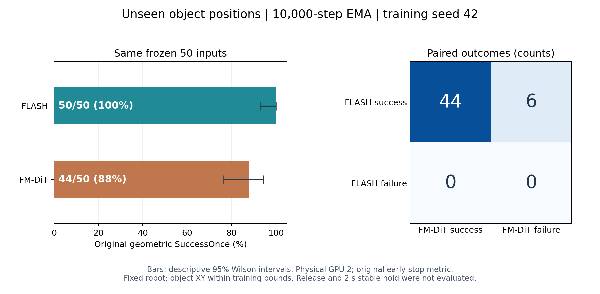

> 历史实验报告，记录的是2026-10-28—29执行时的状态；于2026-11-13整理发布。当前发布范围见[仿真实验总览](../README.md)。未发布的视频、权重、二进制轨迹等链接已标为“原始留档”；下文的服务器路径和原始文件完整性描述保留历史含义。

# FLASH / FM-DiT 冻结未见位置测试结果

2026-10-29（香港时间）。已按用户“用卡2接着做”的授权，在物理 GPU 2（H100 PCIe）上依次完成两个 seed42、10,000-step EMA checkpoint 的评测。每种方法 50 回合，共 100 个正式回合，另保留各 3 个小规模检查回合。没有重新训练、改变测试输入或按测试成绩选 checkpoint。

## 本轮真实结果

| 方法 | 原始几何 SuccessOnce | 描述性 95% Wilson 区间 | 正式评测耗时，含启动和产物 |
| --- | --- | --- | --- |
| FLASH，ds4 / 推理 1 步 | 50/50（100%） | 92.9%–100.0% | 3.48 分钟 |
| FM-DiT，ds1 / 推理 10 步 | 44/50（88%） | 76.2%–94.4% | 3.70 分钟 |

本组结果FLASH 较高，FLASH 减 FM-DiT 为 12 个百分点。这是本任务、本训练 seed、固定机器人和这批未见物体位置下的观察。区间描述本批样本比例，不涵盖训练 seed 的不确定性，也不是跨任务或网络模块因果证据。

| 同一初态的配对结果 | 回合数 |
| --- | --- |
| 两者成功 | 44 |
| 仅 FLASH 成功 | 6 |
| 仅 FM-DiT 成功 | 0 |
| 两者失败 | 0 |

[逐初态配对表](results/paired-outcomes.csv)、[全部正式回合](results/all-rollouts.csv)、[机器可读汇总](results/summary.json)。**本轮没有评测释放后保持 2 秒的稳定放置指标；几何成功不能直接称为完整放置成功。**

## 与原来数据和评测的关系

仍使用原来同批 40 条示范训练的两个 checkpoint，其中 39 条用于优化、1 条用于内部验证。本轮没有新增示范、专家动作、训练 Zarr 或归一化拟合。

新的 50 组测试初态在两种策略运行前冻结。碗和盘的 x/y 在原 39 条优化来源初态的坐标包围盒内独立均匀采样，其他状态固定为来源 ID1。每组 `[碗x, 碗y, 盘x, 盘y]` 的四维配置距离全部原始 50 组至少 5 mm。53 个候选中，3 个因距离规则拒绝，50 个通过预先冻结的静态物理检查；没有根据策略成功率过滤。

这支持检验训练位置范围内的未见物体位置表现。它是新定义的补充分布，不是论文原始随机初态采样器，不证明跨场景泛化或每个状态具有成功专家路径。

原始 50 初态的既有同卡对照成绩为 FLASH 49/50、FM-DiT 37/50。此处保留为背景，单独报告新结果。除了位置，本轮还固定了机器人/柜子初态，并在每回合前显式执行原生 `mj_resetData`；因此旧结果和新结果的差异不能全部归因于位置泛化。

沿用并记录原始第二手指初始负值 −0.03405819233380395；没有夹紧、取绝对值或改初态。此前 CPU 准备验证了物体支持与稳定性，不宣称原始机器人每个关节初值都在限位内。两个方法实际收到的初态完全一致。

## 评测行为与证据核对

- 主指标保持原任务几何 SuccessOnce：碗盘 xy 中心距离小于 0.06 m，且高度差严格位于 (0, 0.03) m；首次满足即停，最多 300 个 15 ms 控制步。
- 每回合原生清空状态，再加载冻结初态；计分回合没有执行 CPU 检查时的 200 步预热。50 对原生 qpos/qvel、机器人/物体观察和首帧 RGB 均逐位相同，并逐回合与冻结 CPU 初态记录核对。
- EMA 权重与 checkpoint 内全部张量逐项完全相等；FLASH 共 177 个、FM-DiT 共 167 个张量，其中各 36 个为归一化张量。使用保存的归一化参数，不读取测试集拟合。
- 两个方法的原生 actuator gain/bias、dof damping、关节顺序和时间步完全相同。FLASH 重规划 480 ms、FM-DiT 120 ms；动作时域和 1 对 10 步推理均保留。FLASH 发送速度目标的既有 handler 行为未改，不能把全部差异归因于网络结构。
- 100 个正式回合从保存物体轨迹独立重算几何成功与首次成功停止位置，并与原版文字记录、关节诊断 NPZ 交叉核对；PASS。全部 100 段视频经 CPU 解码，帧数与回合控制步数一致。小规模检查与正式评测前 3 个回合的动作和状态轨迹逐位相同，共 6 回合通过。
- 原版 `evaluate` 通过严格定位的内存替换接入新输入、原生重置、输出路径和观察器；原始函数、执行函数及 diff 均留档。没有修改官方动作计算、成功判据或首次成功停止条件，也没有改动仓库源码。

核对结果：[verification.json](results/verification.json)、[小规模检查](results/smoke-validation.json)。各运行目录下保存 `resolved-config.yaml`、`environment.json`、`native-controller-and-loaded-policy.json` 和 `instrumentation.patch`。

## 文件和 GPU 使用

冻结输入 SHA256：`ad70b6e7b77873373246002ea0a07e1345312e0e2c10b62e092f939f16b24076`。本包 `inputs/test-initials.json` 为原冻结 JSON 的按字节副本；生成规则、原始划分及 CPU 检查报告也在 `inputs/`。原 CPU 包保持不变。

物理 GPU 2 UUID：`GPU-eb1c016b-9505-66b6-0362-57dea67de4eb`。CUDA 可见设备按 UUID 固定，进程内为 cuda:0；EGL 物理设备固定为 2。各进程查询到自身仅使用该 UUID。运行前卡 2 无计算进程；前后设备记录及 5 秒采样遥测在 `environment/`、`logs/gpu2-telemetry.csv`。其他任务未被暂停或修改。

从小规模检查启动到正式评测完成的作业时间为 8.48 分钟；该数字不含前期接入开发及后续报告整理。脚本只创建本次目录内的产物，评测结束后释放 GPU，上述短期遥测进程已结束。

- `runs/flash/`、`runs/fm_dit/`：各 50 条 JSONL 记录；`episodes/` 保存动作、状态、原生速度/接触；`resets/` 保存初态 NPZ 和 PNG；`official-style/` 保存每回合视频、文字与关节诊断。
- `smoke/`：两种方法各 3 个先行检查回合，单独保存，不计入正式分母。
- `videos/`：固定 test_id=0 的两个视频副本，展示规则预定为首个测试 ID，没有挑选最佳回合。原版视频每帧在执行动作前采集，末帧不包含最后一次动作后的完整状态；最终判据以 `episodes/*.npz` 的动作后状态为准。视频容器时间不同于仿真时间；仿真时间请读逐回合 CSV。`results/test0-contact-sheet.png` 提供过程截图。
- `configs/frozen-evaluation-plan.json`：此前冻结的方案，按字节复制。其“授权前禁止 GPU”状态保留为历史记录；新的用户授权与设备绑定另存于 `configs/execution-authorization.json`。
- `logs/`：原始进程日志；`scripts/`：执行和独立核验脚本；`SHA256SUMS`：本包文件校验。

服务器目录：`/home/hanyu/flash_fr3/flash_sim_reproduction_20261028/heldout_eval_20261029/`。原始三个实验包和冻结初态包均保留。此处没有训练新模型或额外安排 GPU 任务。
