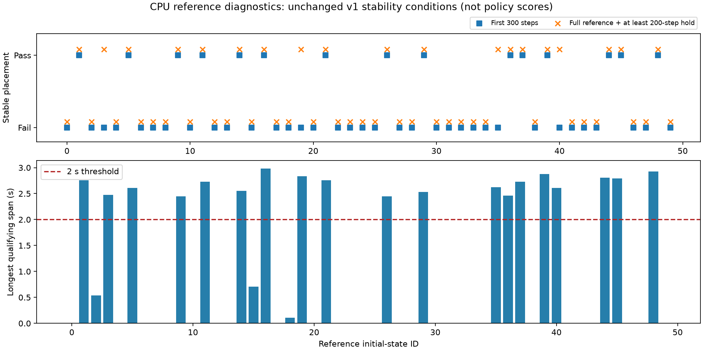
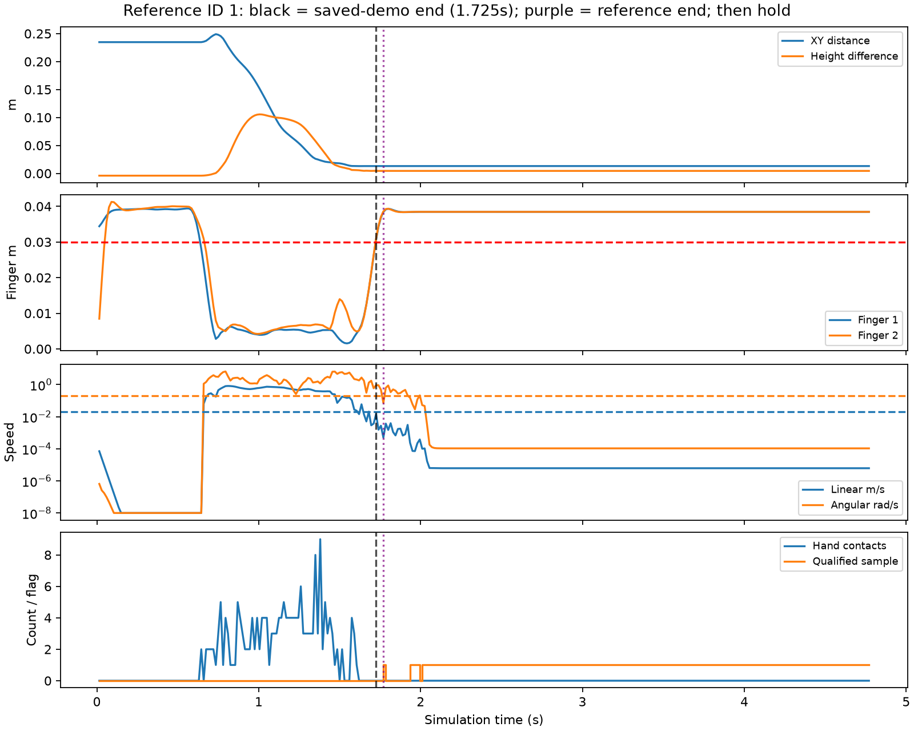

> 历史实验报告，记录的是2026-10-28—29执行时的状态；于2026-11-13整理发布。当前发布范围见[仿真实验总览](../README.md)。未发布的视频、权重、二进制轨迹等链接已标为“原始留档”；下文的服务器路径和原始文件完整性描述保留历史含义。

# FLASH 单任务：完整放置的 CPU 诊断

本轮已完成诊断，未使用 GPU、未加载模型 checkpoint、未训练或重新运行策略。结论是：**原稳定放置判据在当前物理环境中可以达到；现有示范的采集终点确实丢失了不少释放与稳定阶段。指标的夹爪开度要求也有局限，但它不能单独解释两种策略的 0/50。** 数据截断与策略失败之间尚未通过重训做因果验证。

## 真实参考轨迹回放

沿用 `bowl-stable-v1-20261028` 的全部阈值：原几何条件、双指实际开度均至少 3 cm、碗与手部无 contact 接触对、碗质心线速度不高于 0.02 m/s、角速度不高于 0.2 rad/s，连续首尾跨度至少 2 秒。每 15 ms 采样，135 个连续合格样本的首尾跨度为 2.01 秒。

在首次试验前固定了全部 50 个源参考 ID，并预先指定原采集示范按 ID 升序的前 10 条为重点检查对象，没有按本轮成功结果替换它们。全部参考动作播放完后，重复最后一条原始动作至少 200 步（3 秒），不额外张开夹爪、不增加撤离动作。总长度为 `max(300, 参考动作数 + 200)`。

| 来源 | 数量 | 原 300 步内稳定放置 | 完整参考动作及末动作保持后稳定放置 |
| --- | --- | --- | --- |
| 全部公共参考初态 | 50 | 15/50 | 19/50 |
| 原 40 条采集示范的来源 | 40 | 15/40 | 19/40 |
| 预先选定的重点检查来源 | 10 | 5/10 | 6/10 |

全部参考池中，40/50 曾满足几何条件，延长回放后 26/50 曾在目标处满足释放条件。ID 3、19、35、40 仅在延长窗口后满足稳定保持，说明总时限会影响判定；这不说明延长模型回合就一定能消除其失败。

这些是**公共参考动作回放诊断**。重复末动作是明确规定的补充保持过程，不是新增专家控制器，也不是 FLASH 或 FM-DiT 的新成绩。当前参考池与原训练来源重叠，不作为独立测试集。

[逐参考汇总](results/reference-summary.csv)、[完整逐回合记录](formal/reference-rollouts.jsonl)、全部 50 条逐步数组（原始留档：`formal/episodes`）、[预先固定的诊断计划](configs/audit-plan.json)。

## 原示范截断审计

本轮每条回放前先清空 MuJoCo 动态状态、按源初态 reset，再执行原采集脚本的 `ensure_clean_state`。全部 **40/40 条已采集示范的实际关节轨迹前缀与本次 CPU 回放逐值一致，最大绝对差为 0**。这核实了机器人关节前缀，但原 metadata 未保存全部物体和接触状态，因此不能将它夸大为对旧物体轨迹的直接逐值复原。

- 40 条示范中，**33 条结束时仍有尚未录入的参考动作**。
- 原录制末帧双指实际开度均达到 3 cm 的有 **5/40**；双指目标开度均达到的有 **8/40**。
- 若看对应完整参考动作的最后一个目标，双指目标开度均达到 3 cm 的有 **25/40**。
- 对匹配前缀的回放做指标检查，原录制范围内共有 **0 个完全合格的瞬时样本**，也没有 2 秒完整稳定保持；此项是回放推得，区别于原录制直接提供的关节与目标记录。

更精确的时间审计显示，录制终点位于首次几何成功后 **0–24 个控制步，即 0–0.36 秒**。原参数的 20 是累计成功帧计数，几何条件中途可能不连续，不能严格写成固定连续 20 步。原先“约 0.3 秒”的描述应以此处精确结果补充。

固定展示 ID 1：原示范在 1.725 秒结束，完整参考动作在 1.770 秒结束；之后碗才逐渐降低转速并形成连续稳定保持。图中黑虚线为录制终点，紫点线为参考动作终点。

[40 条示范终点审计](results/training-demo-endpoint-audit.csv)、[审计汇总](results/audit-summary.json)、[实际 ds1 / ds4 转换数据末端审计](results/converted-dataset-endpoints.json)。转换数据只读检查，不修改 Zarr。

实际 Zarr 的状态和动作均与原 metadata 对应 stride 逐值一致。FM-DiT 的 ds1 保留末帧实际双指张开 5/40 条、目标张开 8/40 条；FLASH 的 ds4 对应为 2/40 和 3/40。采样还会跳过部分很短的末端阶段，但这项审计没有证明它对两种策略成绩差异的因果贡献。

## 指标正反例及局限

另用 5 组参考初态派生出 15 个物理检查场景：初始时将正放的碗置于盘上方 5 cm 后由重力落下，机器人保持初始手臂目标。除初始化外不固定碗，也不修改动力学或速度。这些夹具是人工构造的指标检查，不计入专家或模型成绩，也不是泛化实验。

| 人工构造条件 | 原 v1 指标 | 观察 |
| --- | --- | --- |
| 碗在盘上稳定、夹爪张开 | 5/5 通过 | 原指标在物理上可以达到 |
| 碗在盘外静止、夹爪张开 | 0/5 通过 | 静止本身不会被当作成功 |
| 碗在盘上稳定、手无接触但夹爪闭合 | 0/5 通过 | 开度条件会拒绝部分已无接触的放置状态 |

第三种夹具中，碗符合几何、无手部接触和速度要求的连续跨度约为 4.275 秒，仅因开度不足被拒绝。因此 v1 更准确的含义是“张开夹爪且无接触的稳定放置”。未来若采用撤离距离等定义，应先固定新版本，保留 v1 成绩。单独取消开度也不自动成为合格的新指标，因为无接触未必足以说明手已撤离或物体获得合理支撑。

[夹具结果](formal/fixtures.json)、全部夹具逐步数组（原始留档：`formal/fixtures`）。

## 对已有策略做离线敏感性检查

只读取上一阶段保存的 100 条策略轨迹，没有调用模型或 GPU。保留其原 300 步长度，取消夹爪开度门槛，仍要求原几何条件、无手部接触和原速度阈值连续满足至少 2 秒：

| 10,000-step 策略 | 原 v1 | 仅去掉开度门槛的事后诊断 | 无开度门槛时最长合格连续跨度 |
| --- | --- | --- | --- |
| FLASH | 0/50 | 0/50 | 1.05 秒 |
| FM-DiT | 0/50 | 0/50 | 0.15 秒 |

即使进一步只看“目标处且无手部接触”，两者最长连续跨度也分别只有 1.14 秒和 0.975 秒。这说明已有失败不能仅用严格开度阈值解释。此处是事后诊断，不替换原指标，不与延长后的参考轨迹直接排名。

[完整离线敏感性结果](results/existing-policy-sensitivity.json)。

## 执行与校验

- 服务器 `cps-server`，目录 `/home/hanyu/flash_fr3/flash_sim_reproduction_20261028/placement_audit_20261028`。
- 保持原源码 commit `f47e490f2b820f835d1b9145da3cdb3df69f50a0`，原兼容性/日志补丁未改动。
- `CUDA_VISIBLE_DEVICES` 为空，`torch.cuda.is_available()` 与 `torch.cuda.is_initialized()` 均为 false；`MUJOCO_GL=disable`，相机保留但关闭图像类型，并以禁止渲染的占位对象替代 Renderer 构造。没有创建 CUDA/OpenGL 上下文，没有渲染视频。物理步长仍为 1 ms、decimation 15。
- 正式回放于 UTC 2026-10-28 15:38:06–15:38:43 完成，全部在 CPU 执行。独立重算覆盖新增 65 份 NPZ / 21,128 个采样点，以及既有 100 份 NPZ / 30,000 个采样点；保存标记全部一致，数值全部有限。
- 首次 smoke 中，参考 ID 1 已完成回放，随后人工夹具因初态关节标量与单元素数组混合而退出。修复为明确标量后，独立 `smoke-fixed` 和正式回放均以退出码 0 完成；初版代码、失败日志及失败产物保留，没有当作完成运行。
- 原始复现包 331 个文件、上一阶段对照包 1,873 个文件的原 SHA256 校验均通过。旧报告与旧成绩没有改写。[旧包完整性](results/prior-package-integrity.json)、[数组复算](results/array-verification.json)、[CPU 环境记录](formal/environment.json)、正式日志（原始留档：`logs/formal.log`）。

## 下一轮建议

优先修复**完整任务的数据验收与采集终点**：保留完整释放及保持阶段，按固定协议验收，再构建双方共享的原始数据与划分。当前只有 19 条来源通过本轮 v1 完整保持诊断，不能把它们复制成 40 条，也不能把按结果筛选出来的初态当随机测试集。

在新训练前固定训练、验证、测试初态；测试来源完全排除在训练 Zarr 和 normalizer 拟合之外。完整放置补充实验与原 40 条几何复现分开报告。流程确认后再做双方各一个 seed 的试训，随后补到 3 个 seed。本轮依照用户要求在诊断后停止，没有占用 GPU、启动重训或排队作业。
