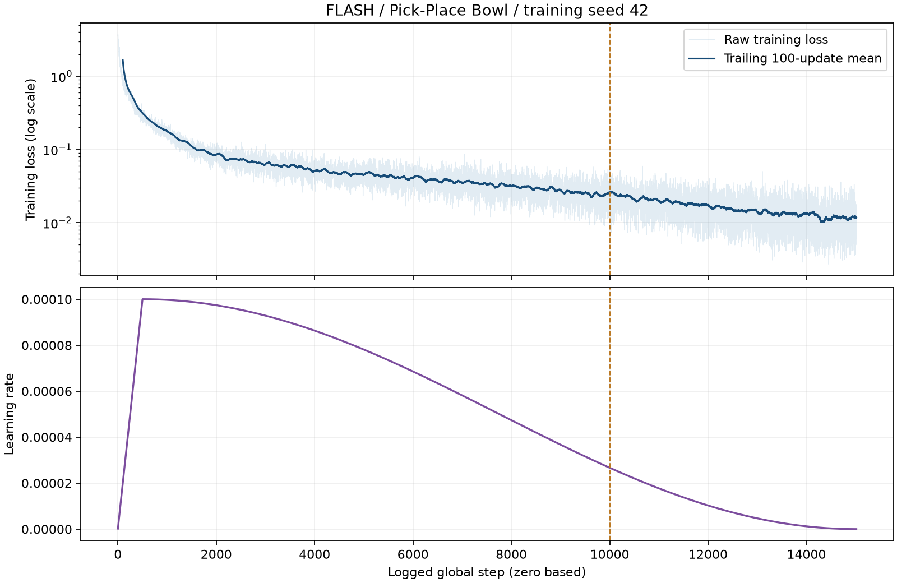
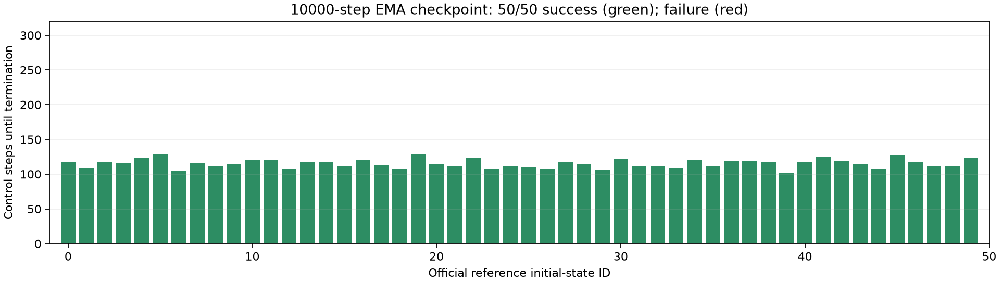

> 历史实验报告，记录的是2026-10-28—29执行时的状态；于2026-11-13整理发布。当前发布范围见[仿真实验总览](../README.md)。未发布的视频、权重、二进制轨迹等链接已标为“原始留档”；下文的服务器路径和原始文件完整性描述保留历史含义。

# FLASH 单任务仿真复现：真实运行报告

更新时间：2026-10-28T21:39:54+08:00。本报告只记录本轮实际运行，范围为 Pick-Place Bowl、FLASH、训练 seed 42。

## 本轮结果

正式训练与 50 次闭环评测已完成，训练和评测进程均以 exit code 0 结束。指定 **10,000-step EMA checkpoint** 的结果为 **50 / 50，成功率 100.0%**。50 回合均保留原始文本、视频和逐步目标/实际关节轨迹。

| 项目 | 实测或已核验值 |
| --- | --- |
| 任务 | `libero_90.kitchen_scene1_put_the_black_bowl_on_the_plate` |
| 数据 | 40 条成功参考回放，ds4 后 1,204 帧，39 条训练 / 1 条验证 |
| 训练 | 请求 15,000 updates，按整 epoch 实际 15,015 updates，batch 32，seed 42 |
| 训练进程墙钟时间 | 2075 秒（34.58 分钟，含启动/保存） |
| 训练循环日志耗时 | 2051.48 秒；最后 500 updates 为 68.62 秒 |
| 最后 100 次训练 loss 均值 | 0.011735；全程 loss/lr 有限 |
| 设备 | 一张 H100，物理 GPU 3；5 秒抽样显存峰值 14799 MiB |
| 评测 | 官方初始状态 ID 0–49，DR 0，单环境，最多 300 控制步 / 回合 |
| 成功率的描述性 Wilson 95% 区间 | 92.9%–100.0%；不能代替多训练 seed 的不确定性 |





## 结果的适用范围

50 个初始状态中有 40 个用于生成本次数据集。它们的精确初始状态、哈希和训练/验证归属保存在 [reference-split.json](manifests/reference-split.json)。因此这不是 50 个未见场景上的泛化评测。

| 初始状态组 | 成功 / 回合数 | 成功率 |
| --- | --- | --- |
| 参与优化的示范初始状态 | 39 / 39 | 100.0% |
| 仅验证的示范初始状态 | 1 / 1 | 100.0% |
| 未纳入示范的初始状态 | 10 / 10 | 100.0% |

未纳入示范的 10 条由专家回放采集结果决定，不是随机独立测试集。这里的区间只是这批回合比例的描述；不能据此宣称论文成绩已经严格复现。任务判据只要求碗/盘子的 xy 距离小于 0.06 m、高度差在 0–0.03 m，命中即结束，不要求松开夹爪或稳定静置。

## 环境与已有工作

服务器为 `hanyu@server1cps`（SSH 别名 `cps-server`），Ubuntu 24.04.3，192 逻辑 CPU、约 1 TiB 内存。启动时 GPU 0–2 已有其他用户的任务，本轮仅使用当时空闲的 GPU 3，UUID `GPU-f16a68c8-8e24-9ac3-0713-b9bdbc3af6f6`。CUDA 按 UUID 隔离后，launcher 内部逻辑编号为 0；EGL 仍指向物理编号 3。实际 NVIDIA EGL RGB 渲染通过。

Python 3.11.16，PyTorch 2.7.0+cu128，torchvision 0.22.0+cu128，NumPy 1.26.4，Zarr 2.18.3，numcodecs 0.13.0，MuJoCo 3.17.0，dm-control 1.0.50。新 venv 以 `--system-site-packages` 复用已有 `flash_fr3` 环境的基础依赖，新增安装在新 venv 内；它不是独立的容器镜像。有效依赖、venv 层依赖与 import 路径均已导出。旧环境在中立 cwd 下的前后 freeze 一致。未安装 Isaac Sim/Isaac Lab，已验证仅 MuJoCo 路径的共享模块及正式训练/评测入口可运行。

已有 FR3 的 15,000-step 离线训练使用 74 episodes、双相机和 8 维动作，属于另一组真实数据实验；其目录与证据保持原样，本报告未将其计入仿真结果。

## 数据来源、失败与偏离

固定源码 commit：`f47e490f2b820f835d1b9145da3cdb3df69f50a0`。资产来自 RoboVerse 官方 Hugging Face 数据库，参考文件 SHA-256 为 `825d791beedc973b58fc1dfbca9eab47c5f1d18997f596ad84c488e703a0a864`；这是官方参考轨迹的重新回放采集，不是论文原始训练示范，也不是本轮新遥操作。

先用两条示范验证采集、转换、短训练和一次闭环，之后复用这两条有效数据。默认正式采集得到 38 条成功；源 ID 7、25 曾命中成功，但在成功后补录 20 帧结束前耗尽参考动作。两条分别以公开参数 `--tot_steps_after_success 0` 重新回放保存，构成最终 40 条；原失败目录及日志全部保留。见 [collection-deviations.json](manifests/collection-deviations.json)。这一截断规则偏离默认采集命令，未改成功判据。

全部 40 条视频帧数、metadata、9 维状态/动作、有限值及 episode 边界通过检查。按 stride 4 重建的状态/动作与 Zarr 对齐，图像最大像素差为 0。数据文件哈希见 [dataset-files.json](manifests/dataset-files.json)。

源码只改三个位置：新版 Diffusers 的类型导入兼容修复、训练 JSON 日志补时间戳、评测打印实际加载的 checkpoint 载荷信息。完整 [source-changes.patch](environment/source-changes.patch) 已保存，没有修改模型、成功判据或控制器。Smoke 默认 batch 32 因样本太少产生零训练 batch 而失败；仅 smoke 改 batch 4 后通过，正式训练保持 batch 32。所有失败日志与修复记录保留。

## 配置和方法

FLASH 输入单相机 256×256 RGB 与 9 维关节状态，使用 8 帧历史；ResNet-18（随机初始化、GroupNorm）加 4 层 DiT，Legendre 阶数 6、历史噪声 0.5、拟合正则 0.1，推理为一个 Euler 步。保留 AdamW、cosine 学习率、500-step 预热和 EMA。详见 [METHOD_NOTES_zh.md](METHOD_NOTES_zh.md) 与解析后的 [checkpoint 配置](configs/formal-checkpoint-config-resolved.yaml)。

MuJoCo 控制周期为 15 ms，ds4 训练采样间隔为 60 ms；采集示范 MP4 为 30 FPS，导出的策略样例为 10 FPS。这些容器参数只决定播放速度，不等于控制频率。8 个动作点在评测中重采样为 32 个控制目标。当前 MuJoCo handler 仅缓存速度目标，物理步进不消费该缓存；配置中的速度目标和 PD 增益开关不能证明速度前馈或该增益实际生效。本轮保留发布版行为。前两维手指位置单位为米，后七维机械臂为弧度；原始诊断图的统一 rad 标签不适用于前两维。

## 原始结果与视频

- [逐回合 CSV](results/rollouts.csv)、[JSONL](results/rollouts.jsonl) 和 [汇总 JSON](results/evaluation-summary.json) 可逐条追溯初始状态、终止原因、checkpoint、原始文本、视频及轨迹路径。
- `raw-evaluation/0000.txt` 至 `0049.txt`、`0.mp4` 至 `49.mp4` 和 `trajectory-diagnostics/` 保存本地导出的全部 50 条原始证据；[导出哈希](manifests/raw-evaluation-files.json) 对应服务器原件。
- 成功样例：rollout 0（原始留档：`videos/policy-success-rollout0000.mp4`）；六帧抽查图（原始留档：`videos/policy-success-rollout0000.png`）。
- 专家参考成功回放（原始留档：`videos/reference-success-demo0001.mp4`） 与 专家参考失败回放（原始留档：`videos/reference-failure-demo0000.mp4`） 单独标注，未作为策略 rollout 结果。

本轮 50 条策略回合均成功，因而没有策略失败视频；上列专家参考回放的失败视频只作为数据采集证据。

视频在每步执行动作前采帧，因此成功可能发生在最后一次动作后的未录制观察；以原始 success checker 记录为判定依据。轨迹 NPZ 保存执行目标和动作后实测状态；本轮未把这些值包装为跨方法跟踪误差改进。

## 服务器保留位置与复查

执行根目录：`/home/hanyu/flash_fr3/flash_sim_reproduction_20261028`。run ID：`flash_bowl_s42_v1_20261028`。

```text
仓库：/home/hanyu/flash_fr3/flash_sim_reproduction_20261028/FLASH-Policy
原始正式示范：/home/hanyu/flash_fr3/flash_sim_reproduction_20261028/data-formal
Zarr：/home/hanyu/flash_fr3/flash_sim_reproduction_20261028/FLASH-Policy/data_policy/libero_90.kitchen_scene1_put_the_black_bowl_on_the_plateFrankaL0_obs:joint_pos_act:joint_pos_ds4_40.zarr
训练目录：/home/hanyu/flash_fr3/flash_sim_reproduction_20261028/FLASH-Policy/il_outputs/flash/libero_90.kitchen_scene1_put_the_black_bowl_on_the_plate/flash_bowl_s42_v1_20261028
评测原件：/home/hanyu/flash_fr3/flash_sim_reproduction_20261028/FLASH-Policy/il_outputs/flash/libero_90.kitchen_scene1_put_the_black_bowl_on_the_plate/flash_bowl_s42_v1_20261028/eval/libero_90.kitchen_scene1_put_the_black_bowl_on_the_plate/flash/franka/10000_sr100_52.85ms_ds4_step1.ckpt_2026-10-28_21-32-29
```

10,000-step checkpoint：`/home/hanyu/flash_fr3/flash_sim_reproduction_20261028/FLASH-Policy/il_outputs/flash/libero_90.kitchen_scene1_put_the_black_bowl_on_the_plate/flash_bowl_s42_v1_20261028/checkpoints/10000.ckpt`，SHA-256 `3080d313b0cb24b574e127bbbd0477ee27f245a70bfe792ca22d721330f260f4`。最终 checkpoint 为 `15015.ckpt`。全部 checkpoint 的大小/哈希和载荷核验结果见 [checkpoints.json](manifests/checkpoints.json)。大数据和权重保留在服务器，本地交付不重复下载权重。

`scripts/22_train_formal.sh` 和 `scripts/25_verify_and_evaluate.sh` 是本轮实际训练/评测入口。它们设置固定 GPU、EGL、线程数、退出码与日志，使用 `bash -e` 和 `pipefail`，防止 launcher 末尾提示掩盖失败。入口带防覆盖检查；复跑应选择新 run/输出目录，先检查空闲 GPU，不可直接覆盖本轮结果。`scripts/` 中其他编号文件包含历史排错过程，不能当作应逐一批量重跑的安装流程。

`logs/` 保存阶段命令输出、原始训练/评测日志、逐 update loss/lr/时间和 5 秒 GPU 采样；`configs/train-hydra/` 与 `configs/eval-hydra/` 分别保留训练和评测配置。无 W&B 外发日志。

## 未完成项

FM-DiT 对照、多训练 seed、预热后网络延迟、速度倍数和跨方法跟踪误差均未执行或未形成可比较结果。本轮没有 90% 成功率或降低 30% 误差的预设目标，也没有 FLASH 真机部署成果。下一阶段应复用同一原始 40 条示范和划分，为 FM-DiT 单独生成 ds1 数据，保留 10 步推理，并对齐初始状态及实际动作覆盖时长后比较。
